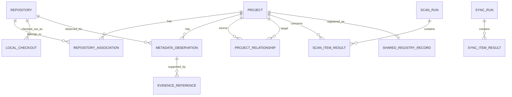

# Vyasa (व्यास) — Data Model

**Document:** `docs/architecture/data-model.md`  
**Product:** Vyasa — Workspace Intelligence MCP  
**Status:** Draft v0.1  
**Related Documents:**
- `docs/product/vision.md`
- `docs/product/scope-and-roadmap.md`
- `docs/requirements/functional-requirements.md`
- `docs/requirements/non-functional-requirements.md`
- `docs/requirements/data-ownership.md`
- `docs/architecture/system-architecture.md`

---

## 1. Purpose

This document defines the conceptual and logical data model for Vyasa.

It establishes:

- The distinction between logical projects, repositories, and local checkouts.
- Stable identity rules.
- Project metadata and its ownership.
- Metadata observations and evidence provenance.
- Scan history and freshness.
- Project relationships and dependencies.
- Local versus shared data boundaries.
- Data validation, persistence, and schema evolution requirements.

The model must support all three delivery phases without making Google Sheets, SQLite, GitHub, or Bitbucket the owner of the core domain model.

This document defines the logical model. The exact SQLite table definitions, indexes, migrations, and serialization formats will be specified in the local storage and MCP interface documents.

## 2. Design Principles

### 2.1 Separate Projects from Repositories

A logical project is the unit users want to discover and understand. A repository is a source-control unit. A local checkout is a copy of a repository on a particular device.

These concepts must not be represented as one entity.

A project may have multiple repositories. A repository may have multiple local checkouts. A project may be known to Vyasa even when no local checkout is available.

### 2.2 Separate Identity from Display Metadata

A project name, repository name, or filesystem path may change without necessarily changing the underlying identity.

Identifiers must not be generated solely from mutable display names or local paths when a more reliable identity is available.

### 2.3 Separate Values from Observations

A value such as a project name may be declared in a profile, observed in a manifest, or cached in the shared registry.

Vyasa must retain enough provenance to distinguish those sources and apply the field-specific ownership rules.

### 2.4 Preserve Unknowns and Conflicts

Missing, unknown, inaccessible, stale, and conflicting values must not be collapsed into one state.

A failed scan must not be treated as evidence that a file or project does not exist.

### 2.5 Separate Local and Shared State

Machine-specific paths and operational state belong in local storage. Only explicitly approved project metadata may be synchronized.

### 2.6 Keep the Model Provider-Neutral

The core entities must not contain mandatory Google Sheets row structures or GitHub/Bitbucket response objects.

Provider-specific identifiers may be retained as external identity references, mapped into a common representation.

---

## 3. Conceptual Entity Model

The initial domain model contains the following entities:

| Entity | Purpose |
|---|---|
| Project | Represents a logical software project. |
| Repository | Represents a Git repository identified locally or remotely. |
| Local Checkout | Represents a repository instance available on a device. |
| External Identity | Associates a project or repository with an identity from another system. |
| Metadata Observation | Records a declared or detected field value and its source. |
| Evidence Reference | Identifies the file, configuration field, or external source supporting an observation. |
| Project Relationship | Represents an explicit or deterministically derived relationship. |
| Scan Run | Records a workspace scan or refresh operation. |
| Scan Item Result | Records the outcome for an individual project, repository, or candidate. |
| Shared Registry Record | Represents shared portfolio metadata synchronized with Google Sheets. |
| Synchronization Run | Records a shared registry synchronization operation. |

The final two entities are introduced in Phase 2. Remote provider observations and discovery runs extend the model in Phase 3.

## 4. Entity Relationships

`REPOSITORY_ASSOCIATION` is a logical association between a project and a repository. It allows a project to contain multiple repositories without embedding repository details directly in the project record.

The diagram is conceptual. The implementation may use additional junction tables or foreign-key relationships as required by the persistence design.

---

## 5. Project Entity

### 5.1 Purpose

The Project entity represents a logical project independently of its name, local directory, and repository provider.

### 5.2 Logical Fields

| Field | Type | Required | Description |
|---|---|---|---|
| `project_id` | String | Yes | Stable Vyasa project identifier. |
| `display_name` | String or unknown | No | Current resolved project name. |
| `identity_status` | Enum | Yes | Whether identity is resolved, provisional, or ambiguous. |
| `lifecycle_status` | Enum or unknown | No | Explicitly declared lifecycle state. |
| `details_status` | Enum | Yes | Completeness state of the available project metadata. |
| `created_at` | Timestamp | Yes | Time the local system first registered the record. |
| `updated_at` | Timestamp | Yes | Time the logical record was last updated. |
| `last_observed_at` | Timestamp | No | Time the project was last successfully observed. |
| `record_version` | Integer | Yes | Version for local record evolution or optimistic updates, as needed. |

The exact timestamp semantics must be documented in the implementation. In particular, `updated_at` must not be used as a substitute for a successful scan timestamp.

### 5.3 Project Metadata

Purpose, domain, project type, technologies, and other descriptive values are represented through metadata fields and their observations.

The model should not require every project to have every descriptive field populated.

### 5.4 Lifecycle Status

Lifecycle status must represent an explicit declaration from its designated owner.

Proposed values include:

- `active`
- `maintenance`
- `paused`
- `archived`
- `unknown`

These values are a proposed controlled vocabulary, not an approved list of all possible states.

A project must not be automatically assigned `archived` merely because it has not been scanned recently or its repository is inaccessible.

### 5.5 Details Status

`details_status` describes the completeness of the currently available metadata, not the quality of the project itself.

Proposed values:

- `complete`
- `partial`
- `requires_review`
- `unknown`

The rules for assigning these values must be deterministic and documented.

---

## 6. Repository Entity

### 6.1 Purpose

The Repository entity represents a source-control repository independently of any particular local checkout.

### 6.2 Logical Fields

| Field | Type | Required | Description |
|---|---|---|---|
| `repository_id` | String | Yes | Stable Vyasa repository identifier. |
| `display_name` | String or unknown | No | Repository name. |
| `repository_type` | Enum | Yes | Git or another explicitly supported repository type. |
| `primary_remote_url` | String or unknown | No | Resolved primary repository URL. |
| `provider_type` | Enum | Yes | Local-only, GitHub, Bitbucket Cloud, or another supported provider. |
| `provider_repository_id` | String or unknown | No | Stable identifier assigned by an external provider, if available. |
| `default_branch` | String or unknown | No | Provider-reported or otherwise explicitly observed default branch. |
| `repository_status` | Enum | Yes | Current knowledge of repository availability and access. |
| `created_at` | Timestamp | Yes | Time first registered locally. |
| `updated_at` | Timestamp | Yes | Time the repository record was last updated. |

`provider_type` and `repository_status` must use defined values. Provider-specific status must not be confused with a project's lifecycle status.

### 6.3 Repository Status

Proposed values:

- `available`
- `inaccessible`
- `missing`
- `unknown`

These values describe the evidence available to Vyasa. They do not necessarily establish the actual state of the remote provider.

For example, a timeout must not set the repository to `missing`.

### 6.4 Repository Associations

A repository association connects a logical project to a repository.

It may include:

- `project_id`
- `repository_id`
- `association_type`
- `association_source`
- `created_at`

Proposed association types include:

- `primary`
- `component`
- `documentation`
- `related`
- `unknown`

The association source distinguishes human-declared relationships from deterministic matches.

Vyasa must not group repositories into one project solely because their names are similar or their directories share a parent.

---

## 7. Local Checkout Entity

### 7.1 Purpose

A Local Checkout represents a repository instance accessible from the current device.

This entity is necessary because the same repository may be checked out more than once or stored at different locations across devices.

### 7.2 Logical Fields

| Field | Type | Required | Description |
|---|---|---|---|
| `checkout_id` | String | Yes | Stable identifier for this local checkout mapping. |
| `repository_id` | String | Yes | Associated repository. |
| `local_path` | Path | Yes | Absolute path on the current device. |
| `workspace_root_id` | String | No | Configured workspace root containing the checkout. |
| `checkout_status` | Enum | Yes | Current local accessibility state. |
| `last_scan_run_id` | String | No | Most recent scan run that examined this checkout. |
| `last_successful_scan_at` | Timestamp | No | Time of its most recent successful scan. |
| `observed_revision` | String or unknown | No | Locally observed commit identifier when available. |
| `created_at` | Timestamp | Yes | Time first registered locally. |
| `updated_at` | Timestamp | Yes | Time the local mapping was last updated. |

### 7.3 Checkout Status

Proposed values:

- `available`
- `inaccessible`
- `missing`
- `unknown`

A missing checkout path must not cause its logical project or repository record to be deleted automatically.

### 7.4 Privacy Rule

`local_path`, workspace roots, and machine-specific checkout mappings are strictly local by default.

They must never be included in Google Sheets exports or shared registry records.

---

## 8. External Identity Entity

### 8.1 Purpose

External Identity associates a project or repository with identifiers maintained by another system.

Examples include:

- GitHub repository ID.
- Bitbucket Cloud repository UUID.
- A normalized remote repository identity.
- A future external project identifier.

### 8.2 Logical Fields

| Field | Type | Required | Description |
|---|---|---|---|
| `external_identity_id` | String | Yes | Internal identifier for the external identity record. |
| `entity_type` | Enum | Yes | Project or repository. |
| `entity_id` | String | Yes | Associated internal project or repository ID. |
| `provider` | String | Yes | External system or identity namespace. |
| `external_id` | String | Yes | Identifier assigned by that system. |
| `normalized_value` | String or unknown | No | Normalized URL or other comparable identity value. |
| `verified_at` | Timestamp | No | Last successful verification time. |
| `verification_status` | Enum | Yes | Verified, unverified, stale, or unavailable. |

The implementation must enforce uniqueness within the relevant provider and identity namespace.

### 8.3 Identity Rules

1. Prefer stable provider identifiers when available and verified.
2. Use normalized remote identities when no stronger identity exists.
3. Use a deterministic local fallback when no reliable remote identity exists.
4. Keep identity separate from mutable display names and filesystem paths.
5. Treat forks, mirrors, renamed repositories, and ambiguous matches according to explicit policies.
6. Never merge records solely because their names match.
7. Preserve an audit trail when identity mappings change.

### 8.4 Stable Identifier Strategy

The exact project ID and repository ID generation algorithm remains an implementation decision.

The selected strategy must meet these requirements:

- Repeated processing of the same established identity returns the same ID.
- Local directory renames do not automatically create new logical projects.
- IDs are safe for storage and use in MCP requests.
- Collisions are detected and handled.
- Identity changes are explicit and recoverable.

A hash of a normalized identity is one possible implementation, but the normalization rules and treatment of identity changes must be settled first.

---

## 9. Metadata Observation Entity

### 9.1 Purpose

Metadata Observation records a value or status observed from a particular source at a particular time.

It is central to Vyasa's evidence-based design.

Instead of storing only one mutable value, the system should retain enough information to distinguish the currently resolved value from the observations supporting it.

### 9.2 Logical Fields

| Field | Type | Required | Description |
|---|---|---|---|
| `observation_id` | String | Yes | Unique identifier for the observation. |
| `entity_type` | Enum | Yes | Project, repository, or checkout. |
| `entity_id` | String | Yes | Entity being observed. |
| `field_key` | String | Yes | Stable identifier for the metadata field. |
| `value` | Typed value or unknown | No | Observed value. |
| `value_status` | Enum | Yes | Status of the observation. |
| `source_type` | Enum | Yes | Source category. |
| `source_ref` | String or unknown | No | Reference to the source. |
| `observed_at` | Timestamp | Yes | Time the source was observed. |
| `detector_id` | String or unknown | No | Detector or extraction rule that produced the observation. |
| `detector_version` | String or unknown | No | Version of the detector. |
| `source_revision` | String or unknown | No | Relevant repository revision when available. |
| `content_fingerprint` | String or unknown | No | Optional fingerprint for invalidation and change detection. |
| `is_current` | Boolean | Yes | Whether this observation is considered current under the retention policy. |

The logical `value` may be a string, number, boolean, list, structured object, or explicit status depending on the field schema.

The physical database representation must validate values against the field definition rather than allowing arbitrary untyped data.

### 9.3 Value Status

Proposed values:

- `observed`
- `declared`
- `unknown`
- `not_detected`
- `unsupported`
- `inaccessible`
- `stale`
- `conflicting`

These states have different meanings.

| Status | Meaning |
|---|---|
| `observed` | A supported detector found evidence for a value. |
| `declared` | A recognized authoritative source explicitly declared the value. |
| `unknown` | Available evidence cannot establish a value. |
| `not_detected` | The relevant supported search was completed, but the indicator was not found. |
| `unsupported` | The system does not support assessing this field or source format. |
| `inaccessible` | The source could not be inspected successfully. |
| `stale` | The observation may no longer represent the source's current state. |
| `conflicting` | Multiple observations disagree and cannot yet be resolved by the ownership policy. |

These statuses must not be collapsed into a boolean.

For example, `not_detected` for a README after a successful complete scan is different from `inaccessible` when the repository cannot be read.

### 9.4 Source Type

Proposed values:

- `local_git`
- `local_file`
- `canonical_profile`
- `project_documentation`
- `google_sheets`
- `github_api`
- `bitbucket_api`
- `derived_rule`

The list may grow as supported sources are added.

### 9.5 Current Value Resolution

The system may expose a resolved value for a field, but that value must be computed from observations using the field's ownership and precedence rules.

The resolution process must:

1. Identify the field's authoritative owner.
2. Filter out invalid or unsupported observations.
3. Evaluate freshness and source availability.
4. Apply the documented precedence policy.
5. Preserve conflicts that cannot be resolved.
6. Return the resolved value together with appropriate provenance.

The most recently observed value must not automatically win when the source does not own that field.

### 9.6 Observation Retention

The implementation must define which historical observations are retained and which are replaced or compacted.

At minimum, it must retain sufficient information to:

- Explain the current resolved value.
- Distinguish a new observation from an unchanged value.
- Recover from interrupted scans.
- Report stale or unavailable evidence accurately.
- Diagnose identity and synchronization conflicts.

An unlimited history of every file read is not required. Retention should be designed around auditability and storage efficiency.

---

## 10. Evidence Reference Entity

### 10.1 Purpose

Evidence Reference identifies the source supporting a metadata observation.

It should reference evidence rather than copy unnecessary source content into the index.

### 10.2 Logical Fields

| Field | Type | Required | Description |
|---|---|---|---|
| `evidence_id` | String | Yes | Unique evidence identifier. |
| `observation_id` | String | Yes | Associated metadata observation. |
| `evidence_type` | Enum | Yes | File, manifest field, Git configuration, API metadata, or other supported source. |
| `source_locator` | String | Yes | Repository-relative path, field reference, or provider locator. |
| `field_locator` | String or unknown | No | Specific configuration key or field when applicable. |
| `line_start` | Integer or unknown | No | Starting line for line-addressable evidence. |
| `line_end` | Integer or unknown | No | Ending line for line-addressable evidence. |
| `source_revision` | String or unknown | No | Relevant source revision when available. |
| `content_fingerprint` | String or unknown | No | Optional fingerprint of the relevant evidence. |
| `observed_at` | Timestamp | Yes | Time evidence was inspected. |

### 10.3 Evidence Rules

- Paths must be relative to the repository when that representation is sufficient.
- Absolute local paths must not be exported.
- Evidence must identify the relevant file or field as precisely as practical.
- Line numbers should be included when reliable and useful.
- Remote evidence should identify the provider and relevant repository revision where available.
- A missing or inaccessible source must not be represented as current positive evidence.
- Sensitive values must not be copied into evidence records unnecessarily.

A content fingerprint can support change detection, but it must not be treated as proof of semantic equivalence.

---

## 11. Project Relationship Entity

### 11.1 Purpose

Project Relationship records relationships between projects and, where appropriate, repositories.

Relationships may be explicitly declared or derived using deterministic rules.

### 11.2 Logical Fields

| Field | Type | Required | Description |
|---|---|---|---|
| `relationship_id` | String | Yes | Unique relationship identifier. |
| `source_project_id` | String | Yes | Source project. |
| `target_project_id` | String | Yes | Target project. |
| `relationship_type` | Enum | Yes | Type of relationship. |
| `relationship_status` | Enum | Yes | Confirmed, candidate, rejected, or unknown. |
| `source_type` | Enum | Yes | Human declaration or deterministic rule. |
| `evidence_refs` | Collection | No | Evidence supporting the relationship. |
| `rule_id` | String or unknown | No | Rule that produced the relationship, if derived. |
| `rule_version` | String or unknown | No | Version of the derivation rule. |
| `observed_at` | Timestamp | Yes | Time the relationship was established or evaluated. |

### 11.3 Relationship Types

Initial supported types may include:

- `depends_on`
- `uses_library`
- `shared_technology`
- `related_project`
- `same_logical_project`
- `potential_duplicate`

The final vocabulary must distinguish direct evidence from weaker indicators.

### 11.4 Relationship Status

- `confirmed`: Supported by explicit or sufficiently strong defined evidence.
- `candidate`: A deterministic rule identifies a possible relationship requiring further verification.
- `rejected`: A previously considered relationship has been explicitly rejected or invalidated.
- `unknown`: Available evidence is insufficient to establish the relationship.

A shared programming language alone may establish a `shared_technology` relationship, but it must not establish a dependency or prove that code can be reused.

### 11.5 Derived Relationship Rules

Every derived relationship must identify its basis.

For example:

- A manifest explicitly references another internal package.
- Two projects declare use of the same library.
- A configured rule finds a common technology.
- Repository metadata explicitly links two repositories.

Similarity-based or semantic relationships requiring LLM inference are outside the initial deterministic model.

---

## 12. Scan Run and Scan Item Result

### 12.1 Scan Run

A Scan Run represents one workspace discovery or index-refresh operation.

| Field | Type | Required | Description |
|---|---|---|---|
| `scan_run_id` | String | Yes | Unique run identifier. |
| `scan_type` | Enum | Yes | Initial, full, incremental, or targeted scan. |
| `started_at` | Timestamp | Yes | Run start time. |
| `completed_at` | Timestamp or unknown | No | Completion time. |
| `run_status` | Enum | Yes | Pending, running, completed, partial, failed, or interrupted. |
| `scan_scope` | Structured value | Yes | Workspace roots or selected project scope. |
| `scanner_version` | String | Yes | Scanner version. |
| `configuration_fingerprint` | String or unknown | No | Identifier for the effective relevant configuration. |
| `discovered_count` | Integer | Yes | Number of discovered candidates. |
| `processed_count` | Integer | Yes | Number processed. |
| `updated_count` | Integer | Yes | Number of records updated. |
| `skipped_count` | Integer | Yes | Number skipped. |
| `error_count` | Integer | Yes | Number of errors. |

The exact count semantics must be documented so that counts remain meaningful across full and incremental scans.

### 12.2 Scan Item Result

A Scan Item Result records an individual item's outcome within a run.

It should identify:

- Scan run.
- Project, repository, or candidate identifier, where known.
- Outcome status.
- Relevant error category.
- Detector or inspection stage.
- Start or completion information where useful.

This allows partial failures to be reported without marking the entire run as a success.

### 12.3 Scan Status Rules

A scan is `completed` only when its defined scope completes successfully.

A scan is `partial` when some required items fail or remain incomplete but useful results were produced.

A scan is `failed` when the operation cannot complete its essential purpose.

An interrupted operation must not be reported as a successful complete scan.

---

## 13. Shared Registry Record — Phase 2

### 13.1 Purpose

The Shared Registry Record represents the shared view of a project in Google Sheets.

It is not a duplicate authoritative copy of all local SQLite data.

### 13.2 Logical Fields

| Field | Type | Description |
|---|---|---|
| `project_id` | String | Stable Vyasa project identifier. |
| `registry_record_id` | String or unknown | Registry row or external record identifier, if needed. |
| `registry_schema_version` | String | Version of the expected registry schema. |
| `shared_fields` | Structured value | Explicitly approved shareable metadata. |
| `portfolio_fields` | Structured value | Human-managed portfolio metadata. |
| `last_synced_at` | Timestamp or unknown | Last successful synchronization time for this record. |
| `sync_status` | Enum | Current synchronization status. |
| `conflict_status` | Enum | Whether unresolved field conflicts exist. |

The workbook's physical column layout is defined separately in the synchronization architecture.

### 13.3 Shared and Portfolio Fields

Shared fields may include:

- Project name.
- Repository URL.
- Programming languages.
- Frameworks and technologies.
- Documentation status.
- Standards configuration status.
- Approved lifecycle information.
- Last successful scan information with clearly defined semantics.

Portfolio fields may include:

- Tracking level.
- Priority, if enabled.
- Human-maintained notes.
- Review decisions.

The final ownership mapping must be approved before synchronization is implemented.

### 13.4 Registry Rules

1. Only allowlisted fields may be exported.
2. Local paths and machine-specific state are excluded.
3. Human-managed fields are not overwritten by local scans.
4. Missing local checkouts do not remove shared project records.
5. Registry schema changes must be detected and handled explicitly.
6. Synchronization status must distinguish success, partial success, failure, and conflict.

---

## 14. Synchronization Run — Phase 2

A Synchronization Run represents a synchronization attempt between local state and the shared registry.

Logical fields include:

- `sync_run_id`
- `started_at`
- `completed_at`
- `sync_direction`
- `run_status`
- `registry_schema_version`
- `projects_processed`
- `records_created`
- `records_updated`
- `conflicts_detected`
- `errors_encountered`

A per-record synchronization result should identify the affected project, the result, and relevant error or conflict information.

Synchronization must be retry-safe. A failed attempt must not automatically change a project's lifecycle status or delete the last known valid record.

---

## 15. Remote Repository Observations — Phase 3

Remote discovery extends the Repository and Metadata Observation entities.

Remote observations should preserve:

- Provider type.
- Provider repository ID.
- Repository URL.
- Access scope where relevant.
- Provider-reported metadata.
- Remote branch or revision inspected.
- Observation timestamp.
- Request outcome.
- Evidence for inspected files.

Provider-specific information may be retained as extension fields, but core identity and metadata must remain provider-neutral.

### 15.1 Remote Access Status

The model must distinguish:

- Successfully accessible.
- Confirmed unavailable under the supported access scope.
- Unauthorized or forbidden.
- Rate-limited.
- Temporarily unavailable.
- Unknown.

These states must not be collapsed into a simple `exists` boolean.

### 15.2 Remote Discovery Run

A remote discovery run should record:

- Provider.
- Configured discovery scope.
- Start and completion times.
- Pagination progress or completion state.
- Repositories discovered.
- Repositories inspected.
- Errors and rate-limit events.
- Overall outcome.

Credentials and secret values must never be stored in the run record.

---

## 16. Field Definitions and Validation

Every supported metadata field must have a registered definition.

A field definition should specify:

| Attribute | Purpose |
|---|---|
| `field_key` | Stable machine-readable field identifier. |
| `value_type` | String, boolean, number, list, structured object, or other supported type. |
| `entity_scope` | Project, repository, or checkout. |
| `owner_category` | Repository-owned, Vyasa-generated, portfolio-owned, provider-owned, machine-local, or derived. |
| `allowed_sources` | Sources permitted to produce observations for the field. |
| `validation_rules` | Type and value constraints. |
| `resolution_policy` | Rules for selecting or reporting the resolved value. |
| `export_policy` | Whether the field may be shared, subject to an explicit allowlist. |
| `freshness_policy` | How the value becomes stale or requires revalidation. |

A field registry may be implemented as typed code definitions initially. A separate configurable schema registry is not required unless a concrete extension need justifies it.

### 16.1 Technology Fields

Programming languages and frameworks should be represented as normalized collections of technology observations, rather than one opaque comma-separated string.

Each technology observation should retain:

- Normalized technology identifier.
- Display name.
- Technology category.
- Source evidence.
- Detection status.
- Optional version or constraint when explicitly available.

The model must not imply that a detected manifest proves that a technology is installed or currently used at runtime.

### 16.2 Documentation Fields

Documentation metadata should distinguish:

- File or directory presence.
- Recognized entry points.
- Recognized structure.
- Configuration validity.
- Assessment status.

A directory existing is not sufficient to claim that documentation is complete or useful.

---

## 17. Canonical Profile and Draft Profile

The profile lifecycle must fit the ownership model.

### 17.1 Canonical Profile

A canonical profile is a project-maintained source of declared metadata.

It is read by Vyasa and represented through metadata observations.

The proposed structured format is `.vyasa/project-profile.yaml`, but the final path and schema remain subject to approval.

The model must not require both a structured profile and a root-level `VYASA.md` to be independent authorities for the same fields.

### 17.2 Generated Draft

A generated draft is non-authoritative and optional.

The proposed draft path is `.vyasa/project-profile.draft.yaml`, git-ignored by default.

Draft generation must:

- Be explicitly enabled.
- Include only supported values.
- Mark missing information clearly.
- Never overwrite the canonical profile.
- Never be automatically promoted to canonical status.

### 17.3 Draft Representation

Draft status should be represented separately from canonical profile status.

The system must not treat the existence of a draft file as proof that a canonical profile exists.

A draft's content may become stale. The implementation must define whether it is preserved, marked stale, or regenerated, without silently destroying human edits.

---

## 18. Identity and Uniqueness Constraints

The implementation must enforce or validate the following invariants.

### 18.1 Project Identity

- Every project has a unique `project_id`.
- Project identity is not based solely on a display name.
- Local path changes do not automatically create a new project.
- Ambiguous matches are retained for review.

### 18.2 Repository Identity

- Every repository has a unique `repository_id`.
- Provider identifiers are unique within their relevant provider namespace.
- A remote URL is not universally treated as immutable identity.
- Forks and mirrors are handled according to documented identity rules.

### 18.3 Checkout Identity

- Every local checkout maps to one known repository or a provisional repository record.
- Multiple checkouts may reference the same repository.
- Local checkout paths are unique within the relevant local namespace, subject to the documented filesystem policy.

### 18.4 Observations

- Every observation identifies a valid entity and field.
- Observation values satisfy the field's validation rules.
- Provenance is retained for supported detected or declared values.
- Current-value resolution follows the field ownership policy.

### 18.5 Relationships

- A relationship cannot point to a nonexistent project.
- A relationship must not silently connect unrelated projects based solely on a name collision.
- Derived relationships identify their rule and evidence.
- Self-relationships are rejected unless a specific supported use case explicitly permits them.

---

## 19. Local and Shared Data Boundaries

The model separates data into three categories.

### 19.1 Local Operational Data

Stored only in local persistence:

- Absolute checkout paths.
- Workspace roots.
- Local database location.
- Local scan state.
- Machine-specific mappings.
- Local diagnostics.
- Local configuration and credential references.

### 19.2 Shareable Project Metadata

Potentially synchronized after explicit approval:

- Stable project ID.
- Project name.
- Repository URL.
- Technologies.
- Documentation and standards status.
- Approved lifecycle information.
- Shared review status.

These fields are not automatically exported merely because they are available.

### 19.3 Credentials and Secrets

Credentials and secret values are not project metadata.

They must not be persisted in the shared registry, metadata observations, evidence references, or ordinary operational logs.

The export mechanism must use a positive allowlist rather than excluding only known sensitive fields.

---

## 20. SQLite Mapping Guidance

The physical SQLite schema should preserve the logical distinctions in this document.

A possible logical table inventory is:

| Table | Purpose |
|---|---|
| `projects` | Logical project records. |
| `repositories` | Repository identity and shared repository attributes. |
| `project_repositories` | Project-to-repository associations. |
| `local_checkouts` | Machine-specific checkout mappings. |
| `external_identities` | Provider and other external identity references. |
| `field_definitions` | Supported metadata field definitions, if persisted. |
| `metadata_observations` | Field observations and provenance. |
| `evidence_references` | Source references supporting observations. |
| `project_relationships` | Explicit and derived project relationships. |
| `scan_runs` | Scan execution summaries. |
| `scan_item_results` | Per-item scan outcomes. |
| `sync_runs` | Phase 2 synchronization summaries. |
| `sync_item_results` | Per-project synchronization outcomes. |
| `shared_registry_records` | Phase 2 shared registry mappings and status. |
| `remote_discovery_runs` | Phase 3 provider discovery summaries. |

This inventory is a proposed mapping, not a requirement to create every table during Phase 1.

The SQLite design must define:

- Primary and foreign keys.
- Unique constraints.
- Search indexes.
- Transaction boundaries.
- Migration strategy.
- Retention policy.
- JSON usage, if any.
- Database integrity checks.

The physical schema must not duplicate every metadata value into unrelated tables without a clear reason. A hybrid design may be appropriate: stable entity and operational tables plus normalized observations and typed query projections.

---

## 21. API and Serialization Boundaries

The domain model must not be exposed directly as an unversioned persistence representation.

MCP responses and Google Sheets rows should use explicit mapping layers.

### 21.1 MCP Serialization

MCP response schemas should define:

- Stable identifiers.
- Structured metadata fields.
- Observation status.
- Source provenance.
- Freshness information.
- Error representation.

Responses must not require clients to understand SQLite table structures.

### 21.2 Google Sheets Mapping

The Sheets adapter maps the approved shareable subset of the domain model to the agreed workbook schema.

Spreadsheet column names and ordering must not determine the internal domain model.

### 21.3 Remote Provider Mapping

GitHub and Bitbucket responses must be normalized into the repository, observation, and evidence models.

Provider-specific extensions may be preserved when useful, but provider API response structures must not become mandatory core fields.

---

## 22. Schema Evolution

The model must evolve without losing valid project knowledge.

### 22.1 Versioning

The implementation must track the SQLite schema version and define a migration strategy.

Metadata detector versions and shared registry schema versions should be tracked independently where needed.

### 22.2 Adding Fields

New fields must define:

- Type.
- Owner.
- Allowed sources.
- Validation rules.
- Resolution policy.
- Export policy.
- Freshness policy.

A new field must not become shareable by default.

### 22.3 Changing Field Semantics

If a field's meaning changes, the change must be documented and tested.

For example, changing `last_scanned_at` from local scan time to last synchronization time is not a harmless rename; these are distinct operational facts and should remain distinct fields.

### 22.4 Identity Migrations

Changes to project identity rules must include a reconciliation strategy.

The migration must detect collisions and ambiguous mappings instead of merging records destructively.

### 22.5 Backward Compatibility

Database migrations must preserve valid records where possible. Breaking MCP or registry changes require an explicit compatibility and migration policy.

---

## 23. Open Decisions

The following decisions must be finalized before the affected implementation begins.

| ID | Decision | Target |
|---|---|---|
| DM-001 | Project ID generation and normalization rules | Phase 1 |
| DM-002 | Repository identity rules for forks, mirrors, and renamed remotes | Phase 1 |
| DM-003 | Canonical project profile format and location | Phase 1 |
| DM-004 | Exact metadata field registry and initial detector inventory | Phase 1 |
| DM-005 | Retention policy for metadata observations and scan history | Phase 1 |
| DM-006 | Physical SQLite schema, indexes, and migration strategy | Phase 1 |
| DM-007 | Approved lifecycle status vocabulary and ownership | Phase 1 |
| DM-008 | Definition of OKF and its metadata representation | Phase 1 |
| DM-009 | Deterministic README quality criteria, or not-assessed-only policy | Phase 1 |
| DM-010 | Google Sheets field mapping and export allowlist | Phase 2 |
| DM-011 | Portfolio-field ownership and synchronization conflict rules | Phase 2 |
| DM-012 | Provider-specific identity and remote revision requirements | Phase 3 |

Unresolved decisions must remain explicit. They must not be silently encoded into the database or MCP contract.

---

## 24. Data Model Acceptance Criteria

The model is ready for Phase 1 implementation when:

1. Projects, repositories, and local checkouts are distinct entities.
2. Stable identity rules are documented.
3. Project metadata is separated from source observations.
4. Detected and declared facts remain distinguishable.
5. Evidence references identify the source of supported facts.
6. Unknown, not detected, inaccessible, stale, and conflicting values are represented distinctly.
7. Ownership and precedence are defined for every implemented metadata field.
8. Local paths and machine-specific data are isolated from shareable metadata.
9. Project relationships include provenance and deterministic derivation rules.
10. Scan history can represent partial failures and interrupted operations.
11. The model can support shared registry records without making Google Sheets the core authority.
12. Remote repository metadata can be incorporated without provider-specific types becoming mandatory core concepts.
13. Schema changes can be versioned and migrated safely.
14. Automated tests can validate identity, ownership, provenance, and serialization rules.

## 25. Governing Principle

Vyasa must model not only **what it knows**, but also **where that knowledge came from, who owns it, when it was observed, and how confidently it can be used**.

Projects are logical identities. Repositories are source-control units. Checkouts are local instances. Observations record evidence. Ownership rules determine authoritative values.

**The data model must preserve these distinctions even as Vyasa grows from a local index into a shared and remote-aware project intelligence system.**
