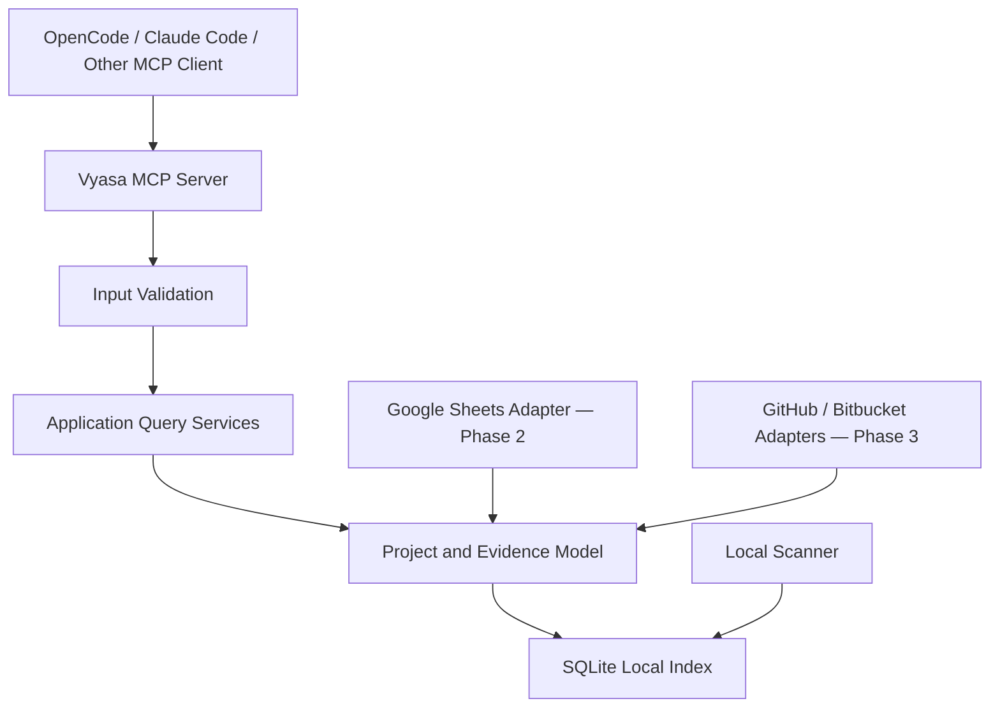

# Vyasa (व्यास) — MCP Interface

**Document:** `docs/architecture/mcp-interface.md`  
**Product:** Vyasa — Workspace Intelligence MCP  
**Status:** Draft v0.1  
**Scope:** Phase 1 local MCP, with extension points for Phases 2 and 3

**Related Documents**
- `docs/product/vision.md`
- `docs/product/scope-and-roadmap.md`
- `docs/requirements/functional-requirements.md`
- `docs/requirements/non-functional-requirements.md`
- `docs/requirements/data-ownership.md`
- `docs/architecture/system-architecture.md`
- `docs/architecture/data-model.md`
- `docs/architecture/scanning-and-evidence.md`

---

## 1. Purpose

This document defines the MCP interface through which OpenCode, Claude Code, and other MCP-compatible agents access Vyasa's workspace intelligence.

It specifies:

- MCP server responsibilities and transport.
- Public tool names and input parameters.
- Response schemas and pagination.
- Evidence, provenance, freshness, and uncertainty.
- Error handling and compatibility.
- Read-only guarantees.
- Extension rules for Google Sheets and remote repository discovery.

The interface is a contract between Vyasa and its MCP clients. Internal modules, SQLite tables, and scanning implementations may evolve without requiring unnecessary changes to this contract.

## 2. Design Principles

### 2.1 Query First

The primary purpose of the MCP interface is to answer questions about projects.

Agents should be able to:

- Find projects by name, technology, domain, or other indexed metadata.
- Retrieve a project's profile and repository information.
- Understand what a project does, where its documentation lives, and what evidence supports those details.
- Discover related projects and reusable solutions.
- Inspect declared dependencies and relationships.
- Understand index freshness and scanning coverage.

### 2.2 Read-Only Project Knowledge

MCP tools must not create, edit, or delete project-owned metadata.

The interface must not expose tools such as:

- `update_project_profile`
- `edit_project_metadata`
- `delete_project`
- `write_project_documentation`

Vyasa owns its generated index, not the contents of the projects it indexes.

An explicitly invoked index refresh may update Vyasa's own index and scan history, but it must not modify repository files or canonical profiles.

### 2.3 Evidence-Aware Responses

Project information must distinguish:

- Values explicitly declared by a project.
- Values detected from supported repository metadata.
- Values imported from a shared registry.
- Values observed from a remote provider.
- Values that remain unknown or unresolved.

When evidence is available, the response should identify the source and relevant location.

### 2.4 Stable Contracts

Tool names, parameter meanings, status values, and response structures must be documented and versioned.

Adding optional response fields should be preferred over changing existing fields incompatibly.

### 2.5 No Hidden Expensive Work

A search or detail query must not silently trigger a full workspace scan, Google Sheets synchronization, or remote API discovery.

Queries operate on the available index and communicate its freshness.

---

## 3. MCP Server Responsibilities

The MCP server is an adapter over Vyasa's application services. It is not the scanner, identity resolver, or database itself.



The diagram represents logical responsibilities, not a requirement that every adapter be active simultaneously.

The MCP server must:

1. Register supported tools and their schemas.
2. Validate arguments.
3. Invoke application services.
4. Return structured, bounded results.
5. Surface errors consistently.
6. Enforce read-only behaviour at the interface boundary.
7. Avoid leaking credentials, local secrets, or unintended filesystem details.

Business rules must remain in the application and domain layers rather than being duplicated in MCP handlers.

---

## 4. Transport and Runtime

### 4.1 Initial Transport

**Recommendation: MCP over standard input/output (stdio)** for the initial local server.

Benefits:

- Works naturally with local coding-agent tools.
- Does not require a network listener.
- Keeps the initial deployment simple.
- Avoids exposing a local service to the network unnecessarily.

The implementation should use the official Python MCP SDK and a supported FastMCP-based server implementation, subject to compatibility checks during project setup.

### 4.2 Runtime Behaviour

The server must:

- Start using validated configuration.
- Initialize the local index connection safely.
- Register only tools available in the current deployment.
- Emit protocol messages through the configured MCP transport.
- Send operational logs to stderr or an appropriate logging destination, never into the stdio protocol stream.
- Fail clearly if essential configuration or index initialization fails.
- Close resources cleanly during shutdown.

### 4.3 Phase Capabilities

| Capability | Phase 1 | Phase 2 | Phase 3 |
|---|---|---|---|
| Search indexed projects | Yes | Yes | Yes |
| Retrieve project details | Yes | Yes | Yes |
| Retrieve evidence-backed context | Yes | Yes | Yes |
| Discover related projects | Yes | Yes | Yes |
| Retrieve dependency information | Yes | Yes | Yes |
| Inspect local index status | Yes | Yes | Yes |
| Refresh local index | Yes, if enabled | Yes | Yes |
| Query shared registry-only projects | No | Yes | Yes |
| Synchronize Google Sheets | No | Yes | Yes |
| Discover remote repositories | No | No | Yes |
| Inspect remote repository metadata | No | No | Yes |

A tool that is unavailable in the current phase must not return fabricated or empty success results. The capability must either be omitted from registration or report a clearly defined unsupported-capability error.

---

## 5. Public Tool Inventory

The following names form the proposed initial MCP contract.

| Tool | Purpose | Reads index | May change Vyasa state |
|---|---|---:|---:|
| `search_projects` | Search and filter indexed projects | Yes | No |
| `get_project` | Retrieve a project's structured record | Yes | No |
| `get_project_context` | Retrieve an evidence-backed project briefing | Yes | No |
| `find_related_projects` | Discover candidate or confirmed relationships | Yes | No |
| `get_project_dependencies` | Retrieve declared dependencies and known project links | Yes | No |
| `get_index_status` | Report index freshness, coverage, and scan status | Yes | No |
| `refresh_index` | Refresh the local generated index | Yes | Yes |

The first six tools are read-only queries. `refresh_index` is a separate operational capability and may be disabled by configuration.

The server must not require the client to use `refresh_index` before every query.

---

## 6. Shared Response Conventions

### 6.1 General Structure

Each tool returns structured data appropriate to its purpose. A conceptual response envelope is:

```json
{
  "schema_version": "1",
  "data": {},
  "meta": {
    "generated_at": "2026-10-26T10:00:00Z",
    "index_version": 12,
    "freshness": "current"
  }
}
```

This is a conceptual envelope, not a requirement that every MCP result use an identical wrapper. The final implementation should follow the SDK's supported structured-content mechanism and retain a consistent logical shape.

Timestamps use ISO 8601 with an explicit timezone. Examples in this document are illustrative.

### 6.2 Stable Identifiers

Project and repository IDs are opaque stable identifiers.

Clients must not construct IDs from display names or local paths. IDs must remain stable across ordinary rescans and directory renames when the identity policy resolves the same logical entity.

### 6.3 Missing Values

The interface must distinguish an unknown value from an empty collection.

Examples:

- Unknown project purpose: status `unknown`, with no asserted purpose.
- No supported dependencies detected after complete inspection: an empty dependency collection with an appropriate assessment status.
- Dependencies not assessed: an explicit status indicating that assessment was incomplete or unavailable.

A missing JSON property must not be interpreted as proof that the value does not exist.

### 6.4 Evidence Objects

Where applicable, evidence should use a consistent shape:

```json
{
  "source_type": "repository_file",
  "source_ref": {
    "repository_id": "repo_123",
    "path": "pyproject.toml",
    "field": "project.dependencies"
  },
  "observed_at": "2026-10-26T09:55:00Z",
  "revision": "abc123",
  "detector": {
    "id": "python_manifest",
    "version": "1"
  }
}
```

The `revision` may be null when no reliable revision is available. Line ranges and fingerprints may be included when supported.

The server must not fabricate evidence fields that it cannot establish.

### 6.5 Observation Status

The interface should reuse the statuses defined in `scanning-and-evidence.md`:

- `observed`
- `declared`
- `not_detected`
- `unknown`
- `unsupported`
- `inaccessible`
- `stale`
- `conflicting`

The final Pydantic models must define allowed values and optional fields explicitly.

### 6.6 Freshness

At the index level, use a documented vocabulary such as:

- `current` — no known invalidation is pending for the requested information.
- `stale` — relevant indexed observations may no longer match their sources.
- `partial` — the latest relevant inspection was incomplete.
- `unknown` — freshness cannot be established.

These are proposed index-level states and are distinct from individual observation statuses.

---

## 7. Tool 1 — `search_projects`

### 7.1 Purpose

Find projects across the available index using text search and structured filters.

Example user questions:

- "Which projects use CrewAI?"
- "Find the projects that use React and TypeScript."
- "Which projects have OpenSpec configured?"
- "Find projects related to documentation tooling."
- "Show projects that need documentation review."

### 7.2 Input Schema

| Parameter | Type | Required | Meaning |
|---|---|---:|---|
| `query` | string | No | Text to match against indexed project metadata |
| `technologies` | string array | No | Technology identifiers or supported names |
| `languages` | string array | No | Programming languages |
| `lifecycle_status` | string array | No | Requested lifecycle states |
| `tracking_level` | string array | No | Requested tracking levels |
| `documentation_status` | string | No | Filter by supported documentation state |
| `openspec_status` | string | No | Filter by supported OpenSpec state |
| `agent_instructions_present` | boolean | No | Filter by instruction-file detection |
| `tests_present` | boolean | No | Filter by test-indicator detection |
| `freshness` | string | No | Filter by freshness state |
| `sources` | string array | No | Restrict results to supported source categories |
| `limit` | integer | No | Page size; default 20, maximum 100 |
| `cursor` | string | No | Opaque pagination cursor |

The exact filter vocabularies must be defined in the public schema. Unknown filter values must produce a validation error rather than silently changing the search.

### 7.3 Search Semantics

- Multiple filters are combined using documented rules; the initial recommendation is AND between filter groups and OR within a multi-value filter.
- Text matching must be deterministic.
- Technology aliases should normalize to stable technology identifiers where supported.
- Search must use indexed information and must not scan every repository during a query.
- Ranking, if used, must be deterministic and documented.
- Results must indicate whether matching metadata is stale or incompletely assessed.

The query implementation must not infer that two projects are related merely because they share a keyword.

### 7.4 Response

Each result should include a compact summary:

```json
{
  "projects": [
    {
      "project_id": "proj_001",
      "display_name": "Example Project",
      "purpose": {
        "value": "Documentation compilation",
        "status": "declared"
      },
      "languages": [
        {
          "value": "Rust",
          "status": "observed"
        }
      ],
      "technologies": [],
      "lifecycle_status": "active",
      "details_status": "complete",
      "freshness": "current"
    }
  ],
  "page": {
    "limit": 20,
    "next_cursor": null,
    "has_more": false
  }
}
```

This example illustrates the logical contract. Empty collections, statuses, and optional fields must be represented consistently by the actual schema.

### 7.5 Search Limitations

Search results are summaries, not complete project records.

The client should call `get_project` for a detailed record or `get_project_context` for an evidence-backed briefing.

---

## 8. Tool 2 — `get_project`

### 8.1 Purpose

Retrieve the structured record for one known project.

### 8.2 Input Schema

| Parameter | Type | Required | Meaning |
|---|---|---:|---|
| `project_id` | string | Yes | Stable Vyasa project identifier |
| `include_repositories` | boolean | No | Include associated repository records |
| `include_technologies` | boolean | No | Include normalized technology observations |
| `include_documentation` | boolean | No | Include documentation and standards indicators |
| `include_evidence` | boolean | No | Include evidence references |
| `include_relationships` | boolean | No | Include known project relationships |

Optional flags default to false unless a different default is specified in the published schema. The base project fields must remain sufficient to identify the project and communicate its status.

### 8.3 Response Sections

A project record may include:

- Stable project ID.
- Display name.
- Declared purpose and other supported metadata.
- Lifecycle and tracking information, where available.
- Associated repositories.
- Technologies and languages.
- Documentation indicators.
- Recognized agent instruction files.
- Test indicators.
- Project details status.
- Source provenance.
- Last successful observation timestamps.
- Freshness and unresolved conflicts.

Local checkout paths must not be returned by default. If a future local-only option exposes them, it must be explicitly configured and clearly scoped to the local client.

### 8.4 Missing Project

An unknown project ID produces a `NOT_FOUND` error.

The tool must not silently return a different project with a similar name.

---

## 9. Tool 3 — `get_project_context`

### 9.1 Purpose

Provide a compact, structured briefing that an agent can use while working in another repository.

This tool is the primary cross-project knowledge interface.

### 9.2 Input Schema

| Parameter | Type | Required | Meaning |
|---|---|---:|---|
| `project_id` | string | Yes | Stable Vyasa project identifier |
| `sections` | string array | No | Requested context sections |
| `max_evidence_items` | integer | No | Maximum evidence references per section |
| `max_related_projects` | integer | No | Maximum related projects to include |
| `include_stale` | boolean | No | Include stale observations with warnings |

Supported section identifiers should include:

- `overview`
- `repositories`
- `technologies`
- `architecture`
- `documentation`
- `standards`
- `agent_instructions`
- `tests`
- `dependencies`
- `relationships`
- `evidence`
- `freshness`

The implementation must document which sections are available in each phase.

### 9.3 Context Construction

Context construction is deterministic.

It assembles supported observations and declarations into a useful structure. It does not use an LLM to invent a narrative or infer undocumented architecture.

For example, if a repository contains a Kotlin Gradle manifest, that evidence may support a Kotlin/build-tool observation. It does not establish the project's architectural pattern unless a supported source explicitly declares that pattern.

### 9.4 Response

```json
{
  "project": {
    "project_id": "proj_001",
    "display_name": "Example Project"
  },
  "overview": {
    "purpose": {
      "value": "Documentation compilation",
      "status": "declared",
      "evidence": []
    }
  },
  "technologies": [],
  "documentation": {
    "readme": {
      "status": "observed",
      "present": true,
      "evidence": []
    },
    "openspec": {
      "status": "unknown",
      "present": null,
      "evidence": []
    }
  },
  "relationships": [],
  "warnings": [],
  "freshness": {
    "status": "current",
    "last_successful_scan": "2026-10-26T09:55:00Z"
  }
}
```

This is illustrative. The real response must use consistent field schemas and avoid asserting `present: false` when inspection was incomplete.

### 9.5 Context Safety

- Include only information needed for the requested sections.
- Bound the response size.
- Do not return credentials or secret values.
- Do not return entire instruction files by default.
- Use evidence references so the calling agent can inspect relevant sources through its authorized repository tools.
- Mark stale and conflicting information explicitly.

---

## 10. Tool 4 — `find_related_projects`

### 10.1 Purpose

Discover other projects that may provide reusable code, architecture, tooling, or documentation.

### 10.2 Input Schema

| Parameter | Type | Required | Meaning |
|---|---|---:|---|
| `project_id` | string | Yes | Project to compare against |
| `relationship_types` | string array | No | Relationship types to include |
| `technologies` | string array | No | Filter or focus matching on technologies |
| `include_candidates` | boolean | No | Include unconfirmed relationship candidates |
| `limit` | integer | No | Maximum results, default 10, maximum 100 |
| `cursor` | string | No | Opaque pagination cursor |

Supported relationship types may include:

- `depends_on`
- `uses_library`
- `shared_technology`
- `related_project`
- `same_logical_project`
- `potential_duplicate`

These types have different meanings and must not be treated as interchangeable.

### 10.3 Relationship Evidence

Each result should provide:

- Related project ID and display name.
- Relationship type.
- Relationship status: confirmed, candidate, rejected, or unknown.
- Deterministic matching rule or reason.
- Supporting evidence references.
- Relevant freshness information.

### 10.4 Deterministic Matching

The initial implementation may use rules such as:

- A declared dependency resolves to another indexed project through a known package or repository identity.
- Two projects explicitly identify the same logical project.
- Two projects declare the same normalized technology.
- Two repositories have sufficiently strong identity evidence suggesting a duplicate.

Shared technology alone should produce a weak relationship candidate, not a claim that one project can directly reuse the other's implementation.

### 10.5 Ranking

If results are ranked, the ranking algorithm must be deterministic and documented.

The system must not invent confidence percentages. If a numeric score is introduced later, its scale and interpretation must be defined and tested.

---

## 11. Tool 5 — `get_project_dependencies`

### 11.1 Purpose

Retrieve dependency information for a project and identify dependencies that resolve to other indexed projects.

### 11.2 Input Schema

| Parameter | Type | Required | Meaning |
|---|---|---:|---|
| `project_id` | string | Yes | Project to inspect |
| `direction` | string | No | `outgoing`, `incoming`, or `both`; default `outgoing` |
| `dependency_kinds` | string array | No | Direct, development, optional, or other supported categories |
| `include_external` | boolean | No | Include declared dependencies that do not resolve to indexed projects |
| `include_evidence` | boolean | No | Include supporting manifest references |
| `limit` | integer | No | Maximum dependency records |
| `cursor` | string | No | Opaque pagination cursor |

### 11.3 Output Semantics

The response must distinguish:

1. Declared dependency.
2. Resolved internal project relationship.
3. Unresolved dependency.
4. External dependency.
5. Unsupported dependency source.
6. Incomplete dependency assessment.

An unresolved dependency is not automatically an error. It may refer to an external package, a private package unavailable to the index, or a project not yet discovered.

### 11.4 Scope

Phase 1 covers dependencies extracted from supported local manifests.

The interface must not claim to provide a complete transitive dependency graph unless the relevant dependency resolution process has actually been implemented and verified.

---

## 12. Tool 6 — `get_index_status`

### 12.1 Purpose

Tell an agent what Vyasa currently knows about the index, when the information was last checked, and whether there are coverage limitations.

### 12.2 Input Schema

| Parameter | Type | Required | Meaning |
|---|---|---:|---|
| `include_scan_history` | boolean | No | Include recent scan summaries |
| `include_source_status` | boolean | No | Include local, shared, and remote source availability |
| `history_limit` | integer | No | Maximum scan history entries |

### 12.3 Response

The response should include:

- Index schema version.
- Index creation and update timestamps.
- Last successful scan time.
- Last attempted scan time.
- Number of indexed projects.
- Number of indexed repositories.
- Counts of current, stale, incomplete, and inaccessible records, where known.
- Latest scan outcome.
- Enabled detectors and versions.
- Configured root count, without exposing absolute paths by default.
- Phase capabilities enabled.
- Source synchronization status, when applicable.
- Outstanding errors or warnings.

### 12.4 Important Distinction

The index status must distinguish:

- When a scan was attempted.
- When a scan completed successfully.
- When a particular project was last inspected.
- When the shared registry was last synchronized.
- When a remote provider was last queried.

One global timestamp must not imply that every project's metadata is equally fresh.

---

## 13. Tool 7 — `refresh_index`

### 13.1 Purpose

Explicitly request a refresh of Vyasa's local generated index.

This tool is operational rather than a routine query.

### 13.2 Availability

The tool should be disabled by default for clients that require strict query-only access. It may be enabled through local configuration.

The server must make its availability and configured scope clear.

### 13.3 Input Schema

| Parameter | Type | Required | Meaning |
|---|---|---:|---|
| `scope` | string | No | `all`, `stale`, or `project`; default `stale` |
| `project_id` | string | Conditional | Required when `scope` is `project` |
| `detectors` | string array | No | Optional subset of supported detectors |
| `force` | boolean | No | Request revalidation rather than cache reuse |

The final schema must reject incompatible combinations, such as `scope: "project"` without a project ID.

### 13.4 Behaviour

The tool may:

- Discover eligible repositories within configured roots.
- Reinspect relevant files.
- Run selected supported detectors.
- Update Vyasa's local generated index.
- Record scan history.
- Report errors and incomplete results.

The tool must not:

- Edit canonical profiles.
- Modify project documentation.
- Generate or overwrite drafts during an ordinary refresh.
- Run repository scripts or tests.
- Perform Git fetch, checkout, or pull operations.
- Synchronize Google Sheets unless a separate explicit operation is designed.
- Trigger remote provider discovery as an implicit side effect.

### 13.5 Response

A refresh result should include:

- Run ID.
- Requested scope.
- Run status.
- Start and completion timestamps, where available.
- Projects discovered, inspected, updated, skipped, and failed.
- Detector errors.
- Whether the index is complete for the requested scope.
- Any remaining stale observations.

### 13.6 Execution Model

A refresh may take longer than a normal query.

The implementation must determine whether the selected MCP transport and SDK support the required progress or cancellation behaviour. Until long-running operation support is verified, the scanner must use bounded scopes or return a clear operational error rather than pretending the scan completed.

Concurrent refreshes must be controlled according to the indexing and SQLite concurrency design.

---

## 14. Errors and Validation

### 14.1 Error Categories

Use stable, documented error codes.

| Code | Meaning |
|---|---|
| `INVALID_ARGUMENT` | Invalid or incompatible input |
| `NOT_FOUND` | Requested project or entity does not exist in the available index |
| `INDEX_UNAVAILABLE` | Local index cannot be accessed |
| `INDEX_INCONSISTENT` | Index integrity or required invariants are violated |
| `CAPABILITY_UNAVAILABLE` | Requested capability is not enabled in this deployment |
| `SOURCE_UNAVAILABLE` | A required source is inaccessible |
| `SCAN_INCOMPLETE` | Requested scanning work did not complete |
| `OPERATION_IN_PROGRESS` | Conflicting operational work prevents execution |
| `INTERNAL_ERROR` | Unexpected failure without exposing sensitive internals |

These codes are application-level conventions. The implementation must map them to appropriate MCP protocol errors or structured tool results according to the selected SDK and client compatibility requirements.

### 14.2 Error Shape

Where structured error results are used, a common shape is recommended:

```json
{
  "error": {
    "code": "INVALID_ARGUMENT",
    "message": "The requested filter value is unsupported.",
    "details": {
      "field": "openspec_status"
    },
    "retryable": false
  }
}
```

Error details must be bounded and safe to expose to an MCP client.

### 14.3 Validation Rules

- Reject unknown enum values.
- Enforce maximum page sizes.
- Bound string lengths.
- Reject invalid IDs and incompatible argument combinations.
- Reject unsupported detector names.
- Do not accept arbitrary filesystem paths as query selectors.
- Do not allow clients to bypass configured workspace boundaries.
- Do not expose stack traces or secret-bearing configuration in normal tool responses.

### 14.4 Empty Results

A valid search with no matches should return a successful empty result.

It should not return `NOT_FOUND`, which is reserved for a requested entity that does not exist.

---

## 15. Pagination and Response Size

### 15.1 Pagination

Tools returning potentially large collections must support bounded results.

Use an opaque cursor rather than requiring clients to construct database offsets or internal query expressions.

The cursor must be validated and must not expose sensitive internal query state.

### 15.2 Stable Ordering

Paginated results must use deterministic ordering with a stable tie-breaker, normally the stable project or repository ID.

The implementation should define how cursors behave if the index changes during pagination. If snapshot consistency is not supported, the API documentation must say so.

### 15.3 Response Limits

Large evidence inventories and dependency graphs must be paginated or capped.

The server should return useful summaries and source references rather than entire README files, agent instruction documents, or manifests.

If truncation occurs, the response must say so and provide a supported continuation path where available.

---

## 16. Security and Privacy

### 16.1 Local-First Boundary

The Phase 1 server must operate without external services.

No repository metadata should be sent to a cloud service simply because an MCP query was made.

### 16.2 Filesystem Boundaries

The query tools must read the generated index rather than accept arbitrary paths from the caller.

Any filesystem access initiated by `refresh_index` must remain within configured roots and follow the scanner's path-safety rules.

### 16.3 Secrets

Never expose:

- Access tokens.
- API credentials.
- Secret values found in manifests or configuration.
- Authentication headers.
- Sensitive local environment configuration.

Remote provider credentials must remain in approved local configuration or secret storage and must never be exported to Google Sheets.

### 16.4 Repository Content Is Untrusted

README files, agent instructions, configuration files, and other repository content are data.

The scanner must not execute instructions embedded in them. MCP handlers must not interpret repository text as commands or configuration for the Vyasa runtime.

### 16.5 Information Minimization

Absolute local paths should be omitted from default responses. Repository-relative paths are generally sufficient for evidence.

If absolute paths are exposed through a future local-only capability, that behaviour must be explicit and configurable.

### 16.6 Operational Controls

- Disable refresh operations where strict read-only behaviour is required.
- Use bounded query execution.
- Avoid uncontrolled recursive traversal from tool arguments.
- Protect index writes with appropriate concurrency controls.
- Keep operational logs free of secrets and unnecessary source contents.

---

## 17. Phase 2 — Google Sheets Integration

Google Sheets adds a shared registry; it does not replace the local index or become the authoritative source for repository file evidence.

### 17.1 Query Behaviour

The existing tools should continue working against the unified project query model.

Where a project is known to the shared registry but is not present on the current machine, Vyasa may return shared metadata with explicit provenance.

For example:

- Project identity may be known from the shared registry.
- Local checkout status may be `not_present` or `unknown`, depending on whether the local workspace has been fully checked.
- Documentation presence may reflect the last recorded scan, not a fresh local inspection.

### 17.2 Synchronization

Synchronization should be implemented as a separate application capability with explicit scope and error handling.

If a sync MCP tool is later introduced, it should be named explicitly, such as `sync_shared_registry`, and must document its write effects, conflict behaviour, and field ownership rules.

It must not be hidden inside `search_projects` or `get_project`.

### 17.3 Source Provenance

Each shared value should indicate that it came from the shared registry.

The interface must distinguish human-maintained portfolio fields from scanner-generated metadata and must not silently overwrite human-managed fields.

### 17.4 Cross-Device Identity

A project discovered from Sheets may have no local checkout on the current machine.

The MCP interface must still support querying the shared record without inventing a local path or claiming that local files were inspected.

---

## 18. Phase 3 — Remote Repository Discovery

### 18.1 Remote Discovery

Remote repository discovery should be exposed through a separate capability, for example `discover_remote_repositories`, if an MCP tool is warranted.

It must not be an implicit side effect of ordinary queries.

### 18.2 Remote Inspection

A future tool may expose remote repository metadata or evidence-backed remote context. The final tool name and schema should be defined when Phase 3 requirements are finalized.

Remote evidence must identify:

- Provider.
- Repository identity.
- Relevant revision, where available.
- Repository-relative path.
- Observation time.
- Authentication or access limitations, where safe to report.

### 18.3 No-Clone Behaviour

Remote tools must use provider APIs rather than requiring repository clones.

A remote API failure must not be presented as proof that a repository or file does not exist.

### 18.4 Authentication and Access

The MCP client must not receive provider credentials as part of ordinary tool responses.

Access should be determined by the configured provider connection and its permissions.

The implementation must not promise private-repository visibility unless the configured credentials have sufficient access.

---

## 19. MCP Client Configuration

Vyasa should provide documented configuration examples for supported clients after testing their current configuration formats.

The examples must specify:

- Command or executable used to launch Vyasa.
- Arguments and working directory requirements.
- Required environment variables, if any.
- How local configuration and credentials are supplied.
- How to disable operational tools such as `refresh_index`.
- How to verify that the server is connected.

Client configuration examples must not contain real credentials or assume that all MCP clients use the same configuration syntax.

The Python package should provide a documented launch entry point so clients do not need to know internal module paths.

---

## 20. Testing and Compatibility

### 20.1 Contract Tests

Each public tool must have tests for:

- Valid inputs.
- Missing required inputs.
- Invalid enums.
- Unknown IDs.
- Empty results.
- Pagination.
- Stale observations.
- Incomplete source coverage.
- Conflicting metadata.
- Index unavailability.
- Capability unavailable.
- Sensitive-field redaction.

### 20.2 MCP Integration Tests

Integration tests must verify:

- Server initialization.
- Tool registration.
- Schema visibility.
- Request validation.
- Structured responses.
- Error mapping.
- stdio protocol integrity.
- Graceful shutdown.

### 20.3 Read-Only Tests

Tests must demonstrate that query tools do not:

- Write to the local index.
- Trigger repository scanning.
- Modify repository files.
- Call external providers.

Operational tools must be tested separately to verify that their writes are limited to their explicitly documented effects.

### 20.4 Client Compatibility

Test with at least one supported MCP client and add further clients as part of the compatibility matrix.

The implementation must verify actual support for structured content, pagination patterns, progress notifications, and cancellation before relying on those capabilities.

### 20.5 Contract Versioning

The server should expose a schema or contract version through documentation and, where appropriate, status responses.

Changes must be classified as:

- Additive and backward-compatible.
- Behavioural but compatible.
- Breaking.

Breaking changes require a documented migration path and an intentional version change.

---

## 21. Proposed Python Package Boundaries

The MCP adapter should remain thin.

```text
src/vyasa/
├── domain/
│   ├── project.py
│   ├── repository.py
│   ├── observation.py
│   ├── evidence.py
│   └── relationship.py
├── application/
│   ├── search_projects.py
│   ├── get_project.py
│   ├── get_project_context.py
│   ├── find_related_projects.py
│   ├── get_project_dependencies.py
│   ├── get_index_status.py
│   └── refresh_index.py
├── infrastructure/
│   ├── persistence/
│   ├── scanning/
│   ├── configuration/
│   └── providers/
└── interfaces/
    └── mcp/
        ├── server.py
        ├── schemas.py
        ├── handlers.py
        └── errors.py
```

This is a proposed organization, not a mandatory final directory structure.

The essential dependency rule is that application services and domain models must not depend on MCP-specific types. MCP handlers translate between protocol inputs and application calls.

---

## 22. Decisions Required Before Implementation

| ID | Decision | Recommendation |
|---|---|---|
| MCP-001 | Initial transport | stdio |
| MCP-002 | MCP SDK and FastMCP version | Pin a supported version after compatibility testing |
| MCP-003 | Structured response mechanism | Use the SDK's supported structured-content interface |
| MCP-004 | Error mapping | Stable application error codes mapped to MCP-compatible errors |
| MCP-005 | Default page size | 20, maximum 100 |
| MCP-006 | Query freshness policy | Return indexed results with explicit freshness; do not silently scan |
| MCP-007 | Refresh tool availability | Configurable, disabled for strict query-only deployments |
| MCP-008 | Cursor consistency | Deterministic ordering; document snapshot guarantees |
| MCP-009 | Local path exposure | Omit absolute paths by default |
| MCP-010 | Future registry sync tool | Separate explicit operation |
| MCP-011 | Future remote discovery tool | Separate explicit operation |
| MCP-012 | Contract versioning | Version schemas and preserve backward compatibility |

These are proposed defaults. Implementation should verify SDK and client capabilities rather than assuming all protocol features are universally supported.

---

## 23. Acceptance Criteria

The MCP interface is ready for Phase 1 implementation when:

1. The seven proposed tools have documented inputs, outputs, and error behaviour.
2. Query tools use the generated index and do not trigger scans implicitly.
3. Project details and context preserve evidence and uncertainty.
4. Related-project results distinguish confirmed relationships from candidates.
5. Dependency results distinguish declared dependencies from resolved internal relationships.
6. Index status reports scan coverage and freshness accurately.
7. Refresh is explicitly scoped, configurable, and limited to Vyasa-owned generated state.
8. Responses are bounded and pagination is deterministic.
9. The server does not expose secrets or unnecessary absolute paths.
10. MCP handlers delegate to application services.
11. Contract and integration tests validate schemas, errors, and read-only behaviour.
12. The interface supports later shared-registry and remote-provider integrations without falsely claiming that remote information was locally verified.

## 24. Governing Principle

Vyasa's MCP interface must make project knowledge easy for coding agents to discover while preserving the distinction between what a project declares, what the scanner observes, what a shared registry records, and what remains unknown.

**The MCP server exposes evidence-backed knowledge; it does not become the owner of that knowledge.**
