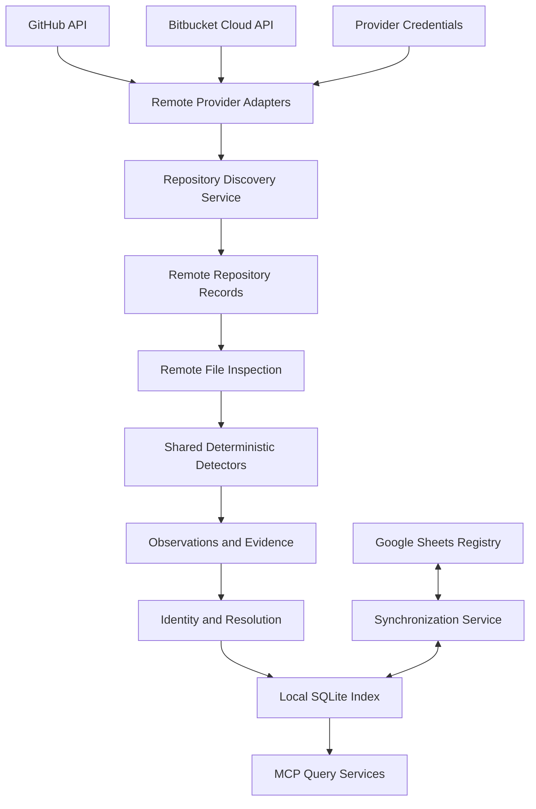

# Vyasa (व्यास) — Remote Repository Discovery

**Document:** `docs/architecture/remote-repositories.md`  
**Product:** Vyasa — Workspace Intelligence MCP  
**Status:** Draft v0.1  
**Scope:** Phase 3 — GitHub and Bitbucket Cloud discovery and remote metadata inspection

**Related Documents**
- `docs/product/vision.md`
- `docs/product/scope-and-roadmap.md`
- `docs/requirements/functional-requirements.md`
- `docs/requirements/non-functional-requirements.md`
- `docs/requirements/data-ownership.md`
- `docs/architecture/system-architecture.md`
- `docs/architecture/data-model.md`
- `docs/architecture/scanning-and-evidence.md`
- `docs/architecture/mcp-interface.md`
- `docs/architecture/local-storage.md`
- `docs/architecture/synchronization.md`

---

## 1. Purpose

This document defines how Vyasa discovers repositories and inspects supported metadata directly from remote Git providers without cloning or checking out repositories.

The initial providers are:

- GitHub.
- Bitbucket Cloud.

The remote discovery layer extends Vyasa's local-first architecture. It enables the system to discover projects that are not present in the current device's workspaces and to inspect authorized repositories without creating local copies.

This document defines:

- Provider adapter responsibilities.
- Repository discovery and identity.
- Authentication and permissions.
- Remote file inspection.
- Pagination, rate limits, caching, and retries.
- Evidence and revision tracking.
- Reconciliation with local observations and Google Sheets.
- Remote-only projects and repositories.
- MCP integration.
- Security and acceptance criteria.

The design must preserve the existing principle that repository-owned knowledge remains owned by its repository, while Vyasa provides deterministic discovery, indexing, and read-only access.

## 2. Goals and Non-Goals

### 2.1 Goals

Vyasa must be able to:

1. Discover repositories available to a configured GitHub or Bitbucket Cloud connection.
2. Enumerate repositories across supported user and organization or workspace scopes.
3. Identify public and authorized private repositories.
4. Retrieve supported repository metadata through provider APIs.
5. Inspect selected files without cloning the repository.
6. Extract supported metadata using the existing deterministic detector framework.
7. Associate remote repositories with existing logical projects where identity is unambiguous.
8. Make remote-only projects discoverable through the shared project index.
9. Preserve source provenance, revision, freshness, and access status.
10. Handle pagination, rate limiting, partial failures, and provider outages safely.
11. Keep credentials outside project metadata, Google Sheets, and ordinary tool responses.
12. Support incremental remote discovery without repeatedly downloading unchanged content.

### 2.2 Non-Goals

The initial implementation does not:

- Clone or checkout remote repositories.
- Push commits or modify remote files.
- Create pull requests or branches.
- Run repository code, build scripts, or tests.
- Execute Git commands that fetch or modify remote state.
- Replace GitHub or Bitbucket as the repository authority.
- Guarantee visibility into repositories that the configured credentials cannot access.
- Automatically delete or archive repositories.
- Infer project quality or purpose using an LLM.
- Treat remote metadata as proof that a local checkout exists.
- Automatically merge forks, mirrors, or similarly named repositories.

---

## 3. Architectural Position

Remote discovery is an additional provider adapter. It must reuse the existing identity, observation, evidence, and query services rather than introducing a separate project knowledge model.

The diagram represents logical responsibilities. Google Sheets synchronization and remote discovery remain independently configurable.

### 3.1 Separation of Responsibilities

| Component | Responsibility |
|---|---|
| Provider adapter | Authenticate, call APIs, normalize provider responses |
| Discovery service | Enumerate repositories and track discovery completeness |
| Remote inspector | Retrieve selected file metadata and content |
| Detector framework | Extract deterministic observations from supported inputs |
| Identity resolver | Match remote repositories to logical projects |
| Evidence service | Record provider, path, revision, and observation time |
| SQLite storage | Persist local index and remote discovery state |
| Synchronization service | Publish approved shared summaries to Google Sheets |
| MCP interface | Expose evidence-backed remote project information |

Provider-specific API logic must not leak into the domain model.

---

## 4. Provider Support

### 4.1 GitHub

The initial GitHub adapter should support:

- Public repository discovery.
- Authenticated repository discovery for the configured account and authorized organizations.
- Repository metadata retrieval.
- Default branch and current commit metadata, when available.
- Selected file metadata and content retrieval.
- Pagination and rate-limit handling.
- Provider-specific repository identity.
- Safe access-status reporting.

The exact API endpoints and permissions must be verified against the selected GitHub API version during implementation.

### 4.2 Bitbucket Cloud

The initial Bitbucket Cloud adapter should support:

- Repository discovery within explicitly configured workspaces.
- Access to public repositories and authorized private repositories.
- Repository metadata retrieval.
- Default branch and commit information, when available.
- Selected file metadata and content retrieval.
- Pagination and API error handling.
- Provider-specific repository identity.

The adapter must target **Bitbucket Cloud**, not assume that Bitbucket Data Center or Server has the same API or authentication model.

### 4.3 Provider Capability Matrix

The implementation should maintain a capability matrix.

| Capability | GitHub | Bitbucket Cloud |
|---|---|---|
| Public repository discovery | Supported where accessible | Supported where accessible |
| Authorized private repositories | Supported | Supported |
| Organization/workspace scope | Supported through configured access | Supported through configured workspace access |
| Repository metadata | Supported | Supported |
| Selected file inspection | Supported | Supported |
| Pagination | Required | Required |
| Revision-aware observations | Required where available | Required where available |
| Clone or checkout | Not used | Not used |
| Repository modification | Not used | Not used |

Any capability unavailable for a particular provider, repository, or permission set must be reported explicitly.

---

## 5. Configuration and Discovery Scope

### 5.1 Explicit Provider Configuration

Each provider connection should specify:

- Provider type.
- Enabled or disabled state.
- Authentication reference.
- Discovery scope.
- Optional organization or workspace identifiers.
- Repository inclusion and exclusion rules.
- Maximum discovery or inspection limits, if configured.
- Refresh policy.
- Applicable timeout and retry settings.

The application must not silently enumerate every account or organization accessible to a credential when the configured scope is narrower.

### 5.2 GitHub Scope

The initial implementation should support explicitly configured discovery scopes, such as:

- Authenticated user's accessible repositories.
- Selected organizations.
- Selected repository owners.
- Selected repository URLs or identifiers.

The exact scopes depend on the authenticated API and the permissions granted to the connection.

An organization being configured does not guarantee access to every repository within it.

### 5.3 Bitbucket Cloud Scope

The initial implementation should support explicitly configured workspace scopes.

The adapter must distinguish:

- A configured workspace.
- A workspace that is successfully accessible.
- A workspace whose access is denied.
- A workspace whose repository enumeration is incomplete.

A failed workspace request must not be interpreted as an empty workspace.

### 5.4 Inclusion and Exclusion

Repository inclusion and exclusion rules should be evaluated against normalized provider identity and configured metadata.

Examples include:

- Include selected organizations.
- Exclude archived repositories from routine inspection while retaining their discovery records.
- Exclude selected repository names or identifiers.
- Inspect metadata only for repositories belonging to a configured portfolio.

The exact supported matching syntax must be documented. Arbitrary expressions must not be evaluated as executable configuration.

### 5.5 Discovery Run Scope

Every discovery run must record its intended scope.

A run scoped to one organization must not be presented as a complete account-wide discovery.

The system must report which scopes were successfully enumerated, skipped, or inaccessible.

---

## 6. Authentication and Credentials

### 6.1 Credential Strategy

The adapter must use supported provider authentication mechanisms.

For GitHub, the implementation may use an appropriately scoped token or supported application-based authentication.

For Bitbucket Cloud, the implementation must select an authentication mechanism currently supported for the intended account and repository access pattern, with appropriate read permissions.

The exact mechanism must be verified during implementation rather than assuming that one provider's token model applies to the other.

### 6.2 Least Privilege

Credentials should have the minimum permissions needed for the configured operation.

For read-only discovery and file inspection, write access to repository contents is unnecessary.

If organization or workspace enumeration requires additional permissions, those permissions must be documented separately from basic repository-read access.

### 6.3 Credential Storage

Credentials must be stored outside repositories and Google Sheets.

Preferred storage options are:

- Operating-system secret storage where available.
- A protected local credential configuration.
- An approved secret-management integration.

Credentials must not be stored in:

- Project profiles.
- SQLite project metadata.
- Evidence records.
- MCP responses.
- Shared registry cells.
- Debug logs.

If a credential is unavailable or expired, the provider adapter must return an authentication status without exposing the secret.

### 6.4 Authentication Failure

Authentication failures must be distinguishable from repository absence.

For example, if a token expires, Vyasa must not mark all previously discovered private repositories as deleted.

The last known repository records may be retained with an appropriate access or freshness status.

### 6.5 Credential Rotation

Credential replacement must not change repository identity.

The adapter should allow a connection to be reauthenticated without recreating all provider repository records.

---

## 7. Repository Discovery

### 7.1 Discovery Process

The discovery workflow is:

1. Load and validate provider configuration.
2. Validate the configured credential.
3. Resolve the configured discovery scope.
4. Enumerate repositories using provider pagination.
5. Normalize repository metadata.
6. Identify each repository using provider identity.
7. Compare discovered repositories with the existing index.
8. Record new, changed, unchanged, and inaccessible records.
9. Optionally inspect selected metadata files.
10. Record run completion and coverage.

Repository discovery and file inspection may be separate operations. The implementation must make their statuses distinguishable.

### 7.2 Minimum Repository Metadata

Where provided by the API, the normalized record should include:

- Provider type.
- Provider repository ID.
- Repository name.
- Repository owner or workspace.
- Canonical web URL.
- Clone URL, if useful for identification, without using it to clone.
- Default branch.
- Visibility.
- Archived status.
- Fork or mirror indicators, where available.
- Creation and update timestamps, where available.
- Latest observed commit or default-branch revision, where available.
- Last successful discovery time.

Fields that are not available from the provider must remain unknown rather than being inferred.

### 7.3 Stable Provider Identity

Each remote repository should have a provider-scoped identity.

Conceptually:

`provider + provider_repository_id`

The provider's stable repository identifier is preferred over repository name or URL text.

URLs may change because repositories are renamed or transferred. Vyasa should update the URL associated with a stable provider identity without treating the repository as an unrelated new entity.

### 7.4 New Repositories

A newly discovered remote repository should be recorded independently of whether it can be associated with an existing logical project.

If identity resolution cannot establish a match, the repository should remain a remote repository record awaiting association or review.

### 7.5 Renamed or Transferred Repositories

When the provider returns a known stable repository ID with a new name or owner:

- Preserve the provider repository identity.
- Update observed mutable metadata.
- Retain relevant historical observations if required.
- Re-evaluate the logical project association if the transfer changes ownership or identity evidence.
- Do not automatically merge the repository with another project merely because its name changed.

### 7.6 Archived Repositories

Archived repositories may remain valuable for project history and reuse.

The system must preserve their discovery record and expose their archived status.

Whether archived repositories are inspected during every refresh should be configurable or defined by the discovery policy.

### 7.7 Deleted or Inaccessible Repositories

If a previously discovered repository disappears from an API response, Vyasa must not immediately conclude that it was deleted.

Possible explanations include:

- Repository deletion.
- Permission changes.
- Authentication failure.
- Organization membership changes.
- Discovery-scope changes.
- Incomplete pagination.
- Temporary provider failure.

The implementation must distinguish confirmed deletion, inaccessible repository, and not observed in the latest completed scope where the provider can supply sufficient evidence.

If deletion cannot be established reliably, preserve the record and mark its state or freshness appropriately.

---

## 8. Pagination and Discovery Completeness

### 8.1 Complete Enumeration

A repository discovery run is complete only when all pages required for its declared scope have been processed successfully.

If a page fails after earlier pages succeeded, the run must report partial completion.

### 8.2 Pagination Strategy

Each provider adapter must follow the provider's documented pagination mechanism.

The adapter must not assume identical page sizes, cursor formats, continuation URLs, or response structures across providers.

### 8.3 Duplicate Results

Some provider responses may overlap due to changing repository lists or pagination behaviour.

Duplicate provider repository IDs within a discovery run must be deduplicated deterministically.

The same repository must not be inserted twice merely because it appeared in multiple responses.

### 8.4 Changing Repository Lists

A repository list may change during enumeration.

Where possible, the adapter should use stable pagination mechanisms and provider revisions or continuation tokens.

If the API cannot guarantee a snapshot, Vyasa must document that limitation and avoid claiming a globally atomic view of the repository inventory.

### 8.5 Partial Scope

If only some configured organizations or workspaces were inspected successfully, the discovery result must include per-scope outcomes.

The aggregate run must not be reported as fully complete.

---

## 9. Remote File Inspection

### 9.1 Purpose

Remote file inspection retrieves selected files needed by supported detectors.

It should reuse the deterministic detector framework defined in `scanning-and-evidence.md`.

The remote inspector must not create a checkout.

### 9.2 Initial File Categories

The initial inspection inventory may include:

- README files.
- Canonical project profiles.
- Supported project manifests.
- Recognized build configuration.
- Documentation entry points.
- OpenSpec configuration and selected artifacts.
- Recognized agent instruction files.
- Test configuration and test indicators.

The exact patterns must be maintained in the detector inventory.

### 9.3 Inspection Levels

The implementation should distinguish these levels:

1. **Repository discovery:** repository metadata only.
2. **File inventory discovery:** determine which relevant paths exist, using supported provider APIs.
3. **Selected file inspection:** retrieve content for approved detector inputs.
4. **Metadata extraction:** run deterministic detectors on retrieved content.

These levels must not be conflated.

A discovered repository may have no file inspection. A file inventory may exist without every relevant file being read.

### 9.4 File Retrieval

The provider adapter should use supported APIs to retrieve files from a specified repository revision.

It must:

- Prefer a specific revision when available.
- Respect configured file-size limits.
- Handle binary or unsupported content safely.
- Avoid retrieving unrelated files.
- Avoid executing scripts or interpreting arbitrary repository content as Vyasa configuration.
- Record when a file could not be retrieved.

### 9.5 Revision Consistency

Files inspected during one logical inspection should use a consistent revision where the provider API permits it.

For example, if the inspector retrieves a README from one commit and a manifest from a newer commit, it must not imply that both observations describe the same repository state.

The preferred approach is to resolve a revision and request selected files against that revision.

If the provider does not support the required consistency, record the limitation.

### 9.6 No Clone or Checkout

The implementation must not use a temporary clone as a fallback for unsupported API calls.

If the API cannot retrieve a required file or revision, Vyasa should report the capability limitation or inspection failure.

### 9.7 Content Retention

The remote inspector should process retrieved content in memory and persist only the metadata and evidence needed for indexing.

Raw repository files should not be stored in SQLite by default.

If future performance requirements justify a content cache, it must have explicit size limits, retention rules, privacy controls, and invalidation behaviour.

---

## 10. Remote Deterministic Detection

### 10.1 Shared Detector Framework

Where a detector accepts a file's content and path, the same detector logic should be reused for local and remote sources.

Provider-specific logic should be limited to:

- Discovering relevant paths.
- Retrieving content.
- Mapping revision and source metadata.
- Reporting provider access failures.

This avoids separate rules for interpreting identical manifests based solely on where they were read.

### 10.2 Provenance

Every remote observation should identify:

- Provider.
- Provider repository identity.
- Repository-relative path or metadata field.
- Revision or commit identifier, when available.
- Detector identifier and version.
- Observation timestamp.
- Inspection outcome.

A remote observation must never be presented as evidence from a local checkout.

### 10.3 Source Status

The inspector must preserve the distinction between:

- `observed`
- `declared`
- `not_detected`
- `unknown`
- `unsupported`
- `inaccessible`
- `stale`
- `conflicting`

For example, a README request returning a confirmed not-found result at a successfully inspected revision can support `not_detected`. An authorization error cannot.

### 10.4 Unsupported Formats

If a repository uses an unsupported manifest or configuration format, the result should identify the limitation.

It must not guess framework dependencies or architecture from filenames alone.

### 10.5 OpenSpec and OKF

OpenSpec detection must follow the same versioned validation rules as local scanning.

The meaning of OKF remains unresolved. Remote OKF detection must not be implemented until its meaning, file representation, and validity rules are confirmed.

---

## 11. Remote Identity and Logical Project Resolution

### 11.1 Separate Entities

The data model must distinguish:

- Logical project.
- Remote repository.
- Local checkout.
- Provider identity.
- Shared registry record.

A remote repository may be known even when it has no local checkout and no confirmed logical project association.

### 11.2 Matching Existing Projects

The identity resolver may use:

- Stable provider repository ID.
- Canonical remote identity.
- Existing repository-to-project associations.
- Explicit canonical project profile references.
- Approved repository identity mappings.

Names and descriptions may help produce candidates, but must not independently establish identity.

### 11.3 One Project, Multiple Repositories

A logical project may consist of multiple remote repositories.

For example, a project may maintain separate frontend and backend repositories.

Vyasa should support multiple repository associations without forcing them into one repository record.

### 11.4 Forks and Mirrors

Forks and mirrors must remain separate repository identities.

They may be associated through a distinct relationship such as `fork_of` or `mirror_of` if that relationship type is added to the data model.

A fork must not automatically replace the upstream repository associated with a logical project.

### 11.5 Duplicate Candidates

When multiple remote repositories appear to represent the same logical project, Vyasa may create a `potential_duplicate` candidate.

The candidate must include the evidence and deterministic rule that produced it.

The system must not merge records or delete a repository automatically.

### 11.6 Identity Conflicts

If a repository appears to match multiple logical projects, the resolver must preserve the ambiguity.

The MCP interface should expose the conflict or review status rather than arbitrarily selecting one project.

---

## 12. Reconciliation With Local Observations

### 12.1 Independent Observation Sources

Remote and local observations are separate records.

For example:

- Local README: observed at local working-tree state.
- Remote README: observed at a specific remote commit.
- Shared registry README status: last synchronized summary.

These are not interchangeable.

### 12.2 Resolution Rules

The field ownership policy determines which observation supplies the resolved value.

A newer remote observation must not automatically overwrite a local working-tree observation, and a local observation must not automatically overwrite a shared human-managed field.

### 12.3 Conflicts

A conflict may arise when:

- The local profile differs from the remote profile.
- The local working tree differs from the remote branch.
- The remote repository identity conflicts with an existing association.
- The shared registry contains a human-managed value that disagrees with repository metadata.

The resolution service must preserve the observations and apply field-specific ownership rules.

### 12.4 Remote-Only Projects

If a repository is discovered remotely and no local checkout exists:

- Store the remote repository record.
- Associate it with a logical project if identity is unambiguous.
- Extract supported metadata when inspection is enabled.
- Make it searchable through the MCP interface.
- Mark local checkout state according to what was actually verified.
- Avoid inventing a local path.

### 12.5 Local-Only Projects

A local repository may have no accessible remote repository or may not be hosted on a supported provider.

It remains a valid local project and must not be deleted from the index simply because remote discovery does not find it.

---

## 13. Google Sheets Integration

Google Sheets remains the shared registry introduced in Phase 2.

Remote discovery must not create a second competing portfolio registry.

### 13.1 Exported Metadata

Approved remote repository metadata may be summarized in the existing registry fields, including:

- Repository URL.
- Git origin.
- Programming languages.
- Frameworks and technologies.
- Documentation indicators.
- Last scanned timestamp.
- Details status.

Only fields allowed by the export/import ownership matrix may be synchronized.

### 13.2 Multiple Repositories

The current `Project Registry` schema contains one `Repository URL` field.

If one logical project needs multiple independently tracked repositories, a dedicated `Repositories` tab may be required.

Before adding it, the implementation must establish whether the existing schema can represent the required relationship without ambiguity.

The system must not silently truncate a multi-repository association or use a single arbitrary URL as though it represented the entire project.

### 13.3 Registry Does Not Prove Current Remote State

A spreadsheet record may describe a repository that has since changed or become inaccessible.

The registry must preserve the last successful observation time and must not imply that the repository was freshly inspected merely because its metadata was synchronized.

### 13.4 Credentials

Provider credentials must never be exported to Google Sheets.

The registry may contain public repository URLs and approved metadata, but not authentication tokens or local credential references.

---

## 14. SQLite Persistence

Remote discovery should extend the local storage model rather than replacing it.

Proposed additional logical entities include:

- `provider_connections`
- `remote_discovery_runs`
- `remote_discovery_scope_results`
- `remote_repository_observations`
- `remote_file_observations`
- `provider_sync_state`

These are logical entities; the final implementation may normalize or combine tables as appropriate.

### 14.1 Provider Connection

Store non-secret connection metadata such as:

- Connection identifier.
- Provider type.
- Configured scope.
- Enabled state.
- Last successful access time.
- Last error category.

Do not store raw credentials in these records.

### 14.2 Remote Discovery Run

Record:

- Run ID.
- Provider.
- Scope.
- Start and completion timestamps.
- Status.
- Pagination completeness.
- Repositories discovered.
- Repositories added or updated.
- Repositories skipped.
- Errors and warnings.

### 14.3 Remote Observations

Remote metadata observations must record source type and revision.

They must not be merged into local observations without preserving provenance.

### 14.4 Cache State

Cache records should identify the repository revision, file fingerprint, and detector version used to produce a result.

The cache must be invalidated when relevant source revisions, file content, or detector behaviour change.

### 14.5 Migration

Adding remote discovery state requires a versioned SQLite migration.

Existing local projects, observations, evidence, and scan history must remain valid after the migration.

---

## 15. Incremental Discovery and Caching

### 15.1 Objectives

Incremental discovery should minimize unnecessary API calls while keeping the index accurate.

It must not trade correctness for a misleading claim of freshness.

### 15.2 Repository-Level Cache

Cache relevant repository metadata such as:

- Provider repository ID.
- Last observed metadata.
- Default branch.
- Latest known revision.
- Last successful discovery time.
- Last error state.

The adapter should refresh fields according to a documented freshness policy.

### 15.3 File-Level Cache

A remote file inspection cache may be reused when all relevant inputs remain unchanged:

- Provider repository identity.
- Target revision.
- File path.
- File content fingerprint or equivalent reliable revision reference.
- Detector version.
- Detector configuration.

A cache hit must not be reused if the detector version or supported schema rules have changed.

### 15.4 Branch Changes

When the default branch advances, the inspector should determine which observations need refreshing.

If the provider supplies a commit identifier, use it to establish the source revision.

Do not assume that a stable branch name means stable content.

### 15.5 Deleted Files

A previously detected file may be considered absent only when the provider successfully establishes that the file is not present at the inspected revision.

An authorization failure or incomplete API request must not invalidate the previous positive observation as a confirmed deletion.

### 15.6 Repository Changes

If the repository is renamed or transferred, update mutable metadata associated with the stable provider identity.

If the repository is archived, preserve its record and update its observed status.

### 15.7 Refresh Policy

The implementation should support explicit refresh operations and may add scheduled discovery later.

The initial implementation should not require continuous polling.

The freshness interval, refresh scope, and treatment of archived repositories must be configurable or documented.

---

## 16. API Rate Limits and Failure Handling

### 16.1 Rate Limits

Each provider adapter must follow its provider's current rate-limit and retry guidance.

The implementation must not assume identical quotas or rate-limit headers across GitHub and Bitbucket Cloud.

### 16.2 Retryable Errors

Potentially retryable failures include:

- Temporary network failures.
- Provider service errors.
- Rate limiting.
- Transient request timeouts.

Retries must be bounded and use appropriate backoff.

### 16.3 Non-Retryable Errors

Examples include:

- Invalid credentials.
- Insufficient permissions.
- Invalid repository identifiers.
- Unsupported API operations.
- Invalid configuration.

These require corrective action rather than indefinite retries.

### 16.4 Partial Discovery

If some repositories are discovered but later pages fail:

- Retain confirmed discoveries.
- Record the run as partial.
- Preserve previous repository records.
- Mark discovery coverage as incomplete.
- Retry the missing scope when safe.

### 16.5 Access Revocation

If a previously accessible repository becomes inaccessible, preserve its last known metadata and update its access or freshness status.

Do not automatically delete it or erase its project association.

### 16.6 Provider Outage

A provider outage must not prevent local scanning or local MCP queries.

The last valid remote observations may remain available, marked with appropriate freshness warnings.

---

## 17. Security and Untrusted Repository Content

### 17.1 No Repository Execution

Remote discovery must not execute repository scripts, workflows, build files, package lifecycle hooks, or agent instructions.

All retrieved repository content is treated as untrusted data.

### 17.2 Resource Limits

The implementation must enforce limits on:

- API request duration.
- Retrieved file size.
- Total files inspected per repository.
- Total repositories processed per run, where configured.
- Memory use during parsing.
- Retry counts.
- Total run duration, where applicable.

Exceeding a limit must produce an explicit skipped or incomplete result.

### 17.3 Secret Redaction

The adapter must sanitize remote URLs that embed credentials or tokens.

Error responses must not include authentication headers or raw secret-bearing request details.

### 17.4 Permission Boundaries

The adapter must only access repositories authorized by the configured credentials and scope.

It must not attempt to bypass repository access restrictions or use an alternate identity to circumvent denied access.

### 17.5 Minimal Data Collection

Only metadata needed for discovery, indexing, and approved evidence should be retained.

The implementation must not download entire repositories simply to determine basic project identity or technology.

### 17.6 Provider Data Exposure

Remote repository metadata returned through MCP must be limited to the configured user and authorized scope.

The system must not treat data obtained through one provider connection as globally available to every unrelated user or deployment.

---

## 18. MCP Interface

Remote discovery should extend the existing MCP contract without changing the semantics of the core query tools.

### 18.1 Existing Tools

The following tools should be able to return remote-derived information once it is indexed:

- `search_projects`
- `get_project`
- `get_project_context`
- `find_related_projects`
- `get_project_dependencies`
- `get_index_status`

They must identify source provenance and freshness where relevant.

### 18.2 Explicit Remote Operations

The following are proposed operational tools, subject to the final MCP interface decision:

- `discover_remote_repositories`
- `inspect_remote_repository`

`discover_remote_repositories` should accept a configured provider and supported scope, then return a bounded summary of discovery outcomes.

`inspect_remote_repository` should accept a stable repository identifier and a bounded inspection scope. It must not accept an arbitrary URL as permission to access any network resource.

The implementation must validate repository identity against configured providers and enforce access boundaries.

### 18.3 Discovery Input

The final discovery tool may accept:

- Provider connection ID.
- Configured scope identifier.
- Optional inclusion filters.
- Dry-run option, where useful.
- Explicit inspection mode.

It should not accept raw credentials or arbitrary API headers as tool arguments.

### 18.4 Inspection Input

The final inspection tool may accept:

- Stable repository ID.
- Optional target revision.
- Optional detector subset.
- Maximum inspection scope.

The repository must belong to an enabled, configured provider connection.

### 18.5 Results

Operational results should include:

- Run ID.
- Provider.
- Scope.
- Status.
- Repositories discovered or inspected.
- Records added or updated.
- Records skipped.
- Errors and warnings.
- Coverage and freshness.
- Whether inspection was complete.

### 18.6 No Implicit Remote Calls

Ordinary project queries must not unexpectedly call GitHub or Bitbucket APIs.

Remote discovery and inspection must be explicit operations or part of a separately configured scheduled workflow.

This keeps query latency predictable and avoids unexpected API usage.

---

## 19. Testing Strategy

### 19.1 Provider Adapter Unit Tests

Use mocked provider responses to test:

- Authentication outcomes.
- Repository normalization.
- Pagination.
- Duplicate repository IDs.
- Renamed repositories.
- Archived repositories.
- Missing metadata.
- Rate limits.
- Transient failures.
- Permission errors.

### 19.2 Remote Inspection Tests

Test:

- README retrieval.
- Manifest retrieval.
- Revision-pinned file inspection.
- Missing files.
- Unsupported formats.
- Oversized files.
- Binary files.
- Invalid content.
- Partial inspection.
- Cache reuse and invalidation.

### 19.3 Identity Tests

Test:

- Remote repository matching an existing local project.
- Remote-only project discovery.
- A local checkout matching a previously remote-only repository.
- Repository rename or transfer.
- Fork and upstream separation.
- Multiple repositories belonging to one logical project.
- Ambiguous matches and duplicate candidates.

### 19.4 Failure Isolation

Verify that:

- A failed provider does not prevent local queries.
- A failed organization does not invalidate other successfully inspected scopes.
- Partial pagination does not imply complete discovery.
- Authentication failure does not imply repository deletion.
- Remote inspection failure does not invalidate unrelated observations.

### 19.5 Security Tests

Verify that:

- Credentials are not persisted in metadata records.
- Secret-bearing URLs are sanitized.
- Remote content is never executed.
- Arbitrary URLs cannot bypass configured provider scope.
- Oversized responses are rejected safely.
- Untrusted repository text cannot alter scanner configuration.

### 19.6 Integration Tests

Use dedicated test repositories and scoped credentials.

Integration tests should verify repository enumeration, file inspection, revision tracking, provider errors, and safe reauthentication.

Tests must not depend on production repositories being permanently available.

---

## 20. Implementation Sequence

The recommended Phase 3 implementation order is:

1. Finalize provider identity and repository-to-project resolution rules.
2. Define the provider adapter interface.
3. Implement provider connection configuration and secret handling.
4. Implement GitHub repository discovery.
5. Implement Bitbucket Cloud repository discovery.
6. Add pagination and partial-discovery reporting.
7. Add remote repository persistence and SQLite migrations.
8. Implement selected-file retrieval at known revisions.
9. Reuse the existing deterministic detector framework.
10. Add remote evidence and freshness handling.
11. Implement incremental discovery and file inspection caches.
12. Integrate remote-only projects with the local query index.
13. Extend approved Google Sheets synchronization fields.
14. Add explicit MCP discovery and inspection operations.
15. Validate rate limits, permission boundaries, recovery, and cross-provider identity.
16. Test with repositories that have no local checkout.
17. Document setup and supported provider capabilities.

GitHub and Bitbucket Cloud should share the same domain-level contract, but their adapters should be implemented and tested independently.

---

## 21. Decisions Required Before Implementation

| ID | Decision | Recommendation |
|---|---|---|
| RR-001 | GitHub authentication mechanism | Use a supported least-privilege read-access model |
| RR-002 | Bitbucket Cloud authentication mechanism | Verify the current supported token and permission model |
| RR-003 | Discovery scope | Explicitly configure accounts, organizations, and workspaces |
| RR-004 | Provider identity | Use provider-scoped stable repository identifiers |
| RR-005 | Repository grouping | Support multiple repositories per logical project |
| RR-006 | Remote inspection defaults | Metadata-only discovery; inspect selected files explicitly |
| RR-007 | Revision consistency | Pin selected file inspections to a known revision where possible |
| RR-008 | Cache freshness policy | Define repository- and file-level refresh rules |
| RR-009 | Archived repositories | Preserve records; configure inspection policy |
| RR-010 | Missing repository policy | Preserve records unless deletion is established reliably |
| RR-011 | Remote-only project status | Distinguish remote discovery from local checkout |
| RR-012 | Multiple-repository Sheets representation | Decide whether a `Repositories` tab is required |
| RR-013 | MCP operational tools | Finalize discovery and inspection schemas |
| RR-014 | Remote request limits | Set and test file, repository, and duration limits |
| RR-015 | Provider rate limits | Implement provider-specific backoff and error handling |
| RR-016 | OKF detection | Defer until meaning and validation rules are confirmed |

These decisions must be resolved or explicitly accepted as implementation defaults before the corresponding functionality is built.

---

## 22. Acceptance Criteria

Remote repository discovery is ready when:

1. GitHub and Bitbucket Cloud repositories can be discovered through their supported APIs.
2. Authorized private repositories can be accessed within configured permissions.
3. Discovery respects configured provider and organization/workspace scopes.
4. Repository enumeration handles pagination and reports incomplete coverage accurately.
5. Stable provider identity prevents duplicate repository records during ordinary refreshes.
6. Remote file inspection works without cloning or checking out repositories.
7. Selected file inspections use revision-specific evidence where supported.
8. Remote observations remain distinguishable from local checkout observations.
9. Deterministic detectors are reused for compatible local and remote inputs.
10. Remote-only projects can be queried without inventing local paths.
11. Authentication failures and provider outages do not imply repository deletion.
12. Incremental discovery avoids unnecessary work while respecting detector and content invalidation.
13. Credentials remain outside the database's ordinary metadata records, MCP responses, and Google Sheets.
14. Repository content is never executed by the scanner.
15. Remote discovery failures do not break local indexing or querying.
16. Duplicate candidates and ambiguous project associations are surfaced for review.
17. The MCP interface exposes remote operations explicitly without making ordinary queries trigger API calls.
18. Provider-specific integration tests validate authentication, pagination, inspection, and recovery.

## 23. Governing Principle

Remote repository discovery extends Vyasa's visibility beyond the current machine without changing who owns project knowledge.

The provider remains authoritative for remote repository identity and state. The repository remains authoritative for its maintained content. SQLite remains the local index, and Google Sheets remains the shared project registry.

**Discover remotely, inspect selectively, preserve provenance, and never confuse remote visibility with a local checkout or complete verification.**
