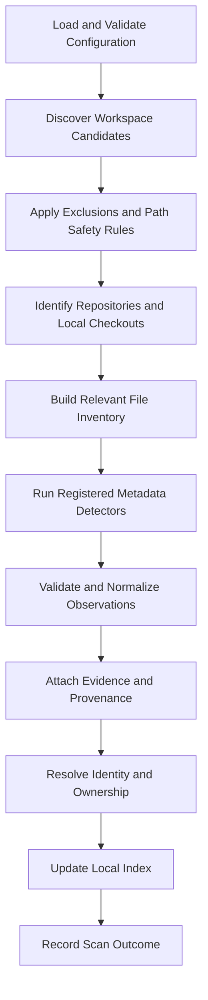

# Vyasa (व्यास) — Scanning and Evidence

**Document:** `docs/architecture/scanning-and-evidence.md`  
**Product:** Vyasa — Workspace Intelligence MCP  
**Status:** Draft v0.1  
**Scope:** Phase 1 local scanning, with extension rules for Phases 2 and 3

**Related Documents:**
- `docs/product/vision.md`
- `docs/product/scope-and-roadmap.md`
- `docs/requirements/functional-requirements.md`
- `docs/requirements/non-functional-requirements.md`
- `docs/requirements/data-ownership.md`
- `docs/architecture/system-architecture.md`
- `docs/architecture/data-model.md`

---

## 1. Purpose

This document defines how Vyasa discovers project information, extracts metadata, records evidence, evaluates freshness, and decides when existing observations must be updated.

It establishes:

- Workspace traversal and repository discovery rules.
- Supported metadata detector categories.
- Evidence requirements for detected and declared facts.
- Rules for representing missing, unknown, inaccessible, stale, and conflicting information.
- Incremental scanning and cache invalidation.
- Safe handling of untrusted repository content.
- Local and remote evidence distinctions.
- Testing requirements for deterministic extraction.

This document defines scanner behaviour, not the physical SQLite schema or MCP tool contracts.

## 2. Core Scanning Principles

### 2.1 Deterministic Extraction

Vyasa MUST use documented rules and recognized evidence sources to extract metadata.

Routine scanning MUST NOT require an LLM to interpret a repository, infer its purpose, classify its quality, or invent missing fields.

Given the same relevant inputs, detector configuration, and detector version, the scanner must produce equivalent observations.

### 2.2 Evidence Before Claims

Every detected or declared fact MUST have an identifiable source wherever practical.

The scanner must not promote a plausible assumption into a confirmed fact.

Examples:

- A `pyproject.toml` file establishes the presence of a recognized Python project manifest, but not that every declared dependency is installed.
- A README containing the word "React" does not by itself prove that React is a project dependency.
- A directory named `tests` is evidence of a test-related directory, not proof that the tests execute successfully.
- An OpenSpec directory does not establish that OpenSpec is correctly configured or that meaningful specifications exist.

### 2.3 Missing Is Not False

Vyasa must distinguish between an indicator that was not found, a source that could not be read, and a source format that is unsupported.

The absence of evidence must not be presented as proof of absence when the scan was incomplete.

### 2.4 Read-Only Scanning

Ordinary scanning MUST NOT modify repository files, canonical project profiles, Git history, or remote repositories.

The scanner may update its own index, evidence inventory, and operational state.

Optional draft generation is a separate, explicitly enabled operation with its own lifecycle rules.

### 2.5 Explicit Detector Coverage

Vyasa must document what each detector supports and what it does not support.

A detector must not claim comprehensive coverage of a technology, framework, test suite, or documentation standard when it recognizes only a subset of the relevant files.

### 2.6 Source Ownership

Scanning records observations; it does not override the field ownership model.

A detector may observe a project name, for example, but the final resolved value must follow the field-specific ownership and precedence rules in `docs/requirements/data-ownership.md`.

---

## 3. Scanning Architecture

The scanning pipeline consists of distinct stages.

Each stage has a defined responsibility.

| Stage | Responsibility |
|---|---|
| Configuration | Validate roots, exclusions, and scan options. |
| Discovery | Identify eligible project and repository candidates. |
| Path safety | Enforce boundaries and traversal rules. |
| Repository inspection | Identify Git metadata and supported repository files. |
| File inventory | Identify files relevant to enabled detectors. |
| Detection | Extract facts using registered rules. |
| Validation | Validate values against field definitions. |
| Evidence | Attach source references and observation details. |
| Identity and ownership | Resolve identities and apply field-specific policies. |
| Index update | Persist generated observations safely. |
| Reporting | Record successful, partial, failed, and interrupted outcomes. |

A failure in one detector should not prevent unrelated detectors from running unless a shared prerequisite has failed.

## 4. Workspace Discovery

### 4.1 Configured Roots

Vyasa MUST scan only configured workspace roots and paths permitted by the effective configuration.

The configuration must support:

- One or more workspace roots.
- Exclusion rules.
- Supported discovery depth or traversal boundaries.
- Symlink handling policy.
- Local index location.
- Enabled detector options, where applicable.

If no valid roots are configured, Vyasa must report that discovery is not configured rather than scanning an unintended default location.

### 4.2 Candidate Discovery

A directory may qualify as a candidate through recognized evidence such as:

- Git repository metadata.
- A recognized project manifest.
- A canonical project profile.
- Other explicitly configured project markers.

The final discovery policy must define how non-Git directories qualify as projects and how broad directory traversal is allowed to be.

A directory must not become a project merely because it exists.

### 4.3 Nested Repositories

Nested repositories must be handled using explicit rules.

The scanner must distinguish:

- A repository nested inside another repository.
- A Git submodule.
- A normal directory inside a repository.
- A linked worktree or another Git-managed checkout, where supported.

Metadata from separate repositories must not be merged simply because their directories are nested.

### 4.4 Exclusions

Excluded paths must not be scanned for project discovery or metadata extraction.

The implementation must define how exclusion patterns are matched, including whether rules apply to directory names, relative paths, or both.

Exclusion rules should be evaluated before expensive file inspection.

### 4.5 Symlinks and Path Boundaries

The initial recommended policy is not to follow directory symlinks during recursive traversal.

If symlinks are followed through an explicitly configured option, the scanner must resolve paths safely and enforce the permitted root boundaries.

The scanner must not unintentionally escape configured roots or repeatedly traverse filesystem cycles.

### 4.6 Discovery Outcomes

Each candidate must have an outcome that distinguishes, as applicable:

- Discovered and eligible.
- Excluded.
- Not a recognized project.
- Inaccessible.
- Malformed.
- Skipped by policy.
- Identity unresolved.

A candidate that cannot be inspected must not be reported as successfully scanned.

---

## 5. Repository Inspection and File Inventory

### 5.1 Relevant File Inventory

Vyasa should build an inventory of files relevant to supported detectors rather than read every file in every repository.

The inventory may include:

- File path relative to the repository.
- File type or recognized role.
- File size.
- Modification metadata.
- Content fingerprint, when needed.
- Readability and inspection outcome.

The inventory is generated operational state. It must not be confused with a complete or authoritative description of all repository content.

### 5.2 File Reading

The scanner MUST:

- Read only the files needed for enabled detectors.
- Use safe parsing libraries and bounded resource consumption.
- Avoid executing repository scripts.
- Avoid evaluating arbitrary configuration expressions.
- Handle malformed text and unsupported encodings without terminating unrelated scanning.
- Avoid retaining unnecessary source content in the local index.

### 5.3 File Size and Resource Limits

The implementation must define configurable or documented limits for:

- Individual file size.
- Total files inspected per project, where needed.
- Directory traversal depth.
- Parsing resource consumption.
- External API response size in later phases.

When a limit prevents inspection, the result must indicate that the source was skipped or only partially assessed. It must not claim the relevant indicator is absent.

The initial numerical limits should be selected during implementation and validated against representative repositories.

### 5.4 Git Metadata

Supported local Git observations may include:

- Remote names and URLs.
- Repository root.
- Current branch, when available.
- Current commit identifier, when available.
- Working-tree status, if explicitly enabled.
- Submodule or worktree indicators, where supported.

Git metadata inspection must not fetch, pull, checkout, or change repository state unless a separate, explicitly approved feature is introduced.

The default scanner should not require network access to inspect local Git configuration.

---

## 6. Detector Architecture

Each detector must implement a defined contract.

A detector definition must specify:

1. Detector identifier and version.
2. Supported input files or metadata.
3. Output fields.
4. Validation rules.
5. Evidence generation rules.
6. Unsupported cases.
7. Failure behaviour.
8. Cache invalidation inputs.
9. Tests covering positive, negative, ambiguous, and malformed inputs.

Detectors should be independently testable.

One detector's failure must not invalidate observations from unrelated detectors.

### 6.1 Detector Output

A detector must produce structured observations rather than directly modifying the project profile or arbitrary database records.

Conceptually, a result contains:

- Entity reference.
- Field identifier.
- Value or explicit status.
- Source category.
- Evidence references.
- Detector identifier and version.
- Observation time.
- Relevant source revision, if available.
- Diagnostic information, if needed.

The application layer validates the result, applies ownership rules, and persists the observation.

### 6.2 Detector Registry

The implementation should use a registry of enabled detectors.

The registry must make it possible to determine:

- Which detectors are supported.
- Which detectors ran for a project.
- Which detectors were skipped.
- Which detectors failed.
- Which detector version produced an observation.

The initial implementation does not require a plugin marketplace or third-party executable detector system.

---

## 7. Project Identity Detection

### 7.1 Inputs

Identity resolution may use:

- Recognized canonical project profile.
- Local Git repository metadata.
- Normalized Git remote identity.
- Provider repository identifiers in later phases.
- Existing project and repository associations.
- Local fallback identity.

### 7.2 Rules

- Prefer reliable, stable repository identity when available.
- Do not use a display name alone as a stable identifier.
- Do not treat a directory rename as a new project when existing identity evidence resolves the same entity.
- Do not merge multiple repositories into one project without explicit or sufficiently strong defined evidence.
- Flag ambiguous identity matches.
- Preserve source identity information for later reconciliation.

### 7.3 Evidence

An identity decision should record the evidence that supports it, such as the normalized remote identity or provider identifier.

If a repository has no usable remote, Vyasa may assign a deterministic local fallback identity according to the approved identity policy.

The exact identity algorithm belongs in the data-model and identity design. It must not be invented independently by individual detectors.

---

## 8. Project Profile Detection

### 8.1 Canonical Profile

The canonical profile is a project-maintained source of declared metadata.

The proposed location is:

` .vyasa/project-profile.yaml`

The leading space above is explanatory formatting only; the actual path begins with `.vyasa/`.

The exact profile format and schema must be finalized before the detector is implemented.

The profile detector must:

- Recognize only approved profile paths and formats.
- Validate values against the profile schema.
- Mark values as declared rather than independently detected.
- Record the source path and field reference.
- Report invalid fields or unsupported schema versions.
- Preserve conflicts between declarations and observations.

A malformed profile must not prevent the scanner from extracting unrelated metadata.

### 8.2 Missing Profile

If no canonical profile exists, Vyasa continues extracting available repository evidence.

It must not assume that a canonical profile exists merely because a draft file exists.

### 8.3 Generated Draft

An optional draft may be generated through a separate operation when explicitly enabled.

Proposed location:

`.vyasa/project-profile.draft.yaml`

The draft should:

- Be git-ignored by default.
- Contain only supported values and clearly marked missing fields.
- Be distinct from the canonical profile.
- Never be automatically promoted to canonical status.
- Never be overwritten during ordinary scanning.
- Follow a defined policy for stale drafts and existing manual edits.

The routine scanner itself remains read-only.

### 8.4 Profile Precedence

The profile detector does not independently decide the final value for every field.

For each field, the ownership and resolution policy determines whether the canonical profile, an observed manifest, explicit documentation, or another source is authoritative.

---

## 9. Metadata Detector Inventory

The initial detector inventory is grouped by domain. Exact supported file patterns must be maintained as a versioned detector specification and tested against fixtures.

### 9.1 Project Identity and Description Detector

**Purpose:** Extract project name and explicitly documented descriptive metadata.

Potential sources:

- Canonical project profile.
- Recognized manifest metadata.
- Explicit project description fields.
- README metadata or defined sections, if a deterministic parser is implemented.
- Repository directory name as a fallback display name.

Rules:

- Record the source of each value.
- Apply the documented field precedence rules.
- Do not infer project purpose from technology choices or filenames.
- If no supported source establishes purpose, report it as unknown or not documented.

### 9.2 Git Detector

**Purpose:** Inspect local Git identity and repository metadata.

Potential outputs:

- Repository root.
- Remote names and URLs.
- Current revision, when available.
- Local checkout mapping.
- Supported repository structure indicators.

Rules:

- Do not fetch remote content as part of local scanning.
- Do not treat a remote URL alone as proof that the remote repository is accessible.
- Keep local checkout paths separate from shareable repository identity.
- Do not automatically merge forks and upstream repositories.

### 9.3 Programming Language Detector

**Purpose:** Identify languages supported by deterministic file and manifest rules.

Potential evidence:

- Recognized source-file extensions.
- Recognized language-specific manifests.
- Recognized build or project configuration files.

Rules:

- File extension detection establishes that files of a recognized type are present.
- A manifest may provide stronger evidence that a language is part of the project's declared build configuration.
- The detector must document whether its output means "files detected," "language declared," or another specific status.
- It must not claim that a language is actively used at runtime solely from a filename.
- Generated files and vendored directories may require explicit exclusions.

If multiple evidence types are combined, their meanings must remain distinguishable.

### 9.4 Framework and Technology Detector

**Purpose:** Identify supported frameworks, libraries, and technologies from recognized manifests and configuration.

Candidate input formats may include:

- `package.json`
- `pyproject.toml`
- `requirements.txt`
- `Cargo.toml`
- `pom.xml`
- `build.gradle`
- `build.gradle.kts`
- `*.uproject`
- Other formats explicitly added to the detector inventory

This list is illustrative, not a guarantee that every format or framework is already supported.

Rules:

- Each manifest format must have a dedicated parsing and validation policy.
- Technology mappings must be explicit and testable.
- Dependency names should be normalized to stable identifiers when possible.
- Declared versions and constraints must be retained where useful.
- Optional dependencies, development dependencies, workspaces, and platform-specific declarations must not be silently flattened into one misleading list.
- Unsupported manifests must be reported as unsupported rather than interpreted speculatively.

### 9.5 README Detector

**Purpose:** Determine README presence and supported metadata extraction.

The detector may record:

- Whether a recognized README exists.
- Its repository-relative path.
- Whether it can be read.
- Its format.
- Explicit metadata or sections recognized by a documented parser.

The detector must distinguish:

- README detected.
- README not detected after a complete supported search.
- README inaccessible.
- README unsupported or malformed.

### 9.6 Documentation Structure Detector

**Purpose:** Identify documentation directories, entry points, and recognized structures.

Potential observations include:

- Documentation directory presence.
- Recognized entry-point documents.
- Known architecture, requirements, or operations documents.
- Recognized documentation index files.
- Known specification and change directories.

Rules:

- Presence is not quality.
- A directory name alone does not prove that the expected documentation is complete.
- The detector must distinguish a recognized structure from a partially matching structure.
- It must not infer undocumented architectural content from filenames.

### 9.7 OpenSpec Detector

**Purpose:** Determine whether recognized OpenSpec artifacts are present and which supported configuration state can be established.

The detector must evaluate separate indicators rather than a single boolean.

Proposed indicators:

1. OpenSpec-related directory detected.
2. Recognized configuration file detected.
3. Configuration parses successfully under supported validation rules.
4. Recognized specifications detected.
5. Recognized change artifacts detected.
6. Recognized templates or instructions detected, if included in the detector specification.

These indicators must remain separate.

For example, a repository may contain an OpenSpec directory but lack a valid configuration. Another repository may have a valid configuration but no meaningful specifications yet.

The detector must:

- Follow the supported OpenSpec version and format rules.
- Avoid treating arbitrary directories or similarly named files as valid OpenSpec.
- Report unsupported schema versions explicitly.
- Distinguish configuration validity from meaningful artifact presence.
- Preserve evidence paths for each reported indicator.

The exact validity rules must be documented against the supported OpenSpec format before implementation.

### 9.8 Agent Instruction Detector

**Purpose:** Detect recognized coding-agent instruction files.

Candidate files may include:

- `AGENTS.md`
- `CLAUDE.md`
- Other explicitly supported instruction files.

The supported inventory must be maintained as a documented list rather than assumed to include every possible agent convention.

The detector may record:

- Filename and repository-relative path.
- Whether the file is readable.
- Whether it applies at the repository root or a nested path.
- The recognized instruction convention.

It must not execute instructions or treat repository instructions as commands to the Vyasa scanner.

Nested instruction files must be represented with their scope rather than incorrectly treated as a single global instruction file.

### 9.9 Test Indicator Detector

**Purpose:** Identify supported evidence that a project has test-related artifacts or configuration.

Potential evidence includes:

- Recognized test directories.
- Recognized test file naming patterns.
- Test framework configuration.
- Build tool test configuration.
- Recognized test-related package dependencies.

Rules:

- Test-related artifacts establish the presence of indicators, not successful test execution.
- Vyasa must not execute test suites during routine scanning.
- A lack of recognized test indicators means "not detected by supported rules," not necessarily "no tests exist."
- The detector must record which evidence established the indicator.

### 9.10 Dependency Detector

**Purpose:** Extract supported declared dependencies and identify relationships to indexed projects when reliable identity evidence exists.

Rules:

- Parse only supported manifests.
- Preserve dependency names and declared version constraints where available.
- Distinguish direct declarations from transitive dependencies when the source permits.
- Distinguish optional and development dependencies when represented by the manifest.
- Do not claim a complete resolved dependency graph when only declarations were inspected.
- Do not invent internal project relationships from similar package names alone.

Internal dependency matching is a separate deterministic resolution step after extraction.

### 9.11 OKF Detector

The meaning of OKF has not yet been confirmed.

Until its definition, repository representation, and validity rules are agreed:

- The detector must not be implemented based on an assumed expansion.
- The system may report the feature as unsupported or not assessed.
- The registry must not interpret missing detection as a confirmed disabled state.
- The exact detector specification must be added after the term is clarified.

### 9.12 README Quality Assessment

README quality is not a directly observable binary fact.

If assessment is implemented, it must use an explicit deterministic checklist, such as whether specified sections, links, or usage instructions are present.

The system must distinguish:

- Not assessed.
- Checklist passed.
- Checklist partially satisfied.
- Checklist failed.
- Assessment unavailable.

A checklist result must not be presented as a subjective or universal quality judgment.

Until a checklist is approved, the recommended default is `not_assessed`.

---

## 10. Evidence Model

### 10.1 Evidence Requirements

Each supported observation should retain enough information to identify why the scanner produced it.

Evidence should include, as applicable:

- Source category.
- Repository or entity identity.
- Repository-relative file path.
- Relevant field or configuration key.
- Line range, where reliable.
- Detector identifier and version.
- Observation timestamp.
- Repository revision, where available.
- Optional content fingerprint.

### 10.2 Evidence Examples

| Observation | Appropriate evidence |
|---|---|
| README exists | Repository-relative README path and successful inspection result |
| Python manifest detected | Path to the recognized manifest |
| Framework dependency declared | Manifest path and relevant dependency field |
| OpenSpec configuration valid | Configuration path, parser result, and supported validation version |
| Agent instructions detected | Instruction filename and scope |
| Tests detected | Test file or configuration path |
| Project purpose declared | Canonical profile or recognized documentation field |
| Remote repository discovered | Provider identity and repository reference |

### 10.3 Evidence Granularity

Evidence must be sufficiently precise to explain a result, but should not require storing the full contents of every source file.

For example, a dependency observation should ideally identify the manifest field that declares the dependency rather than merely pointing to the repository root.

### 10.4 Evidence Freshness

Evidence is an observation at a particular time, not a guarantee that the source remains unchanged forever.

If a relevant source changes, the corresponding observation must be revalidated or marked stale.

### 10.5 Sensitive Content

Evidence references must not copy credentials, tokens, or secret values into the index.

If a supported configuration contains both public metadata and sensitive values, the detector must extract only the necessary fields.

---

## 11. Observation Status and Interpretation

Vyasa must use explicit statuses with stable meanings.

| Status | Meaning | Example |
|---|---|---|
| `observed` | A supported detector found evidence for a value | A manifest declares a dependency |
| `declared` | A recognized authoritative source explicitly provides the value | Project purpose in canonical profile |
| `not_detected` | A complete supported inspection found no matching indicator | No recognized README found |
| `unknown` | Available evidence cannot establish the value | Project purpose is undocumented |
| `unsupported` | The system does not support assessing the source or format | Unknown manifest schema |
| `inaccessible` | The relevant source could not be inspected | Permission denied |
| `stale` | A prior observation may no longer reflect current source state | Source changed since extraction |
| `conflicting` | Multiple observations disagree and cannot yet be resolved | Conflicting authoritative declarations |

These statuses apply to observations and should not be used indiscriminately as project lifecycle states.

### 11.1 Absence of a File

The scanner may report `not_detected` only when the relevant search scope completed successfully.

If a directory was inaccessible or traversal stopped early, the result must indicate incomplete assessment instead.

### 11.2 Invalid Configuration

If a recognized configuration exists but fails supported validation, Vyasa should report:

- Configuration detected.
- Validation failed or unsupported.
- Relevant evidence and safe diagnostic information.

It must not reduce the result to "configuration absent."

### 11.3 Conflicting Values

When multiple sources provide conflicting values, the scanner should preserve the observations.

The application layer applies the ownership and precedence policy. If that policy cannot resolve the conflict, the result remains visibly conflicting.

---

## 12. Metadata Resolution and Ownership

Scanning and value resolution are separate operations.

The detector produces observations. The application layer decides how those observations contribute to the resolved project record.

### 12.1 Resolution Process

1. Validate the observation against its field definition.
2. Attach its source and evidence.
3. Identify the field's authoritative owner.
4. Evaluate source eligibility and freshness.
5. Apply the field-specific precedence policy.
6. Retain unresolved conflicts.
7. Update the resolved index representation.
8. Record the outcome.

### 12.2 Examples

**Project purpose**

A canonical profile declares the purpose while the README contains a different description. Vyasa retains both observations and follows the documented purpose precedence rule.

**Programming languages**

A repository contains Python files and a JavaScript manifest. Vyasa records the supported language evidence independently rather than selecting one language as the only project language.

**README presence**

A README is removed and a complete rescan succeeds. Vyasa updates the current observation to indicate that the README was not detected. It does not rewrite the canonical profile.

**Inaccessible repository**

A previously indexed repository becomes inaccessible. Vyasa marks the affected observations stale or unavailable according to the freshness policy rather than asserting that its files no longer exist.

---

## 13. Incremental Scanning

### 13.1 Objective

Incremental scanning should avoid reprocessing unchanged inputs when previous results remain valid.

Correctness takes precedence over skipping work.

### 13.2 Cache Inputs

A cached detector result may depend on:

- Relevant input file paths.
- File contents or fingerprints.
- Detector version.
- Detector configuration.
- Canonical profile schema version.
- Repository identity.
- Relevant source revision.
- Other explicit detector dependencies.

The cache key and invalidation rules must include all inputs that can change the result.

### 13.3 Invalidation Events

Existing observations must be reconsidered when:

- A relevant file is added.
- A relevant file is modified.
- A relevant file is deleted.
- A supported configuration changes.
- A detector version changes.
- A profile schema changes.
- A repository identity changes.
- A prior inspection was incomplete.
- The source becomes accessible after a previous failure.

### 13.4 File Fingerprints

File modification times and sizes may be used as optimization hints, but must not be treated as universal proof that content is unchanged.

Content fingerprints may provide stronger change detection.

The implementation should choose a practical strategy that balances scan cost and correctness. It must document any circumstances in which cached observations may remain stale.

### 13.5 Deletions

A file deletion can invalidate previous positive evidence.

After a complete successful inspection of the relevant scope, Vyasa should update the affected observation according to the detector's semantics.

If the scope was incomplete, Vyasa must not interpret the missing file as confirmed deletion.

### 13.6 Detector Version Changes

A detector version change may alter the interpretation of existing files.

When a detector changes in a way that affects its output, affected observations must be recalculated or explicitly marked as requiring revalidation.

The scanner must not claim that an old result was produced by a newer detector version.

---

## 14. Full Scans, Partial Scans, and Failures

### 14.1 Full Scan

A full scan evaluates the configured scope according to the supported discovery and detector rules.

The run is complete only if all required work for that scope has reached a terminal outcome.

### 14.2 Partial Scan

A partial scan may produce valid updates while some projects, files, or detectors fail.

It must record:

- The successful scope.
- The failed or skipped scope.
- The relevant error categories.
- Whether previous observations remain usable.
- Which observations need revalidation.

### 14.3 Interrupted Scan

An interrupted scan must not be reported as successfully complete.

Previously committed valid records may remain available, but unfinished updates must not be presented as completed observations.

### 14.4 Error Isolation

A malformed manifest should not stop README detection. An inaccessible project should not prevent other projects from being indexed.

Failures should be isolated to the smallest practical unit: detector, file, repository, or scan run.

### 14.5 Diagnostic Safety

Diagnostics must identify the failing stage and provide actionable context without exposing secrets or unnecessary absolute paths through shared interfaces.

---

## 15. Local and Remote Evidence

Phase 3 introduces remote file inspection. Remote observations must use the same conceptual evidence model as local observations while preserving their source distinctions.

### 15.1 Local Evidence

Local observations may include:

- Local checkout identity.
- Relative file paths.
- Local source state.
- Current local revision when available.
- Local scan time.

Local working-tree changes may differ from committed remote content.

### 15.2 Remote Evidence

Remote observations should include:

- Provider.
- Repository identity.
- Repository-relative file path.
- Remote revision or commit when available.
- Provider request outcome.
- Observation time.

### 15.3 Source Separation

Local and remote observations must not be silently merged into a fictional common revision.

For example, if a local README contains uncommitted changes and the remote default branch contains a different version, both observations remain distinct.

### 15.4 Provider Failure

A failed remote API request is not evidence that the repository or file is absent.

Vyasa must distinguish:

- Confirmed absence under a successfully inspected scope.
- Inaccessible content.
- Authentication failure.
- Rate limiting.
- Provider outage.
- Incomplete discovery.

### 15.5 No-Clone Rule

Remote inspection must use supported provider APIs rather than requiring a clone or checkout.

The same detector logic may be reused when a provider returns the relevant file content in a form the detector supports.

---

## 16. Google Sheets and Evidence

Google Sheets is a shared metadata registry, not the authoritative source of local file evidence.

### 16.1 Export

The registry may contain approved summaries of detection results, such as:

- README present.
- OpenSpec configuration valid.
- Recognized agent instructions detected.
- Test indicators detected.
- Last successful scan timestamp.

Only approved fields may be exported.

Local paths, machine-specific state, and secrets must remain local.

### 16.2 Import

Imported shared metadata must retain its shared-registry provenance.

A shared spreadsheet value must not be treated as direct evidence that a local file currently exists.

### 16.3 Freshness

The registry should distinguish a synchronized summary from a freshly verified local observation.

The last successful local scan and the last successful synchronization are different facts and must not be represented by one ambiguous timestamp.

---

## 17. Performance and Resource Constraints

The scanner must be designed for a large collection of independent projects.

Requirements:

- Avoid reading unrelated source files.
- Avoid rescanning every repository for every query.
- Respect configured traversal boundaries.
- Use incremental detection where safe.
- Limit parsing resources.
- Record skipped work and reasons.
- Support cancellation or interruption without corrupting committed state.
- Avoid unbounded memory growth from repository inventories or provider responses.

Numerical performance targets will be established through representative benchmarks and the non-functional requirements.

A performance optimization must not convert an incomplete scan into a falsely complete result.

---

## 18. Detector Test Strategy

Every detector must have deterministic fixture-based tests.

### 18.1 Required Test Categories

**Positive cases**

A supported input contains the expected evidence.

**Negative cases**

A complete supported inspection does not find the indicator.

**Malformed cases**

A recognized file cannot be parsed or validated.

**Unsupported cases**

The file or schema is outside the detector's declared coverage.

**Ambiguous cases**

Multiple sources disagree or evidence is insufficient to resolve a value.

**Access failure cases**

The file cannot be read.

**Incremental cases**

A source is added, modified, removed, or restored after a previous scan.

**Version cases**

Detector behaviour changes between versions and cached observations are invalidated appropriately.

### 18.2 Cross-Detector Tests

Tests should verify that:

- One detector failure does not invalidate unrelated results.
- Multiple detectors can use the same file without corrupting each other's outputs.
- Evidence references identify the correct source.
- Field ownership and precedence are applied after extraction.
- Equivalent inputs produce equivalent results.
- Unsupported formats do not produce fabricated metadata.

### 18.3 Representative Repository Fixtures

The fixture collection should include:

- A basic Git repository.
- A project without Git.
- A repository with multiple supported manifests.
- A repository with incomplete documentation.
- A repository with invalid configuration.
- A repository containing nested repositories or submodules.
- A repository with inaccessible or malformed files where testable.
- A repository with a canonical profile.
- A repository with only a generated draft.
- A repository with conflicting metadata observations.

Fixtures should be synthetic or sanitized and must not require access to production credentials.

---

## 19. Detector Inventory Maintenance

The supported detector inventory must be documented and version-controlled.

For each detector, record:

- Identifier.
- Supported file patterns.
- Supported schema versions.
- Extracted fields.
- Evidence format.
- Known limitations.
- Invalid and unsupported input behaviour.
- Cache invalidation dependencies.
- Test fixture locations.

Adding a new detector must not silently change the meaning of existing fields.

If detector behaviour changes, the implementation must determine whether existing observations need to be reprocessed.

---

## 20. Acceptance Criteria

The scanning and evidence architecture is ready for Phase 1 implementation when:

1. Workspace traversal respects configured roots and exclusions.
2. Project discovery criteria are documented.
3. Repository inspection is read-only.
4. Detector inputs and outputs are explicit.
5. Metadata is extracted only from supported evidence sources.
6. Observations distinguish detected facts from declared values.
7. Evidence references identify the source of supported facts.
8. Unknown, not detected, unsupported, inaccessible, stale, and conflicting states are distinguishable.
9. OpenSpec detection distinguishes directory presence, configuration validity, and meaningful artifact presence.
10. README quality is not assessed subjectively.
11. OKF detection remains unimplemented until its meaning and rules are confirmed.
12. Incremental scanning has documented invalidation rules.
13. Failed or interrupted scans do not falsely claim complete verification.
14. One detector's failure does not unnecessarily invalidate other observations.
15. Remote observations can be represented without conflating local and remote revisions.
16. Shared registry data cannot masquerade as current local evidence.
17. Automated tests cover positive, negative, malformed, ambiguous, and failure cases.
18. Detector versions and known limitations are traceable.

---

## 21. Decisions Required Before Implementation

| ID | Decision | Required before |
|---|---|---|
| SE-001 | Exact workspace discovery rules and treatment of non-Git directories | Discovery implementation |
| SE-002 | Symlink and nested repository policy | Filesystem scanner |
| SE-003 | Initial manifest and language detector inventory | Metadata extraction |
| SE-004 | Canonical profile path and schema | Profile detector |
| SE-005 | Generated draft lifecycle and git-ignore policy | Optional draft generation |
| SE-006 | Supported OpenSpec format and validity rules | OpenSpec detector |
| SE-007 | Meaning and representation of OKF | OKF detection |
| SE-008 | README quality checklist or not-assessed-only policy | Quality assessment |
| SE-009 | Evidence retention and fingerprint strategy | SQLite indexing |
| SE-010 | Incremental invalidation rules and detector versioning | Incremental scanner |
| SE-011 | Initial resource limits and benchmark dataset | Performance validation |
| SE-012 | Remote revision and evidence requirements | Phase 3 |

These decisions must remain explicit until resolved. They must not be silently inferred by the implementation agent.

## 22. Governing Principle

Vyasa's scanner must be able to explain every supported claim through recognizable evidence and documented rules.

It must preserve the difference between a fact, a declaration, a missing indicator, an inaccessible source, an unsupported format, and an unresolved conflict.

**The scanner must never claim to know more than it has actually verified.**
