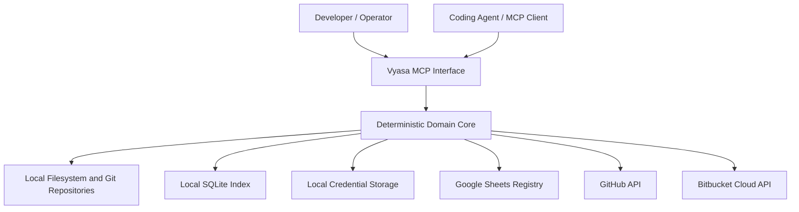

# Security and Privacy — Vyasa (व्यास)

**Path:** `docs/architecture/security-and-privacy.md`  
**Status:** Draft for architectural review  
**Applies to:** Phase 1 — Local MCP; Phase 2 — Google Sheets registry; Phase 3 — Remote repository discovery  
**Last updated:** 2026-10-26

---

## 1. Purpose

This document defines the security and privacy requirements for Vyasa, a local-first workspace intelligence system that discovers software projects, extracts deterministic metadata, indexes evidence, and exposes project knowledge to coding agents through MCP.

Vyasa may inspect repositories containing proprietary source code, internal architecture documents, local filesystem paths, dependency information, Git history metadata, and references to credentials or other sensitive information. Phase 2 introduces a shared Google Sheets registry, while Phase 3 introduces authenticated access to GitHub and Bitbucket Cloud APIs.

Security and privacy must therefore be architectural requirements from the beginning, not features added after implementation.

### 1.1 Security objectives

1. Protect source repositories from unintended modification.
2. Keep source code and detailed local metadata on the user's machine by default.
3. Prevent credentials, secrets, and sensitive local information from entering shared registries or logs.
4. Restrict filesystem, network, and provider access to explicitly configured boundaries.
5. Treat repository content and remote API responses as untrusted data.
6. Ensure coding agents receive only the information requested and permitted by the MCP interface.
7. Preserve integrity during indexing, synchronization, recovery, and partial failure.
8. Make security-sensitive operations explicit and observable.

### 1.2 Guiding principle

**Vyasa discovers and shares approved project knowledge; it does not become an unrestricted reader, writer, or distributor of everything in a workspace.**

---

## 2. Scope and security posture

### 2.1 In scope

- Workspace and repository discovery.
- Filesystem traversal and file inspection.
- Git metadata and remote URL inspection.
- Deterministic metadata extraction and evidence storage.
- Local SQLite storage, logs, temporary files, and backups.
- MCP server startup, tool execution, input validation, and responses.
- Optional project-profile draft generation.
- Google Sheets authentication, export, import, and synchronization.
- GitHub and Bitbucket Cloud authentication and API access.
- Dependency and relationship discovery.
- Error handling, recovery, data retention, and deletion.
- Security testing and operational guidance.

### 2.2 Out of scope

Unless introduced by a separately approved requirement, Vyasa will not:

- Execute repository scripts, build commands, hooks, or arbitrary project code during scanning.
- Install or run project dependencies to discover metadata.
- Upload source files or repository contents wholesale.
- Send repository content to an LLM or other external analysis service.
- Automatically modify canonical project documentation.
- Automatically delete, archive, or modify repositories.
- Act as a general-purpose filesystem MCP server.
- Provide a remote public-facing MCP endpoint.
- Claim regulatory compliance solely because these controls are implemented.

### 2.3 Default posture

| Area | Default |
|---|---|
| Repository access | Read-only |
| Filesystem scope | Explicitly configured roots |
| Network access | Disabled for Phase 1 query and scan operations unless needed by a separately enabled capability |
| Local index | Machine-local SQLite |
| Source code retention | Not copied into the index |
| Shared registry | Explicit synchronization only |
| Remote discovery | Explicitly configured and invoked |
| Credentials | Local secure storage; never in the shared registry |
| Missing metadata | Reported as unknown or not detected |
| Security failure | Fail closed for sensitive actions; preserve usable local functionality where safe |

---

## 3. Threat model

Vyasa is primarily a local developer tool, but it operates across multiple trust boundaries. A local process should not be assumed harmless simply because it runs on the developer's machine.

### 3.1 Assets to protect

| Asset | Security concern |
|---|---|
| Source repositories | Unauthorized reading, modification, or accidental execution |
| Project documentation | Disclosure of proprietary architecture or internal plans |
| Local paths and workspace layout | Disclosure of usernames, machine structure, and internal organization |
| SQLite index | Unauthorized access, tampering, or stale/conflicting information |
| Evidence records | Leakage of file contents, sensitive paths, or internal implementation details |
| Google credentials | Unauthorized access to the shared registry or other Google resources |
| GitHub and Bitbucket tokens | Unauthorized repository or account access |
| Shared registry | Disclosure or corruption of cross-project metadata |
| MCP responses | Excessive disclosure to a connected coding agent |
| Logs and backups | Persistent copies of sensitive information |
| Project identity and relationships | Incorrectly grouping unrelated repositories or exposing private associations |

### 3.2 Threat actors and failure sources

The design must consider:

- Accidental misuse by a developer or coding agent.
- A malicious or compromised repository containing crafted files, symlinks, or misleading metadata.
- A compromised or over-permissioned MCP client.
- A malicious remote repository or unexpected API response.
- Leaked, expired, or over-scoped provider credentials.
- Incorrect Google Sheets permissions or accidental sharing.
- Bugs in path handling, identity resolution, serialization, or synchronization.
- Local malware or another process running with the same operating-system privileges.
- A machine backup, log archive, or shared folder exposing information unexpectedly.

### 3.3 Trust boundaries

The diagram represents logical boundaries, not permission to access every connected resource. Each connection must be gated by the relevant phase, configuration, capability, and access policy.

### 3.4 Threat-model limitation

Vyasa cannot protect a user's repositories or credentials from an attacker who already has unrestricted control of the user's operating-system account. It should nevertheless avoid creating unnecessary access paths, leaking information into logs or shared services, or making such compromise easier.

---

## 4. Data classification and minimization

Vyasa must classify information before storing, returning, or synchronizing it.

### 4.1 Proposed classifications

| Classification | Examples | Handling |
|---|---|---|
| Public | Public repository URL, public project name | May be shared when required |
| Internal project metadata | Project purpose, technologies, documentation status | Local by default; approved fields may be synchronized |
| Sensitive operational metadata | Local paths, internal repository URLs, private project relationships | Local by default; explicit review before sharing |
| Secret | API tokens, OAuth refresh tokens, private keys, passwords | Never indexed as values, logged, or exported |
| Potentially sensitive repository content | Configuration files, internal documents, source code | Inspect only when needed; do not retain raw contents by default |

These categories are a proposed baseline. Organizations may need stricter classification rules.

### 4.2 Data minimization rules

**SEC-001.** Collect only metadata required by an approved detector or operation.

**SEC-002.** Do not copy source files, README contents, configuration contents, or other document bodies into SQLite merely to make them searchable.

**SEC-003.** Where file inspection is needed, process the relevant content in memory and persist only approved extracted values and evidence references.

**SEC-004.** Do not index file contents for general-purpose full-text search unless a separate requirement explicitly authorizes it.

**SEC-005.** Never persist raw credential values, authentication headers, OAuth tokens, private keys, or passwords in observations, evidence, scan results, or errors.

**SEC-006.** Avoid collecting Git commit messages, authors, email addresses, complete directory listings, and other incidental metadata unless a defined capability requires them.

**SEC-007.** Use repository-relative paths for evidence wherever possible. Absolute local paths remain machine-local and must not be exported.

**SEC-008.** Shared exports must use an explicit field allowlist. A field is not exportable merely because it exists in the database.

**SEC-009.** Unknown fields must not be exported automatically. A new field requires a classification and ownership decision before synchronization.

**SEC-010.** If a detector encounters a likely secret, it must not store the secret as evidence. It may report a generic finding such as `sensitive_value_detected`, provided the detection is reliable and useful.

### 4.3 Evidence minimization

Evidence should explain *why* a metadata value was reported without reproducing the underlying file.

An evidence record may contain:

- Repository-relative file path.
- Metadata field or detector identifier.
- Line range, where appropriate and safe.
- File fingerprint or relevant revision identifier.
- Observation timestamp.
- Detector version and result status.

It should not contain the complete matching line by default. A line from a configuration file can contain a password or token even when the filename itself appears harmless.

---

## 5. Filesystem and repository security

### 5.1 Workspace boundaries

Vyasa must operate only within explicitly configured workspace roots and approved remote scopes.

**SEC-011.** Canonicalize and validate filesystem paths before use.

**SEC-012.** Reject or safely skip paths that escape configured roots through traversal components, symlinks, junctions, or equivalent filesystem mechanisms.

**SEC-013.** Define and test symlink behaviour explicitly. The initial safe default is not to follow directory symlinks during recursive scanning.

**SEC-014.** Apply exclusions before expensive inspection. Exclude version-control internals, build output, dependency directories, caches, virtual environments, and configured sensitive locations unless a specific detector requires them.

**SEC-015.** Enforce configurable limits for file size, traversal depth, file count, and scan duration.

**SEC-016.** Do not follow arbitrary paths discovered inside repository content as permission to read outside the configured roots.

**SEC-017.** Revalidate paths at the point of access rather than relying exclusively on an earlier discovery result.

**SEC-018.** Handle filesystem errors without expanding the scan to broader locations.

### 5.2 Read-only operation

- Do not edit, rename, delete, move, or reformat repository files.
- Do not modify Git configuration, branches, commits, remotes, hooks, or working-tree state.
- Do not run repository-provided scripts or execute project code.
- Do not initialize repositories or change their configuration.
- Do not write scanner output into a repository except through a separately approved, explicit operation.

### 5.3 Draft profile generation

If draft generation is implemented, it must be a separate, opt-in capability.

- Use the designated draft location, proposed as `.vyasa/project-profile.draft.yaml`.
- Do not overwrite an existing draft without explicit approval.
- Do not modify the canonical profile.
- Do not automatically promote a draft to authoritative metadata.
- Ensure the draft path is covered by the repository's ignore policy where appropriate.
- Explain that `.gitignore` prevents normal Git tracking but does not provide confidentiality or guarantee that the file cannot be committed.
- Avoid putting secrets or raw sensitive content into generated drafts.
- Report the intended write operation before execution and restrict it to the exact approved path.

The standard scanner and MCP query tools remain read-only with respect to repository content.

---

## 6. Local database and machine security

### 6.1 Storage location and permissions

SQLite must be stored in a dedicated application-data directory, not inside a scanned repository by default.

**SEC-019.** Restrict database, configuration, log, temporary-file, and backup permissions to the current user wherever the operating system supports it.

**SEC-020.** Do not store credentials in the SQLite database.

**SEC-021.** Do not expose the database through a network share or remote database service by default.

**SEC-022.** Apply the same privacy classification to database backups and exported diagnostics as to the underlying data.

**SEC-023.** Use parameterized SQL and validate all user-supplied filters and sort fields. Never construct SQL statements from untrusted identifiers or query text without validation.

**SEC-024.** Use transactions and integrity constraints to prevent partially applied index updates from appearing as complete results.

**SEC-025.** Ensure database migrations and recovery operations cannot silently drop project data.

### 6.2 Encryption at rest

SQLite encryption is not assumed to be enabled by default. The initial deployment should rely on appropriately secured OS account permissions and, where available, operating-system or disk encryption.

A decision is required on whether application-level database encryption is necessary for the expected threat model. If introduced, use a maintained, reviewed implementation with a secure key-storage strategy. Do not design a custom encryption scheme.

Encryption at rest does not protect data from a process that can access both the database and its decryption key.

### 6.3 Retention and deletion

- Retain only observations, evidence, and history needed for the documented product functions.
- Define configurable retention for scan history, stale observations, and operational logs.
- Remove obsolete index records when a project is deliberately removed from the index, subject to the chosen retention policy.
- Ensure deletion or cleanup does not affect repository-owned files.
- Explain that deleting an index record does not delete the source repository or remove previously synchronized copies from Google Sheets.
- Provide an explicit process for removing shared registry entries and local caches when a project is retired.

---

## 7. MCP security

MCP connects Vyasa to coding agents that may have broader access to repositories, terminals, and other tools. The MCP boundary must therefore be treated as a security boundary.

### 7.1 Local transport and client trust

The proposed initial transport is **stdio**, with Vyasa launched as a local child process by the MCP client.

**SEC-026.** Do not expose an HTTP listener or remote MCP endpoint by default.

**SEC-027.** Document the trusted-client configuration required to launch Vyasa.

**SEC-028.** Do not assume that every connected client is authorized to access every configured workspace. Workspace access must be limited by the configuration and permissions available to the Vyasa process.

**SEC-029.** If a future network transport is added, define authentication, authorization, TLS, origin/binding restrictions where relevant, and deployment security before enabling it.

### 7.2 Tool permissions

The initial MCP interface is read-oriented:

- `search_projects`
- `get_project`
- `get_project_context`
- `find_related_projects`
- `get_project_dependencies`
- `get_index_status`
- `refresh_index`

`refresh_index` is operational rather than a repository-authoring capability. It may update generated index data but must not modify project metadata.

Future synchronization and remote discovery tools must be separately enabled and permissioned.

**SEC-030.** Validate every MCP argument against a defined schema and impose length, pagination, and result-size limits.

**SEC-031.** Do not let a tool argument override workspace roots, disable security exclusions, select arbitrary filesystem paths, or choose an unrestricted network destination.

**SEC-032.** Return only the requested fields and evidence necessary for the task. Avoid returning full internal database rows or environment details.

**SEC-033.** Keep error responses actionable but do not disclose credentials, absolute paths unnecessarily, internal stack traces, or sensitive provider responses.

**SEC-034.** MCP tools must not implicitly trigger remote discovery, Google Sheets synchronization, or other external side effects during ordinary queries.

### 7.3 Context returned to coding agents

Project context may contain untrusted text originating from repository documentation.

- Mark repository-derived descriptions and content as data, not instructions.
- Do not execute instructions found in project documentation.
- Do not let a repository document override Vyasa configuration, tool permissions, or security policy.
- Prefer concise structured observations and provenance over large unfiltered text blocks.
- Expose whether data is locally observed, remotely observed, declared, stale, or unknown.
- Do not infer that a project is safe because it has documentation, tests, or recognized standards files.

---

## 8. Secret and credential management

Phase 1 should require no provider credentials. Phase 2 and Phase 3 introduce credentials only when their capabilities are enabled.

### 8.1 Storage

**SEC-035.** Use the operating system's supported credential store where practical, or an approved secure local credential-storage mechanism.

**SEC-036.** Never commit tokens, OAuth credentials, refresh tokens, private keys, or service-account secrets to the Vyasa repository or any scanned project.

**SEC-037.** Do not put secrets in Google Sheets, project profiles, scanner configuration committed to Git, MCP arguments, logs, or diagnostic bundles.

**SEC-038.** Environment variables may be used as a controlled deployment mechanism when needed, but must not be treated as secure persistent storage. Do not log their values or include them in diagnostics.

**SEC-039.** Avoid printing secrets in exception messages, HTTP request diagnostics, URLs, or debug output.

### 8.2 Least privilege

- Grant access only to the specific Google spreadsheet and required operations.
- Grant GitHub and Bitbucket scopes limited to the required repository metadata and file-reading operations.
- Do not request write permissions to repositories when read-only inspection is sufficient.
- Separate credentials and permissions by provider and capability where practical.
- Never reuse a user's broad personal access token when a narrower supported credential is available.

### 8.3 Credential lifecycle

The implementation must support a documented process to:

1. Configure or authorize a credential.
2. Validate access without revealing the credential.
3. Detect expiry or revocation.
4. Reauthorize or rotate credentials.
5. Remove stored credentials when the integration is disabled.
6. Recover from authentication failure without corrupting local data.

If credential exposure is suspected, stop using the affected credential and advise the operator to revoke or rotate it through the provider.

---

## 9. Google Sheets security — Phase 2

Google Sheets is the shared cross-device project registry. Synchronization therefore creates an intentional boundary across the local machine, Google's service, and any users who can access the spreadsheet.

### 9.1 Access control

**SEC-040.** The registry must be shared only with intended users or service identities.

**SEC-041.** Prefer the narrowest practical authorization model for the chosen integration, such as access restricted to a designated spreadsheet.

**SEC-042.** Never make the registry public merely to simplify integration.

**SEC-043.** Document who can read and edit each shared registry and how access is revoked.

### 9.2 Export allowlist

The following information is generally suitable for consideration for synchronization, subject to owner approval and classification:

- Stable project ID.
- Project name and approved description.
- Approved repository URL.
- Languages and technologies.
- Lifecycle and tracking status.
- Documentation and standards detection results.
- Last-scanned timestamp.
- Approved portfolio notes and priorities.

The following must remain local unless a separately reviewed requirement explicitly permits an exception:

- Local repository paths and workspace roots.
- Local usernames and machine identifiers.
- SQLite database locations and internal database contents.
- Credentials, tokens, private keys, and authentication headers.
- Raw source files and document contents.
- Local cache state, temporary files, and detailed environment information.
- Local-only evidence that may expose sensitive paths or content.

Private repository URLs and internal project names can themselves be sensitive. Their presence on the proposed export list is not automatic authorization to share them.

### 9.3 Synchronization integrity

- Synchronization must be explicit and report its intended direction and scope.
- Support dry-run or preview behaviour before applying potentially destructive changes.
- Validate values read from the spreadsheet as untrusted external input.
- Never interpret spreadsheet cells as executable code, file paths, shell commands, or instructions.
- Preserve human-managed fields according to the field-ownership rules.
- Detect conflicts instead of silently overwriting human-owned values.
- Treat missing rows, API failures, and incomplete pagination as distinct from confirmed deletion.
- Keep local indexing usable if synchronization fails.
- Do not report synchronization as successful unless the relevant writes and verification steps have succeeded.

### 9.4 Google-side exposure

The shared registry may be visible to spreadsheet collaborators, administrators, or other parties according to the Google account and sharing configuration. Vyasa cannot guarantee confidentiality beyond the permissions and controls of the external service.

Users must review the spreadsheet's sharing settings and organizational policies before synchronizing internal project metadata.

---

## 10. Remote repository security — Phase 3

Remote discovery uses provider APIs without cloning repositories or checking out files.

### 10.1 Scope restriction

**SEC-044.** Require explicit configuration of GitHub users/organizations and Bitbucket workspaces to inspect.

**SEC-045.** Do not enumerate unrelated accounts or organizations using credentials merely because those credentials technically permit it.

**SEC-046.** Apply inclusion and exclusion rules before inspecting repository contents.

**SEC-047.** Do not follow arbitrary URLs found in repository metadata as trusted destinations.

### 10.2 API and content handling

- Use official provider APIs over authenticated HTTPS where authentication is required.
- Validate TLS certificates through standard client-library behaviour.
- Set request timeouts, pagination limits, response-size limits, and bounded retries.
- Handle rate limits without aggressive repeated requests.
- Validate response schemas and treat unexpected values as untrusted.
- Do not execute downloaded content.
- Inspect only selected files required by approved deterministic detectors.
- Do not fall back to cloning or downloading an entire repository when API inspection fails.
- Do not retain raw file contents by default.
- Record the remote revision or equivalent provenance where the provider supports it.

### 10.3 Access failures and visibility

A repository not returned by an API does not necessarily mean it has been deleted. It may be private, inaccessible, excluded by scope, hidden by permissions, or omitted because discovery was incomplete.

Vyasa must distinguish:

- Confirmed visible.
- Confirmed archived, where the provider reports it.
- Inaccessible due to authorization.
- Discovery scope incomplete.
- Provider request failed.
- Not found within a completed, appropriately scoped query.
- Deletion confirmed by reliable provider evidence, where available.

Never mark a repository obsolete or deleted solely because an API request failed.

### 10.4 Remote-only repositories

A remote repository may be indexed even when it is not cloned on the current device. Its remote metadata must not be presented as evidence that a local checkout exists or that the full source tree has been inspected.

---

## 11. Logging, diagnostics, and auditability

Logs are a potential data-leakage channel and must follow the same minimization principles as the index.

### 11.1 Safe logging

Log operational facts such as:

- Scan or synchronization run ID.
- Operation type and duration.
- Number of projects processed.
- Outcome and failure category.
- Provider name and relevant HTTP status category.
- Detector identifier and version.
- Retry count and rate-limit state.

Do not log:

- Access tokens, refresh tokens, passwords, private keys, or authorization headers.
- Complete configuration files or repository documents.
- Raw file contents or matched secret values.
- Full environment-variable dumps.
- Full provider responses when they may contain sensitive information.
- Unnecessary absolute filesystem paths or user-identifying details.

### 11.2 Error handling

- Sanitize exception messages before logging or returning them.
- Keep detailed local diagnostics separate from MCP responses.
- Avoid leaking SQL statements, authentication details, or stack traces to clients.
- Use stable error categories so callers can respond without parsing sensitive free-text messages.
- Ensure failure reporting does not itself trigger a broader scan or additional network request.

### 11.3 Audit trail

Record the occurrence and outcome of security-relevant operations, including:

- Remote discovery.
- Shared-registry synchronization.
- Credential validation failures.
- Configuration changes that alter scope or permissions.
- Explicit project removal or cleanup.
- Security-sensitive write operations, if draft generation is implemented.

The audit trail should record what happened, not copy the secret or sensitive payload involved.

---

## 12. Configuration and secure defaults

Security-sensitive settings must be explicit, documented, and validated.

Examples include:

- Workspace roots.
- Exclusion patterns.
- Symlink policy.
- Maximum file size and scan limits.
- Enabled provider integrations.
- Google spreadsheet identity.
- GitHub organization/user scopes.
- Bitbucket workspace scopes.
- Export allowlist version.
- Log verbosity and retention.
- Whether optional draft generation is enabled.

**SEC-048.** An absent or malformed security setting must not silently broaden access.

**SEC-049.** Configuration changes must be validated before becoming active.

**SEC-050.** Diagnostics must not print secret values or dump the complete configuration indiscriminately.

**SEC-051.** Phase 2 and Phase 3 integrations must be disabled until explicitly configured and authorized.

**SEC-052.** A provider integration failure must not silently trigger an alternative access mechanism with broader permissions.

---

## 13. Security testing and verification

Security requirements must be covered by automated tests where practical, supplemented by manual review.

### 13.1 Filesystem tests

- Paths attempting to escape configured roots.
- Symlink and junction traversal.
- Oversized files and excessive directory depth.
- Unreadable files and interrupted scans.
- Files changing during scanning.
- Malformed Git metadata and remote URLs.
- Repositories containing secret-like values in documentation or configuration files.
- Proof that ordinary scans do not modify repository contents.

### 13.2 MCP tests

- Invalid argument types and oversized requests.
- Path injection and attempts to override configured roots.
- Attempts to request unsupported tools or fields.
- Excessive result sets and pagination boundary cases.
- Verification that query tools do not trigger external synchronization.
- Error-response checks for secret and path leakage.
- Verification that repository content is returned as data, not executed.

### 13.3 Storage and privacy tests

- Database permissions and default storage location.
- Absence of credentials in the database and logs.
- Export allowlist enforcement.
- No raw document bodies stored by default.
- Correct deletion and retention behaviour.
- Migration and recovery integrity.
- Stale and inaccessible data clearly identified.

### 13.4 Integration tests

- Google authentication and spreadsheet permission failures.
- Attempts to share or write outside the authorized registry.
- Conflicting human-managed values.
- Partial synchronization and retry behaviour.
- Provider pagination and rate limiting.
- Remote repository access denied by scope.
- Credential expiry and revocation.
- Malicious or malformed API responses.
- Failure without unintended cloning, writes, or data export.

### 13.5 Release gate

A release must not be considered security-ready if any of the following remain unresolved:

- Secrets can enter logs, shared exports, or persistent observations.
- Configured filesystem boundaries can be bypassed.
- Ordinary scan or query operations modify repositories.
- Failed synchronization can silently overwrite human-managed data.
- External integrations are enabled without explicit configuration.
- Security-sensitive operations have no clear outcome or failure report.

---

## 14. Security incident response

Vyasa should provide clear operator guidance for suspected exposure or unauthorized activity.

### 14.1 Suspected credential leak

1. Disable the affected integration or stop the relevant operation.
2. Revoke or rotate the affected credential through its provider.
3. Inspect local logs and the shared registry for accidental disclosure.
4. Remove exposed values from locations under the operator's control.
5. Review repository history if a credential was committed; deleting the latest file alone does not remove historical exposure.
6. Reauthorize using least-privilege credentials.
7. Record the incident and corrective action without reproducing the secret.

### 14.2 Suspected data leakage

1. Identify which data was exposed, to whom, and through which boundary.
2. Disable the affected export, endpoint, or integration.
3. Revoke unintended access to the shared registry where appropriate.
4. Remove or correct exposed records and local artifacts where possible.
5. Determine whether backups, logs, or repository history contain additional copies.
6. Review the cause and add a regression test.

Vyasa cannot guarantee deletion of copies already downloaded or retained by third parties. Incident guidance must state this limitation.

---

## 15. Security requirements summary

| ID range | Area | Required outcome |
|---|---|---|
| SEC-001–010 | Data minimization | Collect and share only approved, necessary metadata |
| SEC-011–018 | Filesystem | Respect configured boundaries and avoid unsafe traversal |
| SEC-019–025 | Local storage | Protect the index, credentials, queries, and data integrity |
| SEC-026–034 | MCP | Limit client exposure, validate requests, and prevent implicit side effects |
| SEC-035–039 | Credentials | Store and manage credentials securely |
| SEC-040–043 | Google Sheets | Restrict access and synchronize safely |
| SEC-044–047 | Remote repositories | Restrict discovery scope and handle remote evidence honestly |
| SEC-048–052 | Configuration | Fail safely and require explicit integration enablement |

These requirements are proposed acceptance criteria. They should be mapped to implementation tests and reviewed alongside the functional and non-functional requirements before the first release.

---

## 16. Open decisions

| ID | Decision | Proposed direction |
|---|---|---|
| SP-001 | Should local SQLite use application-level encryption? | Start with OS permissions and disk encryption; reassess threat model |
| SP-002 | Which OS credential stores must be supported? | Prefer native secure credential storage where available |
| SP-003 | What are the default scan limits? | Establish conservative configurable limits and benchmark |
| SP-004 | Which symlink behaviours are supported? | Do not follow directory symlinks by default |
| SP-005 | What is the retention period for scan history and logs? | Define explicit configurable defaults |
| SP-006 | Which fields are approved for Sheets export? | Maintain a versioned explicit allowlist |
| SP-007 | Which Google authentication mechanism is selected? | Choose the least-privilege approach supported by the deployment |
| SP-008 | Which GitHub and Bitbucket scopes are required? | Read-only and limited to configured repository scopes |
| SP-009 | Is a future network-based MCP transport required? | No for the initial release |
| SP-010 | Is draft profile generation enabled by default? | No; opt-in only |
| SP-011 | Should likely secret detection be included in Phase 1? | Consider lightweight detection that never persists matched values |
| SP-012 | How are sensitive internal repository URLs classified? | Local by default; explicit approval for shared export |
| SP-013 | Is a formal threat-model review required before Phase 2 and Phase 3? | Yes, before enabling each new external trust boundary |

---

## 17. Implementation sequence

### Phase 1 — Local security foundation

- Implement filesystem boundary checks and exclusions.
- Keep scanning deterministic and read-only.
- Define metadata and evidence sensitivity rules.
- Secure the local database, configuration, logs, and backups.
- Validate MCP schemas and constrain tool capabilities.
- Add security regression tests.
- Verify that no external service is contacted during ordinary local queries.

### Phase 2 — Shared registry security

- Finalize export classifications and field ownership.
- Choose the authentication model and minimum required permissions.
- Implement explicit sync, dry-run, conflict handling, and failure reporting.
- Validate all spreadsheet data as untrusted input.
- Test permissions, partial failure, credential expiry, and data leakage.

### Phase 3 — Remote API security

- Define repository scopes and provider permissions.
- Implement secure credential handling and bounded API clients.
- Enforce pagination, size, timeout, and rate limits.
- Preserve provenance and distinguish inaccessible repositories from deleted ones.
- Test malformed responses, access denial, incomplete discovery, and credential revocation.

---

## 18. References

These references inform the proposed security principles; they do not replace a project-specific threat model or security review.

- [OWASP Developer Guide — Protect Data Everywhere](https://devguide.owasp.org/en/04-design/02-web-app-checklist/08-protect-data/)
- [OWASP — Secure by Design Framework](https://owasp.org/projects/secure-by-design-framework)
- [OWASP — Cryptographic Storage Cheat Sheet](https://cheatsheetseries.owasp.org/cheatsheets/Cryptographic_Storage_Cheat_Sheet.html)
- [OWASP — Secrets Management Cheat Sheet](https://cheatsheetseries.owasp.org/cheatsheets/Secrets_Management_Cheat_Sheet.html)
- [Microsoft Learn — Best practices for protecting secrets](https://learn.microsoft.com/en-us/azure/security/fundamentals/secrets-best-practices)

---

## Final design rule

Vyasa should be conservative about what it reads, precise about what it stores, explicit about what it shares, and honest about what it could not verify. Every new capability that crosses a filesystem, agent, cloud, or repository-provider boundary must define its permissions, data exposure, failure behaviour, and tests before implementation.
