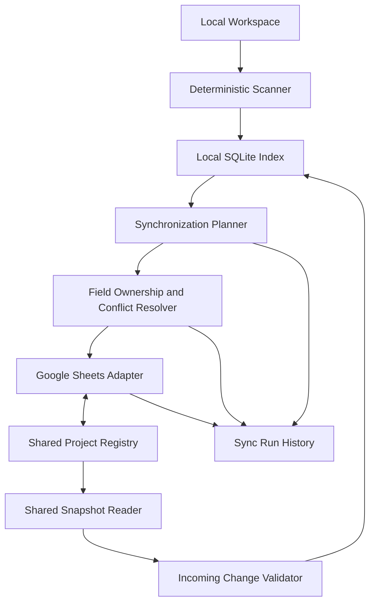
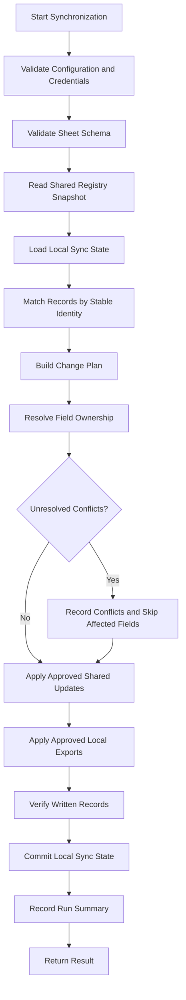

# Vyasa (व्यास) — Synchronization

**Document:** `docs/architecture/synchronization.md`  
**Product:** Vyasa — Workspace Intelligence MCP  
**Status:** Draft v0.1  
**Scope:** Phase 2 — Google Sheets shared registry and synchronization

**Related Documents**
- `docs/product/vision.md`
- `docs/product/scope-and-roadmap.md`
- `docs/requirements/functional-requirements.md`
- `docs/requirements/non-functional-requirements.md`
- `docs/requirements/data-ownership.md`
- `docs/architecture/system-architecture.md`
- `docs/architecture/data-model.md`
- `docs/architecture/scanning-and-evidence.md`
- `docs/architecture/mcp-interface.md`
- `docs/architecture/local-storage.md`

---

## 1. Purpose

This document defines how Vyasa synchronizes project metadata between a local SQLite index and a shared Google Sheets registry.

The synchronization system must allow multiple devices to maintain independent local workspace indexes while sharing a consistent portfolio-level view of projects.

It defines:

- The role of Google Sheets in the overall architecture.
- The shared registry structure.
- Field ownership and synchronization direction.
- Stable identity and record matching.
- Upserts, conflict detection, and deletion handling.
- Initial synchronization and incremental synchronization.
- Failure recovery, retries, and idempotency.
- Authentication, privacy, and export controls.
- Local and shared project discovery.
- Synchronization status, history, and testing.

This document covers Phase 2 only. GitHub and Bitbucket Cloud discovery remain Phase 3 capabilities.

## 2. Core Design Principles

### 2.1 Google Sheets Is the Shared Registry

Google Sheets is a shared, cross-device registry of logical projects and approved project metadata.

It is not simply an export destination or reporting dashboard.

A device that has not cloned a project must still be able to discover that project through the shared registry, subject to the available metadata.

### 2.2 SQLite Is the Local Index

Each device maintains its own SQLite database.

SQLite contains local scan observations, evidence references, checkout mappings, and query-ready project data. It may also cache approved shared-registry values.

A synchronization failure must not prevent queries against the last usable local index.

### 2.3 Ownership Is Field-Specific

There is no universal rule that local SQLite or Google Sheets always wins.

Each field has a defined owner:

- Repository-owned fields originate from the project repository.
- Scanner-generated fields originate from supported observations.
- Shared human-managed fields originate from the portfolio registry.
- Machine-local fields remain on the device.
- Derived fields are computed according to documented rules.

Synchronization must respect these ownership boundaries.

### 2.4 Idempotency

Repeating the same synchronization operation must not create duplicate projects or repeatedly overwrite unchanged values.

The system must safely retry operations after timeouts or partial failures.

### 2.5 No Silent Data Loss

Synchronization must not silently discard human edits, erase valid local observations, or delete shared records because a device no longer sees a repository.

Conflicts must be surfaced and handled according to explicit rules.

### 2.6 Privacy by Default

Only explicitly approved fields may leave the local device.

Local paths, workspace roots, database paths, credentials, and machine-specific scan state must never be exported through a generic object serializer.

---

## 3. Architecture

The synchronization service coordinates the process, but the scanner and repository-owned profile remain separate components.

The Google Sheets adapter handles spreadsheet access. It must not independently decide project identity, field ownership, or conflict resolution.

### 3.1 Responsibilities

| Component | Responsibility |
|---|---|
| Local scanner | Observe repository state using deterministic rules |
| SQLite index | Store local observations, evidence, and cached shared data |
| Synchronization planner | Determine eligible outbound and inbound changes |
| Ownership resolver | Decide which source may update each field |
| Sheets adapter | Read and write approved spreadsheet records |
| Conflict handler | Record unresolved disagreements |
| Sync history | Record attempted, completed, and failed synchronization work |

### 3.2 Separation From MCP Queries

Ordinary MCP queries must not implicitly synchronize with Google Sheets.

Synchronization should be an explicit application operation, whether initiated through a CLI, a separately enabled MCP tool, or another approved interface.

A later MCP tool may be named `sync_shared_registry`. Its inputs, write effects, and capability requirements must be documented before implementation.

---

## 4. Shared Registry Structure

The initial spreadsheet should contain three tabs.

No additional tab should be required for the first implementation unless a concrete requirement justifies it.

### 4.1 Tab 1 — `Project Registry`

One row represents one logical project.

| Field | Description | Proposed ownership |
|---|---|---|
| `Project ID` | Stable Vyasa logical project identifier | Identity system |
| `Project Name` | Human-readable project name | Repository/profile or shared edit, subject to resolution policy |
| `Domain` | Project domain or business area | Shared human-managed or explicitly declared |
| `Project Type` | Project classification | Shared human-managed or explicitly declared |
| `Git Origin` | Provider/category for the repository origin | Repository/provider observation |
| `Repository URL` | Approved repository URL | Repository/provider observation |
| `Programming Languages` | Supported languages detected or declared | Scanner-generated, with provenance |
| `Frameworks & Technologies` | Normalized technology summary | Scanner-generated, with provenance |
| `Lifecycle Status` | Portfolio lifecycle state | Ownership to be finalized |
| `Tracking Level` | Portfolio tracking classification | Shared human-managed |
| `Last Scanned` | Last successful relevant scan time | Scanner-generated |
| `Details Status` | Completeness or review state | Derived or shared, according to the final definition |

The exact allowed values for `Domain`, `Project Type`, `Lifecycle Status`, `Tracking Level`, and `Details Status` must be documented and validated.

The shared registry must not imply that a remote repository was successfully inspected merely because a repository URL is present.

### 4.2 Tab 2 — `Documentation & Standards`

One row represents the documentation and standards summary for a logical project.

| Field | Description | Proposed ownership |
|---|---|---|
| `Project ID` | Stable logical project ID | Identity system |
| `README Present` | Whether a supported inspection detected a README | Scanner-generated |
| `README Quality` | Result of an approved deterministic checklist, or not assessed | Derived assessment |
| `Documentation Present` | Whether supported documentation indicators were detected | Scanner-generated |
| `Documentation Structure` | Summary of recognized documentation structure | Scanner-generated |
| `OpenSpec Enabled` | Whether supported OpenSpec indicators were detected | Scanner-generated |
| `OpenSpec Configuration` | Configuration detection and validation summary | Scanner-generated |
| `OKF Enabled` | OKF-related status, once defined and supported | Pending definition |
| `Agent Instructions` | Summary of recognized instruction files | Scanner-generated |
| `Tests Present` | Whether supported test indicators were detected | Scanner-generated |
| `Documentation Entry Point` | Repository-relative documentation entry point, if known | Scanner-generated |

This tab must preserve the difference between absence and incomplete assessment.

For example, if the repository was inaccessible during a scan, `README Present` must not be overwritten with `false`.

**Excluded fields:** `CI/CD Present` and `Standards Review` are not part of the initial schema.

They must not be reintroduced without an explicit requirements change.

### 4.3 Tab 3 — `Scan History`

One row represents a synchronization-relevant scan or registry operation.

| Field | Description |
|---|---|
| `Run ID` | Stable identifier for the run |
| `Timestamp` | Run timestamp |
| `Scan Scope` | Scope of the operation |
| `Projects Discovered` | Number of projects discovered |
| `Projects Added/Updated` | Number of records added or updated |
| `Projects Requiring Review` | Number of records requiring human review |
| `Skipped Projects` | Number of projects skipped |
| `Errors` | Count or concise summary of errors |
| `Synchronization Result` | Outcome of synchronization |

`Scan History` is a shared summary, not a replacement for the detailed local scan history in SQLite.

The implementation must define whether a row records a scan, a synchronization, or a combined workflow. The selected meaning must remain consistent across all producers.

### 4.4 Sheet Schema Version

The spreadsheet should have a documented schema version, preferably in controlled metadata such as a designated configuration cell or developer-managed schema record.

The adapter must validate the expected tabs, headers, and version before writing.

It must not silently create a different schema or reinterpret unknown columns.

---

## 5. Field Ownership and Direction

### 5.1 Ownership Categories

The synchronization planner must classify every exported or imported field into an ownership category.

| Category | Authoritative source | Typical direction |
|---|---|---|
| Repository-owned | Canonical project profile or repository source | Repository observation to local index; approved summary to Sheets |
| Scanner-generated | Deterministic scanner | Local index to Sheets |
| Shared human-managed | Google Sheets registry | Sheets to local cache |
| Machine-local | Current device | Local only |
| Provider-owned | Git provider | Provider observation to local index; approved summary to Sheets |
| Derived | Documented deterministic rule | Recomputed from eligible source data |
| Unresolved | Conflicting or insufficient evidence | No automatic overwrite |

The final field-by-field mapping must be maintained as a versioned export/import specification.

### 5.2 Scanner-Generated Fields

Scanner-generated fields include supported observations such as:

- Detected programming languages.
- Detected technologies.
- README presence.
- Documentation indicators.
- OpenSpec detection.
- Agent instruction indicators.
- Test indicators.
- Last successful scan timestamp.

These fields may be published to Sheets only through the approved export mapping.

They must not overwrite unrelated human-managed fields.

### 5.3 Shared Human-Managed Fields

Examples include:

- Tracking level.
- Portfolio notes, if added through an approved schema change.
- Portfolio priority, if added through an approved schema change.
- Business domain, when maintained centrally.
- Project classification, when maintained centrally.

A device that pulls these fields must preserve them in its local cache without changing their ownership.

If a scanner produces a value that conflicts with a shared human-managed value, the system must apply the agreed field policy rather than automatically replacing either value.

### 5.4 Mixed-Ownership Fields

Some fields may have multiple potential sources.

For example, a project name may be declared in the canonical profile, derived from a manifest, or edited in the shared registry.

Before implementation, the ownership specification must decide whether the field is repository-owned, shared human-managed, or resolved by a specific precedence rule.

The synchronizer must not treat a mixed-ownership field as a generic last-write-wins value.

### 5.5 No Universal Last-Write-Wins

A newer timestamp does not automatically establish authority.

A later local scan may provide fresh evidence for a scanner-owned field, while a later spreadsheet edit may be authoritative for a human-managed field.

Conflict resolution must be based on ownership, not timestamp alone.

---

## 6. Stable Identity and Record Matching

### 6.1 Project ID

Every logical project must have a stable `Project ID`.

The ID is the primary key for matching shared project records across devices.

Project names, repository directory names, and local paths must not be used as the sole matching key.

### 6.2 Identity Creation

When a local project is first discovered:

1. Resolve its identity using the approved identity algorithm.
2. Check for an existing local logical project.
3. Check the shared registry for the same stable project ID.
4. If identity is unambiguous, associate the local observation with the existing project.
5. If identity is ambiguous, preserve the candidate and require review.

The exact project ID generation and reconciliation algorithm must be defined in `identity-and-resolution.md`.

### 6.3 Existing Registry Records

If the same `Project ID` already exists in Sheets, synchronization updates the approved fields for that record rather than creating a second row.

A duplicate project name with a different ID must not be automatically merged.

### 6.4 Multiple Repositories

A logical project may contain multiple repositories.

The initial registry schema has one `Repository URL` field per project, so the ownership and representation policy must define which repository is shown.

If multiple repositories need independent registry records, the spreadsheet schema will require a dedicated repositories tab or another approved representation.

The synchronizer must not silently concatenate multiple repository identities into one field and treat the result as a canonical identity.

### 6.5 Projects Without Git Remotes

A project without a remote may still be included in the shared registry if its identity is stable and the owner permits sharing.

It must not receive a fabricated repository URL.

The identity policy must define how such projects remain recognizable across devices.

---

## 7. Synchronization Modes

The application should distinguish initial synchronization from normal incremental synchronization.

### 7.1 Initial Pull

Initial pull imports eligible shared records into the local cache.

It should:

- Validate the spreadsheet schema.
- Read the relevant registry tabs.
- Validate stable IDs and required fields.
- Identify duplicate IDs or malformed rows.
- Import approved shared-owned fields.
- Record source provenance and the last successful pull.
- Preserve existing local-only information.
- Report conflicts rather than overwriting them.

Initial pull must not claim that remote or local repository files have been scanned.

### 7.2 Initial Push

Initial push publishes eligible local projects that are not yet represented in the shared registry.

Before pushing:

- Confirm project identity.
- Validate exportable fields.
- Check for existing records.
- Detect possible duplicates.
- Preserve shared human-managed values.
- Exclude machine-local fields and secrets.

If an existing shared record is found by stable ID, perform an approved upsert rather than inserting a duplicate.

### 7.3 Bidirectional Synchronization

Normal synchronization consists of two logical directions:

1. **Pull:** retrieve approved shared-owned changes.
2. **Push:** publish approved locally generated changes.

The implementation may read and plan both directions before writing either direction.

It must define the order explicitly and preserve conflict information throughout the operation.

### 7.4 Full Reconciliation

A full reconciliation compares the local and shared views and reports:

- Records present in both places.
- Local-only projects.
- Shared-only projects.
- Records with changed scanner-owned fields.
- Records with changed shared-owned fields.
- Identity conflicts.
- Duplicate candidates.
- Incomplete or inaccessible records.

A full reconciliation is not permission to delete unmatched records.

### 7.5 Read-Only Sync

A diagnostic or dry-run mode should calculate the planned changes without applying them.

It should report the proposed creates, updates, conflicts, and skipped records.

The dry-run must not mutate the shared registry or change canonical project metadata.

---

## 8. Synchronization Workflow

The diagram illustrates the logical workflow. The exact order of remote writes and local state commits must account for the fact that SQLite and Google Sheets cannot participate in one atomic distributed transaction.

### 8.1 Plan Before Write

The synchronizer should build a change plan before applying updates.

The plan identifies:

- Records to insert.
- Fields to update.
- Fields to preserve.
- Conflicts.
- Records that need human review.
- Rows that could not be validated.

This reduces unintended overwrites and makes dry-run behaviour straightforward.

### 8.2 Field-Level Changes

Where practical, updates should be applied at field level rather than replacing an entire row.

A scanner update to technologies must not clear a human-managed tracking level or overwrite a portfolio classification.

### 8.3 Local Commit

The local synchronization state should be committed only after the corresponding remote operation is known to have succeeded, or marked as pending verification when the result is ambiguous.

A timeout does not prove that Google Sheets rejected a write.

### 8.4 Partial Success

The system must record partial success when some records are synchronized and others fail.

A partial run must not be reported as fully successful.

---

## 9. Conflict Detection and Resolution

### 9.1 Conflict Definition

A conflict occurs when multiple sources provide incompatible values for a field and the ownership rules do not authorize an automatic resolution.

Not every difference is a conflict.

For example, a new scanner observation for a scanner-owned field may legitimately replace an older scanner observation when the scan completed successfully.

### 9.2 Conflict Examples

| Situation | Required behaviour |
|---|---|
| Shared tracking level changed by a human | Pull the shared value into the local cache |
| Local scan detects new technologies | Update approved scanner-owned fields in Sheets |
| Project name differs between profile and sheet | Apply the defined name ownership policy; otherwise flag |
| Local project identity is ambiguous | Do not create or merge automatically |
| Sheet row has a duplicate project ID | Stop writes affecting the ambiguous identity and report it |
| Local repository is temporarily inaccessible | Do not clear previously valid shared metadata |
| Shared field is blank | Apply its explicit empty-value policy; do not assume blank means delete |
| Spreadsheet schema is unexpected | Reject writes and report a schema error |

### 9.3 Field-Level Conflict Handling

When a conflict is limited to one field, unrelated fields may still synchronize if doing so is safe and supported by the change plan.

The synchronizer must not discard the entire project record unnecessarily, nor should it continue with an unsafe identity or schema ambiguity.

### 9.4 Conflict Records

Conflicts should be stored locally with enough detail to explain:

- Logical project and field.
- Local candidate value and source.
- Shared candidate value and source.
- Detection timestamp.
- Ownership policy applied.
- Reason automatic resolution was not allowed.
- Resolution status, if a later resolution workflow is implemented.

Sensitive values must not be copied into conflict records.

### 9.5 Manual Resolution

The initial implementation may require a human or coding agent to resolve conflicts through the project's normal metadata-maintenance workflow or the shared registry.

Vyasa must not silently modify the canonical project profile to resolve a conflict.

A dedicated conflict-resolution tool is not required for the initial phase.

---

## 10. Upsert and Idempotency Rules

### 10.1 Upsert Key

The primary matching key for project rows is `Project ID`.

The primary matching key for documentation and standards rows is also `Project ID`.

The scan history uses `Run ID` to identify an operation.

### 10.2 Upsert Behaviour

For each approved record:

1. Read and validate the existing row.
2. Match by stable ID.
3. Compare the fields owned by the current source.
4. Skip unchanged fields.
5. Update only approved fields.
6. Preserve human-managed and local-only fields.
7. Verify the resulting state where practical.
8. Record the outcome.

### 10.3 Retry Safety

If a write times out:

- Do not assume it failed.
- Read the affected record when feasible.
- Compare its values with the intended update.
- Mark it successful if the intended state is already present.
- Retry only the remaining changes.

### 10.4 Duplicate Prevention

The adapter must validate that each logical project ID appears only once in each relevant tab.

If duplicate IDs exist, the system must not select an arbitrary row and overwrite it.

The ambiguity must be reported and handled through an explicit repair process.

### 10.5 No Blind Row Replacement

The synchronizer must not clear and rewrite entire rows unless the row is exclusively owned by the synchronizer and the replacement semantics have been explicitly approved.

---

## 11. Change Detection and Sync State

### 11.1 Local State

SQLite should track the last known synchronization state separately from scanner observations.

Proposed local state includes:

- Shared spreadsheet identity.
- Sheet schema version.
- Last successful pull timestamp.
- Last successful push timestamp.
- Last attempted synchronization.
- Last known remote record fingerprint or revision, where available.
- Per-record synchronization outcome.
- Pending verification state.
- Outstanding conflicts.

### 11.2 Fingerprints

A deterministic fingerprint may be calculated over a normalized set of fields.

The fingerprint must:

- Include only fields relevant to the comparison.
- Use a documented canonical serialization.
- Exclude timestamps that change without semantic content changes.
- Exclude secrets and machine-local state.
- Change when a relevant field value changes.

A fingerprint is a change-detection aid, not a substitute for ownership validation.

### 11.3 Remote Change Detection

Google Sheets does not necessarily provide the same revision and transaction semantics as a database.

The adapter must define how it detects changes using available API responses, stored fingerprints, and read-back verification.

It must not assume that a row remains unchanged merely because its project ID is stable.

### 11.4 Pending Writes

When a remote write result is uncertain, record the pending operation and reconcile it on the next synchronization attempt.

Do not discard the intended update merely because the local process stopped before receiving confirmation.

---

## 12. Deletion and Retirement Policy

Deletion requires special handling because devices may have different workspace contents.

### 12.1 Local Project Missing

If a project is not discovered during a scan:

- Mark its local discovery or checkout status according to the approved policy.
- Preserve its logical project record.
- Preserve the shared registry record.
- Do not delete the project from Sheets.

A device may have had the repository removed, excluded, or temporarily inaccessible.

### 12.2 Shared Row Missing

If a shared row disappears:

- Record the absence during a successful registry read.
- Compare it with the previous synchronization state.
- Do not immediately recreate or delete records when the cause is ambiguous.
- Follow the explicit policy for shared-record deletion and human-managed fields.

### 12.3 Retirement

Lifecycle retirement is a separate semantic operation from physical deletion.

A project may be marked archived or retired through an approved lifecycle workflow. The system must not infer retirement solely from age, inactivity, or local absence.

### 12.4 Tombstones

If reliable deletion synchronization is required later, a tombstone or explicit retirement record may be introduced.

It must identify the entity and deletion intent without relying solely on a missing spreadsheet row.

The initial implementation should favour preservation and review over automatic deletion.

---

## 13. Authentication and Google API Access

### 13.1 Authentication Strategy

The implementation must choose an authentication approach appropriate for the intended user and deployment model.

Possible approaches include:

- OAuth authorization for an individual Google account.
- A service account for a deliberately shared, organization-managed registry.

The choice must be made before implementation because the required setup, ownership model, and access permissions differ.

### 13.2 Least Privilege

Credentials must have only the access required for the selected spreadsheet and operations.

If the application writes to the registry, the credential must support those writes. A read-only credential must not be treated as sufficient for bidirectional synchronization.

### 13.3 Credential Storage

Credentials must be stored outside the project repository and outside Google Sheets.

Use approved local configuration or operating-system secret storage where available.

Do not:

- Commit tokens or client secrets.
- Include credentials in debug logs.
- Persist tokens as project metadata.
- Export authentication state to shared registry tabs.

### 13.4 Spreadsheet Selection

The spreadsheet ID must be explicitly configured or securely selected during setup.

The adapter must not discover and modify arbitrary spreadsheets simply because the account can access them.

### 13.5 Access Failure

Authentication or authorization failure must be reported clearly.

The system should preserve the local index and provide actionable setup guidance without exposing secret values.

---

## 14. API Limits, Retries, and Resilience

### 14.1 Batching

The adapter should batch reads and writes where supported and safe.

Batching must not undermine field-level ownership or make partial failures impossible to identify.

### 14.2 Retryable Errors

Potentially retryable errors include transient network failures, rate limiting, and temporary provider errors.

Retries should use bounded exponential backoff with jitter where appropriate.

### 14.3 Non-Retryable Errors

Invalid credentials, missing permissions, invalid schema, and malformed records generally require configuration or data correction rather than endless retries.

The adapter must distinguish retryable from non-retryable failures.

### 14.4 Rate Limiting

The implementation must respect provider quotas and avoid repeated full-sheet reads when a smaller operation is sufficient.

It should report when a synchronization run was limited by API quota.

### 14.5 Partial Failures

If some records synchronize and others fail:

- Preserve confirmed successful writes.
- Record failed records and fields.
- Keep unresolved changes pending.
- Return a partial result.
- Retry only work that remains outstanding when safe.

### 14.6 Local Independence

No synchronization failure may corrupt or disable local project queries.

The application must remain useful offline using the last available local index.

---

## 15. Cross-Device Behaviour

### 15.1 Device A Discovers a Project

1. Device A scans a local repository.
2. Vyasa extracts supported metadata.
3. The local index stores observations and evidence.
4. The synchronization planner exports approved fields.
5. The shared registry records the project and summary.

### 15.2 Device B Has Not Cloned the Project

1. Device B pulls the shared registry.
2. The logical project appears in its local index.
3. The project is identified as shared-known.
4. Its local checkout status indicates that a local checkout has not been established, if this was verified.
5. The agent can query the project summary and decide whether to access the repository separately.

Device B must not claim to have inspected the project's local files.

### 15.3 Device B Later Clones the Project

1. The scanner discovers the local repository.
2. Identity resolution attempts to match it to the existing logical project.
3. If identity is unambiguous, the local checkout is associated with the existing project.
4. Fresh observations are generated.
5. Approved scanner-owned fields are synchronized.
6. Shared human-managed fields remain intact.

### 15.4 Concurrent Updates

If two devices update different scanner-owned fields or observations, the system should merge the approved field changes where safe.

If they attempt to change the same shared human-managed field, the configured ownership and conflict policy determines the result.

The system must not assume a global, atomic ordering of all operations across devices.

---

## 16. Synchronization Results and History

### 16.1 Run Status

Recommended statuses:

- `running`
- `completed`
- `partial`
- `failed`
- `cancelled`

### 16.2 Result Counters

A run summary should include:

- Records read.
- Records created.
- Records updated.
- Records unchanged.
- Fields skipped due to ownership.
- Conflicts detected.
- Records requiring review.
- Records skipped.
- Errors.
- Pending verification operations.

The exact counters must be defined consistently between local history and the shared `Scan History` tab.

### 16.3 Local History

SQLite should retain detailed synchronization runs and item-level results.

Google Sheets should contain only the approved aggregate history summary.

### 16.4 Honest Completion

A run is `completed` only when all required operations for its declared scope have succeeded or were safely determined to require no change.

If some required operations remain unresolved or failed, the result must be `partial` or `failed`, according to the defined run policy.

---

## 17. Synchronization and MCP Interface

### 17.1 Query Behaviour

The existing MCP query tools should read from the local index and expose source provenance.

A shared-only project may be returned even when no local checkout exists.

### 17.2 Explicit Synchronization

If synchronization is exposed through MCP, the proposed tool is:

`sync_shared_registry`

Its contract should include:

- Direction: pull, push, or bidirectional.
- Scope: all eligible records or a supported subset.
- Dry-run option.
- Run status and summary.
- Conflicts and pending work.
- Whether writes were performed.

The final input schema must prevent ambiguous combinations and require explicit authorization for writes.

### 17.3 Capability Controls

The sync tool must be unavailable when the integration is not configured or the user has not enabled it.

A read-only deployment must not silently gain write access because credentials happen to be present.

### 17.4 Query Consistency

The MCP interface must distinguish:

- Last local scan.
- Last successful pull.
- Last successful push.
- Last synchronization attempt.
- Current known conflicts.

A successful pull does not prove that local repository observations are fresh.

---

## 18. Observability and Diagnostics

Logs and structured results should identify:

- Sync run ID.
- Direction and scope.
- Spreadsheet identity, represented safely.
- Schema validation outcome.
- Counts of reads, writes, skips, and conflicts.
- Retry attempts.
- API failure category.
- Verification outcome.
- Completion status.

They must not include tokens, secret configuration, or full raw project records unnecessarily.

Diagnostics should make it possible to determine whether a problem occurred during authentication, schema validation, matching, conflict resolution, API writing, verification, or local persistence.

---

## 19. Testing Strategy

### 19.1 Unit Tests

Test:

- Field ownership decisions.
- Export allowlist enforcement.
- Canonical field normalization.
- Fingerprint stability.
- Conflict classification.
- Stable ID matching.
- Retry classification.
- Empty-value handling.

### 19.2 Fake Adapter Tests

Use a fake Google Sheets adapter to simulate:

- Successful reads and writes.
- Duplicate IDs.
- Missing tabs.
- Unexpected columns.
- Permission errors.
- Timeouts.
- Rate limits.
- Partial batch failures.
- Concurrent edits.
- Ambiguous write outcomes.

These tests must not require production credentials.

### 19.3 Integration Tests

Use a dedicated test spreadsheet or isolated test environment to verify:

- Initial pull.
- Initial push.
- Bidirectional synchronization.
- Read-back verification.
- Cross-device identity matching.
- Schema validation.
- Conflict reporting.
- Recovery after interrupted synchronization.

### 19.4 Data Preservation Tests

Verify that:

- Human-managed fields survive scanner updates.
- Local-only paths never appear in exported records.
- Secrets cannot enter the export payload.
- A failed scan does not clear valid shared metadata.
- A failed sync does not corrupt SQLite.
- Duplicate project IDs do not result in arbitrary row overwrites.
- Local disappearance does not automatically delete a shared project.

### 19.5 Idempotency Tests

Running the same synchronization twice with unchanged sources should produce no duplicate projects and no unnecessary updates.

A repeated operation after an uncertain write should reconcile the actual shared state before retrying.

---

## 20. Implementation Sequence

The recommended Phase 2 order is:

1. Finalize the field ownership and export/import matrix.
2. Finalize the Google Sheets schema and version marker.
3. Choose the authentication model.
4. Implement the Google Sheets adapter behind a provider-neutral interface.
5. Add local synchronization state and migrations to SQLite.
6. Implement schema validation and registry reads.
7. Implement stable identity matching.
8. Implement dry-run change planning.
9. Implement field-level ownership and conflict detection.
10. Implement safe upserts and write verification.
11. Implement bounded retries and partial-failure recovery.
12. Implement synchronization history and status reporting.
13. Integrate explicit synchronization with the application interface.
14. Add cross-device, privacy, idempotency, and failure-recovery tests.
15. Validate against a dedicated test spreadsheet before enabling the integration for normal use.

Phase 2 is complete only when a project discovered on one device can be represented in the shared registry and safely discovered on another device without a local checkout.

---

## 21. Decisions Required Before Implementation

| ID | Decision | Recommendation |
|---|---|---|
| SY-001 | Authentication model | Choose OAuth or service account based on registry ownership |
| SY-002 | Spreadsheet ownership | Explicitly configure the shared registry |
| SY-003 | Field ownership matrix | Finalize before enabling writes |
| SY-004 | Project ID generation | Reuse the approved identity policy |
| SY-005 | Multiple repositories per project | Define representation before schema freeze |
| SY-006 | Enum values for portfolio fields | Define and validate allowed values |
| SY-007 | Empty-field semantics | Distinguish blank, unknown, not detected, and intentional clearing |
| SY-008 | Conflict resolution | Field-specific; no universal last-write-wins |
| SY-009 | Delete and retirement workflow | Preserve records by default |
| SY-010 | Write verification | Read back ambiguous or critical updates |
| SY-011 | Retry policy | Bounded backoff and safe reconciliation |
| SY-012 | Sync scheduling | Explicit/manual initially; automation can be added later |
| SY-013 | Shared scan-history semantics | Define whether rows represent scans or sync operations |
| SY-014 | Registry schema version | Controlled version marker and validation |
| SY-015 | Conflict resolution interface | Manual review initially |
| SY-016 | Sync tool enablement | Explicit configuration; disabled in strict read-only mode |

These decisions must be resolved or explicitly accepted as implementation defaults before the corresponding functionality is built.

---

## 22. Acceptance Criteria

The synchronization implementation is ready when:

1. Google Sheets acts as a shared project registry across devices.
2. The initial spreadsheet contains the three approved tabs.
3. `CI/CD Present` and `Standards Review` are excluded from the initial schema.
4. Projects are matched using stable identity rather than names or local paths.
5. Synchronization follows an explicit field ownership matrix.
6. Scanner updates preserve human-managed registry fields.
7. Local paths, database paths, credentials, and machine-specific state never enter shared exports.
8. Upserts are idempotent.
9. Duplicate identities and ambiguous writes are handled safely.
10. Conflicts are visible and do not cause silent data loss.
11. A missing local project does not automatically delete the shared record.
12. Failed or partial synchronization does not corrupt the local index.
13. Retries are bounded and safe.
14. Local scan freshness and synchronization freshness are tracked independently.
15. Shared-only projects can be queried on a device without a local checkout.
16. Authentication and permissions are validated before writes.
17. Synchronization has dry-run, integration, and recovery tests.
18. The local index remains useful when Google Sheets is unavailable.

## 23. Governing Principle

Vyasa synchronization connects independent local indexes to a shared portfolio registry without collapsing their different responsibilities.

Repositories remain the source for repository-owned information. SQLite remains the local index. Google Sheets provides shared portfolio visibility and shared human-managed metadata.

**Synchronize approved knowledge, preserve ownership, and never let a failed or ambiguous sync destroy information.**
