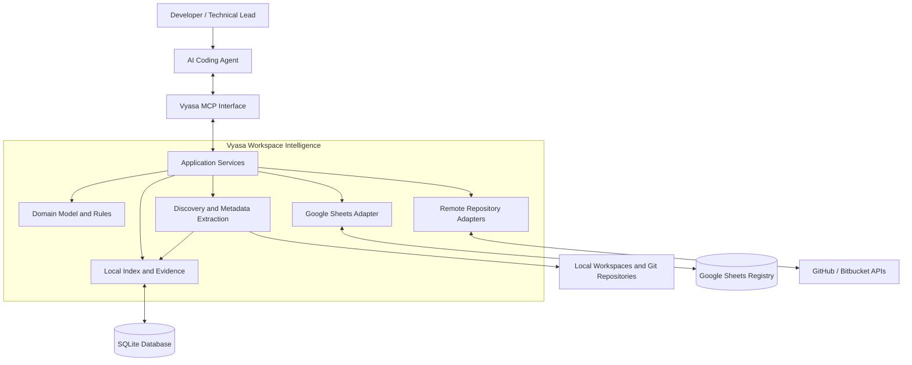
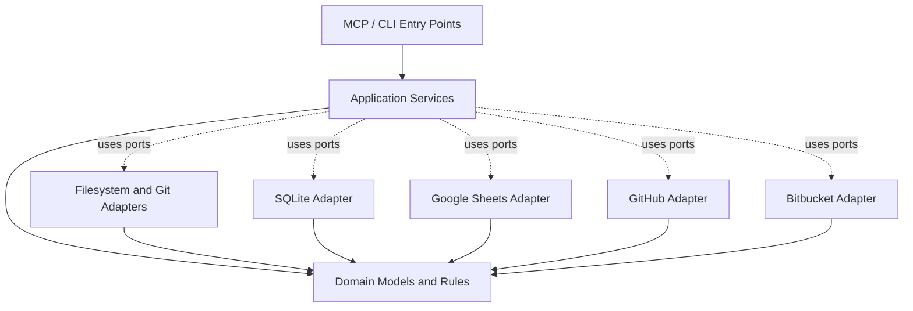
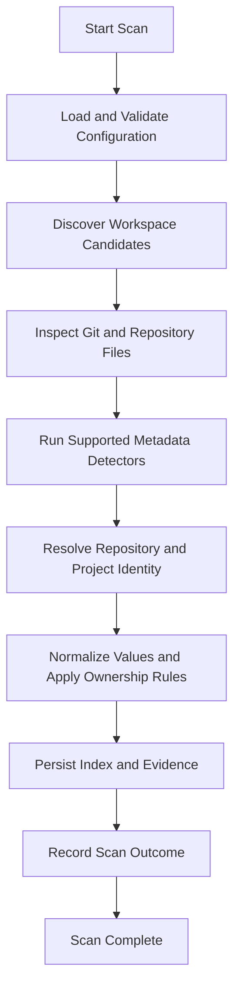
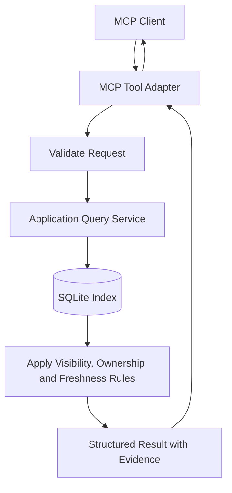
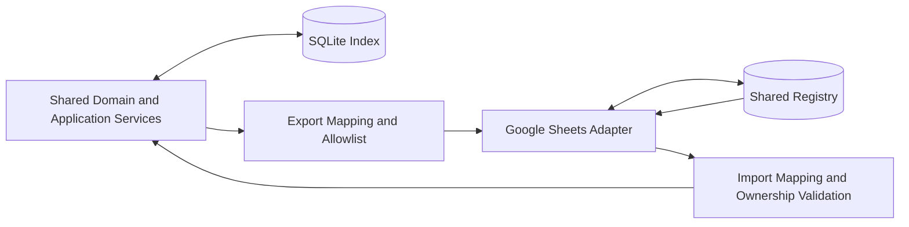
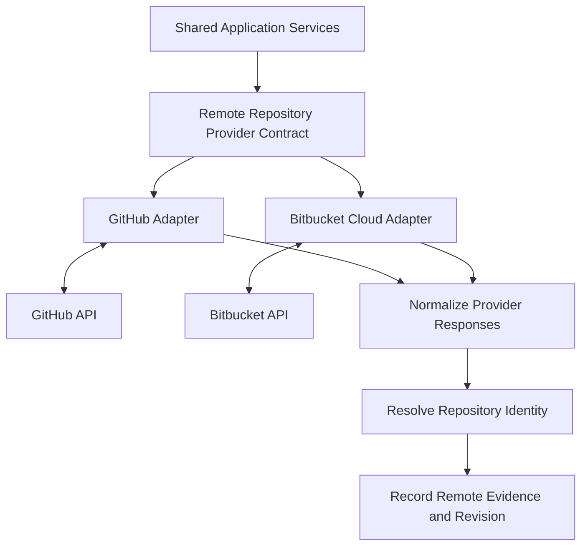

# Vyasa (व्यास) — System Architecture

**Document:** `docs/architecture/system-architecture.md`  
**Product:** Vyasa — Workspace Intelligence MCP  
**Status:** Draft v0.1  
**Architecture style:** Modular, local-first, protocol-oriented  
**Primary language:** Python  
**Initial storage:** SQLite  
**Agent interface:** Model Context Protocol (MCP)

## 1. Purpose

This document defines the logical architecture of Vyasa, including its components, responsibilities, dependencies, data flows, and extension points.

Vyasa is a workspace intelligence system that discovers projects, extracts verifiable metadata, maintains a searchable project index, and exposes project information to AI coding agents.

It will evolve through three phases:

1. Local workspace scanning, SQLite indexing, and MCP access.
2. Shared project registry through Google Sheets.
3. Remote repository discovery through GitHub and Bitbucket APIs.

The architecture must support these phases through a common domain model without making external integrations mandatory for local operation.

## 2. Architectural Vision

Vyasa provides a common intelligence layer across independent software projects while leaving each project in control of its own source code and documentation.

The architecture follows these principles:

- **Local-first:** Core functionality works without external services.
- **Deterministic:** Supported facts are extracted through explicit rules, not LLM inference.
- **Evidence-backed:** Extracted facts retain their provenance and freshness information.
- **Read-only by default:** Repository scanning does not modify maintained project content.
- **Project-owned knowledge:** Canonical project metadata remains under the project's control.
- **Shared domain model:** All adapters translate to and from common domain concepts.
- **Explicit data ownership:** Synchronization does not silently transfer ownership.
- **Incremental evolution:** Each phase delivers useful functionality independently.
- **Testable boundaries:** Core rules can be tested without databases, MCP transport, or external APIs.

## 3. System Context

Vyasa operates between the project portfolio and the developer's AI coding tools.



The diagram represents logical responsibilities, not a requirement that every component run as a separate process.

For Phase 1, the MCP server, application services, scanner, and SQLite adapter may all run within one Python process.

### 3.1 External Systems

| System | Responsibility |
|---|---|
| Local workspaces | Source of local repository files and project evidence |
| Git metadata | Source of local repository identity and configured remotes |
| SQLite | Persistent local index and operational state |
| MCP clients | Consumers of project discovery and context tools |
| Google Sheets | Shared registry introduced in Phase 2 |
| GitHub API | Remote repository discovery introduced in Phase 3 |
| Bitbucket Cloud API | Remote repository discovery introduced in Phase 3 |

## 4. Architectural Layers

Vyasa uses a layered modular architecture.

### 4.1 Domain Layer

Contains the core business concepts and rules:

- Project identity.
- Repository identity.
- Project metadata.
- Evidence and provenance.
- Metadata ownership.
- Project relationships.
- Freshness and observation status.
- Search criteria and matching rules.

The domain layer must not depend on MCP, SQLite, Google Sheets, GitHub, Bitbucket, or filesystem-specific implementation details.

### 4.2 Application Layer

Coordinates use cases through explicit services.

Examples include:

- Discover workspaces.
- Scan projects.
- Refresh the local index.
- Search projects.
- Retrieve project details.
- Build project context.
- Find related projects.
- Resolve project dependencies.
- Read index status.
- Synchronize shared metadata.
- Discover remote repositories.

Application services coordinate domain rules and ports. They should not contain provider-specific API logic or database queries directly.

### 4.3 Adapter Layer

Adapters implement the interfaces required by the application layer.

Examples include:

- Filesystem discovery adapter.
- Git metadata adapter.
- Manifest and configuration detectors.
- SQLite repository adapter.
- MCP server adapter.
- Google Sheets adapter.
- GitHub adapter.
- Bitbucket Cloud adapter.

Each adapter translates external representations into the common domain model.

### 4.4 Entry Points

Entry points expose application capabilities to external callers.

The initial entry point is the MCP server. A command-line interface may be added for installation, configuration, scanning, diagnostics, and administration.

Entry points must not bypass application services to manipulate domain state directly.

## 5. Component Responsibilities

### 5.1 Configuration Manager

**Purpose:** Load and validate application configuration.

Responsibilities:

- Workspace roots.
- Exclusion rules.
- Local database location.
- Scanner options.
- Enabled integrations.
- Credential references and secret-provider configuration.
- Logging and operational settings.

Configuration must distinguish ordinary settings from secrets.

Invalid configuration must produce actionable errors rather than silently falling back to unintended filesystem locations or permissions.

### 5.2 Workspace Discovery

**Purpose:** Find eligible project and repository candidates.

Responsibilities:

- Traverse configured workspace roots.
- Apply exclusions.
- Identify Git repositories and supported non-Git projects.
- Handle nested repositories according to explicit rules.
- Respect symlink policies.
- Report inaccessible and malformed directories.
- Produce repository candidates for further inspection.

Workspace discovery must not decide project ownership or invent relationships from directory proximity alone.

### 5.3 Repository Inspector

**Purpose:** Retrieve supported repository metadata.

Responsibilities:

- Read Git remotes and repository state.
- Identify relevant repository files.
- Detect the repository revision or local state where practical.
- Inspect supported files without executing repository code.
- Provide controlled access to files required by detectors.

The inspector must enforce file-size limits and safe path handling.

### 5.4 Metadata Detector Registry

**Purpose:** Extract supported facts through independent, deterministic detectors.

Potential detector groups include:

- Project profile detector.
- README detector.
- Language detector.
- Framework and dependency detector.
- Documentation structure detector.
- OpenSpec detector.
- Agent instruction detector.
- Test indicator detector.
- Other explicitly supported convention detectors.

Each detector should declare:

- Which files or evidence it consumes.
- Which fields it can produce.
- How it validates its inputs.
- How it represents unknown or unsupported information.
- How it records evidence.
- Its detector version.

A detector must not claim that a field is supported simply because a relevant directory or file exists.

### 5.5 Identity Resolver

**Purpose:** Establish stable identities and associate repository observations with logical projects.

Responsibilities:

- Normalize supported remote identities.
- Assign deterministic fallback identities when no reliable remote identity exists.
- Match local checkouts to known repositories.
- Detect duplicate and ambiguous identities.
- Support projects with multiple repositories when explicit grouping evidence exists.
- Avoid merging uncertain records automatically.

Identity rules must be deterministic, documented, and tested independently of the storage adapter.

### 5.6 Metadata Normalizer and Ownership Policy

**Purpose:** Convert detector output into a consistent representation while preserving ownership and provenance.

Responsibilities:

- Normalize supported values.
- Validate canonical profile fields.
- Distinguish detected facts from declared metadata.
- Apply field-specific precedence rules.
- Retain conflicting observations where necessary.
- Prevent generated observations from overwriting human-owned values.

Normalization must not erase evidence of the original source or imply certainty beyond what the evidence supports.

### 5.7 Project Index Service

**Purpose:** Coordinate updates to the generated local index.

Responsibilities:

- Receive scan results.
- Resolve project identity.
- Apply ownership rules.
- Persist observations and evidence.
- Update freshness and scan status.
- Maintain project-to-repository mappings.
- Preserve valid state during failed operations.

The index service owns generated index state, not project-maintained documentation.

### 5.8 SQLite Persistence Adapter

**Purpose:** Persist local index and operational state.

Responsibilities:

- Store project and repository records.
- Store metadata observations and evidence references.
- Store local checkout mappings.
- Store scan history and errors.
- Manage schema migrations.
- Support indexed search and retrieval.
- Maintain transaction boundaries.

The database must not become the only surviving authority for project-owned knowledge. It is a local index that can be rebuilt from available sources, subject to the documented retention policy.

### 5.9 Project Query Services

**Purpose:** Provide reusable read operations over the indexed domain model.

Responsibilities:

- Search projects.
- Retrieve a project.
- Build structured project context.
- Find related projects.
- Retrieve supported dependency information.
- Report index and freshness status.

Query services must operate against indexed data by default rather than rescanning every repository for every request.

### 5.10 MCP Adapter

**Purpose:** Expose application services through MCP.

Responsibilities:

- Register tools and their schemas.
- Validate inputs.
- Call application services.
- Return structured results.
- Report errors consistently.
- Enforce the read-only boundary of query tools.

MCP tools must not implement separate copies of the domain rules.

### 5.11 Google Sheets Adapter — Phase 2

**Purpose:** Synchronize approved shared project metadata.

Responsibilities:

- Validate the workbook structure.
- Map registry rows to domain records.
- Export only approved fields.
- Import only explicitly designated shared fields.
- Preserve human-owned fields.
- Detect and report conflicts.
- Record synchronization outcomes.
- Retry operations safely.

The adapter must not export local paths, credentials, or arbitrary local database fields.

### 5.12 Remote Repository Adapters — Phase 3

**Purpose:** Discover and inspect remote repositories without requiring local clones.

Separate adapters should support GitHub and Bitbucket Cloud.

Responsibilities:

- Authenticate within the configured access scope.
- Enumerate repositories.
- Handle pagination and rate limits.
- Retrieve repository metadata.
- Read supported files through provider APIs.
- Record provider identity and observation provenance.
- Convert results into the shared domain model.

Provider-specific response types must not leak into core domain rules.

## 6. Dependency Direction

Dependencies must point toward stable domain concepts rather than external infrastructure.



The arrows to infrastructure adapters represent application services using defined ports; they do not require the domain layer to import those adapters.

The intended dependency rules are:

1. Domain modules do not import infrastructure modules.
2. Application services depend on domain concepts and abstract ports.
3. Adapters implement the ports defined for the application.
4. Entry points call application services.
5. External integrations remain optional unless explicitly enabled.
6. Provider-specific logic is confined to its adapter and mapping code.

## 7. Proposed Package Structure

The following is a proposed Python package layout. Exact module names can be refined during implementation without changing the architectural boundaries.

```text
vyasa/
├── pyproject.toml
├── README.md
├── docs/
├── tests/
└── src/
    └── vyasa/
        ├── domain/
        │   ├── models/
        │   ├── identity/
        │   ├── metadata/
        │   ├── evidence/
        │   ├── ownership/
        │   └── relationships/
        ├── application/
        │   ├── ports/
        │   ├── discovery/
        │   ├── scanning/
        │   ├── indexing/
        │   ├── projects/
        │   ├── search/
        │   ├── synchronization/
        │   └── remote_discovery/
        ├── adapters/
        │   ├── filesystem/
        │   ├── git/
        │   ├── detectors/
        │   ├── persistence/
        │   │   └── sqlite/
        │   ├── mcp/
        │   ├── google_sheets/
        │   └── repositories/
        │       ├── github/
        │       └── bitbucket/
        ├── configuration/
        ├── observability/
        └── bootstrap/
```

This structure is illustrative, not a requirement to create empty packages for every future capability in Phase 1.

Only implement modules needed for the active phase. Reserve extension points where they provide real architectural value, without prematurely implementing future integrations.

## 8. Core Domain Model

The system must distinguish a logical project from its repositories and local checkouts.

### 8.1 Logical Project

Represents a project that users want to discover and query.

A project may have:

- A stable project ID.
- A display name.
- Explicitly declared descriptive metadata.
- One or more repository associations.
- Metadata observations.
- Shared portfolio fields.
- Derived relationships.
- Current availability and freshness information.

### 8.2 Repository

Represents a repository identified through local Git metadata or a remote provider.

A repository may have:

- A stable repository identity.
- One or more known remote identifiers or URLs.
- A provider identity, if applicable.
- A default branch or revision when available.
- Local or remote observations.
- A relationship to a logical project.

### 8.3 Local Checkout

Represents a repository instance accessible on the current device.

It may have:

- An absolute local path.
- A workspace root association.
- Local Git state.
- Last local scan information.
- Local accessibility status.

A local checkout is machine-specific and must not be exported to Google Sheets.

### 8.4 Metadata Observation

Represents a field value observed or declared from a particular source.

It should capture, as appropriate:

- Field identifier.
- Value or explicit status.
- Source category.
- Source reference.
- Observation timestamp.
- Detector or schema version.
- Repository revision where available.
- Freshness or validity status.

A metadata observation is not automatically the authoritative value for the logical project. Ownership and precedence rules determine how observations are exposed.

### 8.5 Evidence Reference

Identifies the source supporting an observation.

Examples include:

- A repository-relative file path.
- A manifest field.
- A Git remote configuration.
- A provider repository identifier.
- A canonical profile field.

Evidence references should be as precise as practical without copying unnecessary file contents into the index.

### 8.6 Project Relationship

Represents a supported relationship between projects or repositories.

Relationship types may include:

- Explicit dependency.
- Shared technology.
- Shared library or repository association.
- Potential duplicate.
- Human-declared relationship.

Each relationship must identify its basis and distinguish confirmed relationships from candidates generated by deterministic rules.

## 9. Phase 1 Data Flow

The local indexing flow should be independent of Google Sheets and remote provider access.



### 9.1 Scan Behaviour

1. Validate configuration before traversal.
2. Discover eligible project and repository candidates.
3. Apply exclusions and path-safety rules.
4. Inspect recognized files and Git metadata.
5. Run supported deterministic detectors.
6. Resolve stable identities.
7. normalize observations and apply ownership policies.
8. Commit index updates safely.
9. Record scan outcome, errors, and freshness.
10. Return a structured summary.

A failure affecting one repository should not unnecessarily terminate the entire scan.

The implementation must define transaction boundaries so that interrupted operations do not report incomplete updates as a successful complete scan.

### 9.2 Incremental Scanning

Incremental scanning may reuse prior observations when the system can establish that their inputs and detector versions remain valid.

Invalidation must account for:

- Relevant file changes.
- Deleted files.
- Changes in detector configuration.
- Detector version changes.
- Canonical profile changes.
- Git remote changes.
- Repository identity changes.

An incremental scan must not reuse stale facts merely because a file timestamp appears unchanged when other invalidation evidence indicates that the result is no longer trustworthy.

## 10. Query Data Flow

Project retrieval must not depend on a fresh scan for every request.



The query layer should:

- Validate inputs.
- Resolve the requested project identity.
- Retrieve indexed observations.
- Apply the documented ownership and freshness rules.
- Return structured data and evidence.
- Distinguish empty results from failures.

If shared registry records are added in Phase 2, query services must distinguish shared project knowledge from locally accessible repository content.

## 11. MCP Interface Architecture

The MCP adapter exposes application capabilities without becoming a second business-logic layer.

### 11.1 Initial Read Tools

| Tool | Responsibility |
|---|---|
| `search_projects` | Search projects using supported metadata and filters |
| `get_project` | Retrieve a project's indexed details |
| `get_project_context` | Return structured context for an agent working on a project |
| `find_related_projects` | Find projects related by documented deterministic criteria |
| `get_project_dependencies` | Retrieve supported dependency information |
| `get_index_status` | Report scan state, freshness, and index health |

An optional refresh tool may trigger an authorized scan and update generated index state.

### 11.2 Response Design

Responses should provide:

- Stable project or repository identifiers.
- Structured field values.
- Source provenance where practical.
- Freshness and availability status.
- Explicit unknown or unsupported states.
- Predictable error information.

The MCP adapter must not convert missing facts into invented narrative summaries.

### 11.3 Transport

The initial transport should be a local transport, with stdio the leading candidate.

The transport decision must be finalized before implementation. Network exposure, if introduced later, requires an explicit authentication and access-control design.

## 12. SQLite Storage Architecture

SQLite stores local project intelligence and operational state.

Logical storage areas include:

- Projects.
- Repositories.
- Local checkouts.
- Metadata observations.
- Evidence references.
- Project relationships.
- Scan runs and outcomes.
- Detector or schema versions.
- Synchronization state, introduced in Phase 2.
- Remote discovery state, introduced in Phase 3.

The exact tables, indexes, constraints, and migrations belong in `docs/architecture/local-storage.md`.

### 12.1 Storage Principles

- Keep local-only data in local storage.
- Use transactions for related index updates.
- Enforce identity constraints where possible.
- Support controlled schema migrations.
- Index fields used frequently in searches.
- Avoid storing entire documentation files when source references suffice.
- Make the index rebuildable from available evidence.
- Define retention rules for historical observations and errors.

## 13. Phase 2 — Google Sheets Integration

Phase 2 introduces shared metadata without replacing SQLite.



### 13.1 Responsibilities

- Map shared fields to registry columns.
- Validate the registry schema before writes.
- Export only approved fields.
- Import only fields designated as shared or portfolio-owned.
- Preserve local paths and machine-specific state.
- Preserve human-managed registry values.
- Detect conflicts.
- Record synchronization outcomes.

### 13.2 Cross-Device Behaviour

A project can exist in the shared registry without a local checkout.

The query layer must distinguish:

- Project known in the shared registry.
- Repository known through a remote URL.
- Repository accessible as a local checkout.
- Repository currently inaccessible or not present locally.

The absence of a local checkout must not be interpreted as the absence of the project.

### 13.3 Failure Isolation

If Google Sheets is unavailable, local queries and indexing must continue to work.

Synchronization failure must not invalidate successful local scans or overwrite locally stored data with incomplete responses.

The synchronization adapter must follow the field ownership and conflict policy defined in `docs/requirements/data-ownership.md`.

## 14. Phase 3 — Remote Repository Discovery

Phase 3 introduces provider adapters for GitHub and Bitbucket Cloud.



### 14.1 Provider Contract

The common provider contract should support:

- Enumerating accessible repositories.
- Retrieving repository metadata.
- Reading supported files or file metadata.
- Reporting provider identity and access status.
- Handling pagination.
- Reporting rate-limit and authorization errors.

The contract must not require every provider to expose identical metadata. Unsupported fields remain unknown.

### 14.2 No-Clone Rule

Remote discovery and supported file inspection must not require a clone or checkout.

Remote providers may retrieve supported files through their APIs and return the necessary evidence to the scanner or detector services.

### 14.3 Provider Isolation

GitHub and Bitbucket failures must be isolated from each other and from local indexing.

A failed remote request must not cause a project to be marked deleted or absent.

## 15. Security Architecture

Security is a cross-cutting responsibility.

### 15.1 Filesystem Boundary

- Scan only configured roots and permitted paths.
- Apply exclusions consistently.
- Define symlink handling.
- Prevent unintended traversal outside permitted roots.
- Treat repository files as untrusted input.
- Do not execute repository scripts to extract metadata.

### 15.2 Local State

- Store machine-specific paths only locally.
- Keep credentials out of the project index where possible.
- Use protected credential storage for external integrations.
- Sanitize diagnostic output.

### 15.3 Shared Registry

- Apply an explicit field export allowlist.
- Exclude secrets and local filesystem details.
- Validate imported values.
- Respect human field ownership.
- Avoid unrestricted export of local records.

### 15.4 MCP Boundary

- Keep tool capabilities narrowly scoped.
- Make read-only behaviour the default.
- Separate optional index refresh from project-content modification.
- Require explicit configuration for any network-exposed transport.

## 16. Error Handling and Observability

The architecture must distinguish failures at different boundaries.

Expected error categories include:

- Invalid configuration.
- Missing or inaccessible workspace.
- Repository inspection failure.
- Unsupported or malformed metadata.
- Identity conflict.
- Database failure.
- Scan interruption.
- MCP input validation failure.
- Google authentication or synchronization failure.
- Remote provider rate limiting or access failure.

Each operation should produce an outcome containing, as appropriate:

- Operation or run ID.
- Scope.
- Start and completion times.
- Success, partial success, or failure status.
- Counts of discovered, updated, skipped, and failed items.
- Structured error categories.
- Safe diagnostic details.

Logs must not corrupt stdio-based MCP protocol messages. Diagnostics should use an appropriate logging channel.

## 17. Testing Architecture

Testing should follow the same module boundaries as the implementation.

### 17.1 Domain Tests

Test:

- Project and repository identity.
- Field ownership and precedence.
- Metadata normalization.
- Evidence and freshness states.
- Deterministic relationship rules.

These tests should not require a database or network.

### 17.2 Adapter Tests

Test:

- Filesystem discovery against controlled directory fixtures.
- Detectors against representative files.
- SQLite persistence and migrations.
- MCP schemas and responses.
- Google Sheets mappings and synchronization using test doubles.
- Remote provider pagination and error handling using fixtures or mocks.

### 17.3 Integration Tests

Test the complete flow from workspace discovery through SQLite persistence to MCP retrieval.

Later phases should add separate integration suites for Sheets synchronization and remote repository discovery.

External integration tests must not require production credentials for routine local test execution.

### 17.4 Failure Tests

Include:

- Missing roots.
- Unreadable files.
- Malformed manifests.
- Duplicate identities.
- Interrupted scans.
- Database failures.
- Partial synchronization.
- Rate limits.
- Invalid authentication.
- Stale observations.

## 18. Technology Choices

The following are proposed baseline technologies, subject to validation during implementation.

| Concern | Proposed choice | Reason |
|---|---|---|
| Language | Python 3.12+ | Suitable for filesystem tooling, metadata processing, and integration adapters |
| MCP | Official Python MCP SDK / FastMCP approach | Provides the agent-facing protocol integration |
| Validation | Pydantic | Structured input and output validation |
| Local persistence | SQLite | Embedded, portable, and local-first |
| Git inspection | Git CLI or a carefully selected Python library | Repository metadata and remote inspection |
| Testing | pytest | Unit and integration testing |
| Configuration | Validated typed configuration | Explicit and predictable application settings |
| Logging | Python structured logging approach | Operational diagnostics |
| Remote APIs | Provider-specific HTTP clients or supported SDKs | Phase 3 integration |

The implementation should use the least complex dependency set that meets the requirements.

Exact package choices, version pins, CLI behaviour, and database schema are implementation decisions and should be documented separately.

## 19. Architectural Decisions and Constraints

The following constraints are part of the proposed architecture.

### Mandatory constraints

1. The core domain model must remain independent of external integrations.
2. Phase 1 must operate without Google Sheets or remote provider APIs.
3. Routine metadata extraction must be deterministic and evidence-backed.
4. Repository source files and canonical project profiles must not be modified during ordinary scanning.
5. Local paths and secrets must never be exported by default.
6. Google Sheets must not become the sole source for locally scanned evidence.
7. Remote discovery must not require repository cloning.
8. External integration failures must not invalidate unrelated local functionality.
9. Uncertain identities must not be silently merged.
10. Human-owned fields must not be overwritten by automated synchronization.

### Decisions still requiring approval

- Canonical project profile format and location.
- Exact package and module layout.
- Local MCP transport.
- SQLite concurrency and migration approach.
- Supported detector inventory.
- Project identity normalization and grouping rules.
- Google Sheets conflict and field-ownership policy.
- GitHub and Bitbucket discovery scope.
- Retention of historical observations and evidence.

These decisions should be captured in architecture decision records when resolved.

## 20. Architecture Evolution by Phase

### Phase 1

Implement:

- Domain model and core rules.
- Configuration.
- Workspace discovery.
- Git inspection.
- Metadata detectors.
- Identity resolution.
- SQLite persistence.
- Application query services.
- MCP adapter.
- Automated tests and local setup documentation.

Do not implement unused Google Sheets or remote provider adapters merely to populate the package structure.

### Phase 2

Add:

- Shared registry synchronization service.
- Google Sheets adapter.
- Export and import mapping.
- Conflict detection.
- Synchronization history.
- Cross-device registry-only project handling.

Reuse the domain model and local persistence interfaces.

### Phase 3

Add:

- Remote repository provider contract.
- GitHub adapter.
- Bitbucket Cloud adapter.
- Remote metadata inspection.
- Remote identity and reconciliation logic.
- Provider-specific error and rate-limit handling.

Reuse existing detectors wherever remote file evidence can be normalized into the same input model.

## 21. Architecture Acceptance Criteria

The architecture is sufficiently defined for Phase 1 implementation when:

1. Core domain concepts and ownership boundaries are documented.
2. Filesystem discovery, metadata extraction, identity resolution, persistence, and MCP have separate responsibilities.
3. Application services depend on defined ports rather than concrete external providers.
4. Project and repository identity are distinct concepts.
5. Metadata observations retain provenance and freshness.
6. Ordinary scanning is read-only with respect to project-owned content.
7. SQLite can be used without external services.
8. Query services do not require a full rescan for every request.
9. Failure handling preserves valid previously indexed state.
10. Critical domain rules can be tested independently of infrastructure.
11. Future integrations can be added without coupling the domain model to provider-specific structures.
12. Open decisions are recorded and resolved before they affect implementation.

## 22. Governing Architectural Principle

Vyasa should be built as a **deterministic domain core surrounded by replaceable adapters**.

Local repositories provide evidence. The domain layer establishes meaning and ownership. SQLite maintains the local index. MCP exposes the capabilities to AI agents. Google Sheets provides shared metadata, and remote repository providers extend discovery.

No adapter should become the owner of the entire system's knowledge model.

**The core remains stable; integrations evolve around it.**
