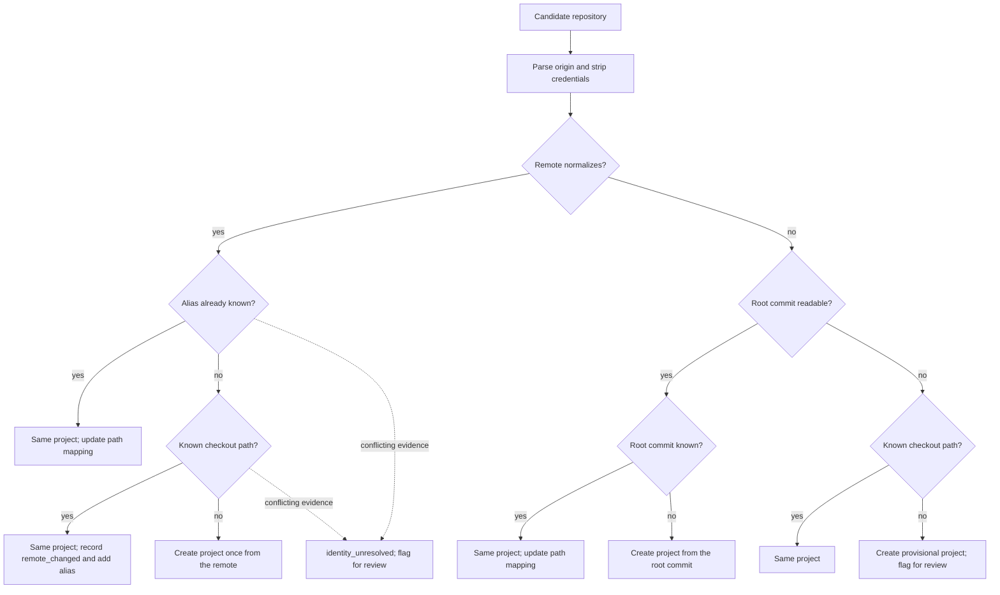

# Diagrams: Project Identity and Review Candidates

C4 vocabulary: `knowledge/architecture/c4-system-views.md`. The Identity Resolver is a domain component with
no I/O of its own, so one dynamic view is enough.

## How is an existing project found on rediscovery? (dynamic view)

