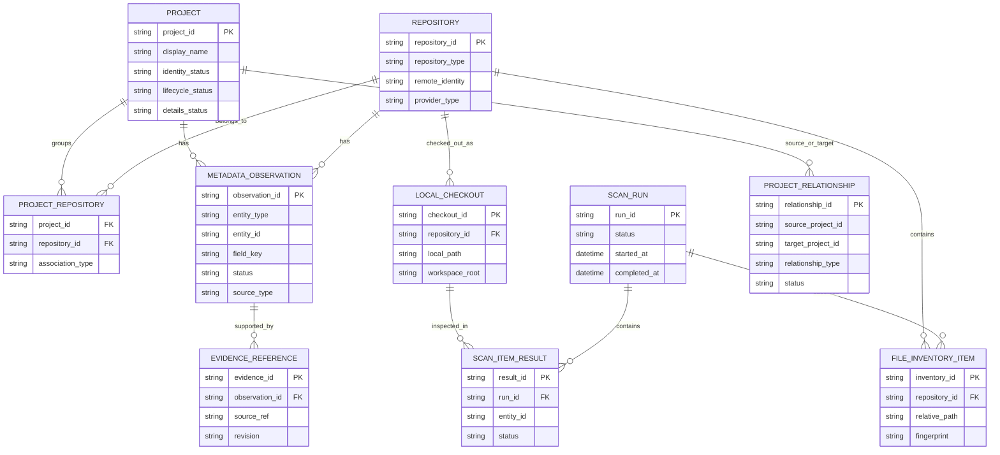

# Vyasa (व्यास) — Local Storage

Related architecture:

- [system-architecture](/architecture/system-architecture.md)
- [data-model](/architecture/data-model.md)
- [scanning-and-evidence](/architecture/scanning-and-evidence.md)
- [mcp-interface](/architecture/mcp-interface.md)

## 1. Purpose

This document defines how Vyasa persists and retrieves its local workspace intelligence.

It specifies:

- SQLite database responsibilities and boundaries.
- Logical storage entities and table relationships.
- Persistence of project metadata, observations, evidence, and relationships.
- Scan history and incremental scanning state.
- Transaction and concurrency rules.
- Database migrations and compatibility.
- Backup, recovery, and corruption handling.
- Local-only information and privacy boundaries.
- Preparation for Google Sheets synchronization and remote repository discovery.

The storage layer must support deterministic scanning and fast MCP queries without making SQLite the authoritative owner of project-maintained information.

## 2. Storage Principles

### 2.1 Local-First

Phase 1 must operate without an external database or network service.

SQLite stores the local index and the operational state needed to maintain it.

### 2.2 Generated Index, Not Source of Truth

The local database contains generated observations, normalized metadata, resolved query records, and operational state.

It must not silently become the canonical owner of project purpose, documentation, or other project-maintained facts.

The ownership model defined in `data-ownership.md` determines which source is authoritative for each field.

### 2.3 Deterministic and Rebuildable

The index should be reconstructible from accessible repositories and supported external sources, subject to the configured scope and source availability.

A rebuild may not recover machine-local observations, historical scan records, or human-managed portfolio fields unless those are preserved separately.

Vyasa must not claim that every database field can be reconstructed from repository files alone.

### 2.4 Preserve Provenance

Stored facts must retain enough provenance to explain their origin.

Where applicable, records should identify:

- Source type.
- Source entity.
- Source location.
- Detector or provider.
- Observation time.
- Relevant revision or fingerprint.
- Status and freshness.

### 2.5 Atomic and Consistent Updates

A failed scan must not leave half-written records that appear to represent a completed observation.

Transactions should commit logically consistent updates, while allowing independent projects to succeed even if another project fails.

### 2.6 Explicit Separation of Local and Shared Data

Machine-specific state must remain local.

Google Sheets will become a shared registry in Phase 2. It must not receive local paths, database paths, local-only identifiers, credentials, or other machine-specific operational state.

---

## 3. Storage Responsibilities

The SQLite database is responsible for:

1. Maintaining stable local mappings to logical projects and repositories.
2. Storing metadata observations and their status.
3. Storing evidence references.
4. Maintaining resolved project and repository records for efficient queries.
5. Recording project relationships and dependency observations.
6. Recording scan runs and per-project outcomes.
7. Tracking incremental scanning fingerprints and detector versions.
8. Supporting index status, freshness evaluation, and diagnostics.
9. Providing consistent query access to the application and MCP layers.
10. Supporting schema migrations and safe recovery.

SQLite is not responsible for:

- Editing project documentation or canonical profiles.
- Executing repository code.
- Replacing the repository's own Git history.
- Storing full repository contents.
- Acting as a secret store.
- Becoming the shared cross-device registry.
- Automatically deleting projects because they are no longer visible locally.

---

## 4. Database Location and Configuration

### 4.1 Database Path

The database location must be configurable.

The default should use the operating system's appropriate per-user application-data directory, rather than placing the database inside an arbitrary project repository.

A proposed default layout is:

```text
<user-data-directory>/
└── vyasa/
    ├── vyasa.db
    ├── backups/
    └── logs/
```

The exact directory resolution must be implemented using a cross-platform library or a documented operating-system-specific policy.

The database must not be created in the current working directory by accident.

### 4.2 Configuration

Configuration should support:

- Database path.
- Workspace roots.
- Exclusion rules.
- Scanning options.
- Database busy timeout.
- Backup location and retention policy.
- Logging configuration.
- Enabled optional capabilities.

Configuration secrets must not be stored in the database unless a future, explicitly reviewed requirement establishes a secure and necessary use case.

### 4.3 Directory Permissions

Vyasa should create its application-data directory with appropriately restrictive permissions where supported.

The implementation must not assume that filesystem permissions behave identically across Linux, Windows, and macOS.

---

## 5. Logical Storage Model

The database should separate stable entities from observations and operational records.



This diagram is conceptual. The physical schema may use composite keys or additional association tables where appropriate.

### 5.1 Core Storage Groups

| Group | Purpose |
|---|---|
| Identity and entities | Projects, repositories, local checkouts |
| Observations | Declared and detected metadata |
| Evidence | Source references supporting observations |
| Relationships | Dependencies and related-project links |
| Scanning | Runs, item results, detector outcomes |
| File inventory | Relevant files and fingerprints for incremental scanning |
| Resolved index | Efficiently queryable project summaries |
| Schema management | Migration version and storage compatibility |
| Future shared registry | Synchronization metadata in Phase 2 |
| Future remote discovery | Provider discovery and observation state in Phase 3 |

---

## 6. Proposed Tables

The following tables are the proposed initial logical inventory. Exact columns, SQL types, constraints, and indexes will be finalized during implementation.

### 6.1 `schema_migrations`

Records database schema changes.

Proposed fields:

- `version`
- `migration_id`
- `applied_at`
- `checksum`, where useful

Requirements:

- Every successful migration must be recorded.
- A migration must not be marked complete before its changes are committed.
- Reapplying an already completed migration must not duplicate its effects.
- Unexpected migration state must produce an actionable error.

### 6.2 `projects`

Stores stable logical project records used by local queries.

Proposed fields:

- `project_id`
- `display_name`
- `identity_status`
- `lifecycle_status`
- `tracking_level`, if applicable
- `details_status`
- `created_at`
- `updated_at`
- `last_observed_at`
- `record_version`

Rules:

- `project_id` must be stable according to the approved identity policy.
- Display names are not unique identifiers.
- Missing descriptive metadata must not prevent the project record from existing.
- Human-managed fields must follow the ownership rules.
- Project deletion must not be inferred from one failed or incomplete scan.

The table should contain a compact resolved representation, not duplicate every source observation as an untraceable value.

### 6.3 `repositories`

Stores logical repository identities.

Proposed fields:

- `repository_id`
- `display_name`
- `repository_type`
- `provider_type`
- `remote_identity`
- `provider_repository_id`, when available
- `default_branch`, when known
- `repository_status`
- `created_at`
- `updated_at`

Rules:

- Repository identity must be distinct from local checkout identity.
- Remote URLs must be normalized using a documented provider-specific policy.
- Credentials embedded in remote URLs must be removed before persistence or exposure.
- Forks and upstream repositories must not be merged merely because their names are similar.

### 6.4 `project_repositories`

Associates logical projects with repositories.

Proposed fields:

- `project_id`
- `repository_id`
- `association_type`
- `association_status`
- `source_type`
- `created_at`
- `updated_at`

This association supports a logical project containing multiple repositories and permits a repository to have explicitly managed associations where the domain rules allow them.

The uniqueness constraints must prevent accidental duplicate associations without preventing legitimate many-to-many relationships.

### 6.5 `local_checkouts`

Stores machine-local repository checkout information.

Proposed fields:

- `checkout_id`
- `repository_id`
- `local_path`
- `workspace_root`
- `checkout_type`
- `last_known_revision`
- `last_scan_at`
- `checkout_status`
- `created_at`
- `updated_at`

This table is local-only.

It must never be exported to Google Sheets as a shared project record.

Local paths must be treated as machine-specific identifiers, not as stable project IDs.

If a directory moves, Vyasa should attempt to reconcile the checkout using repository identity rather than automatically creating a new logical project.

### 6.6 `metadata_observations`

Stores individual declarations and detected facts.

Proposed fields:

- `observation_id`
- `entity_type`
- `entity_id`
- `field_key`
- `value_type`
- `value_json` or an equivalent typed representation
- `status`
- `source_type`
- `source_entity_id`
- `detector_id`
- `detector_version`
- `observed_at`
- `source_revision`
- `content_fingerprint`
- `is_current`
- `created_at`

The actual schema should use validated types and avoid encoding all fields as arbitrary unvalidated JSON.

Rules:

- Values must be validated against field definitions.
- Status must use the documented observation vocabulary.
- Observations from different sources must remain distinguishable.
- Historical records must not silently appear current.
- A detector update must not falsely rewrite the provenance of an old observation.

If a project field has several competing observations, the resolution layer must apply the ownership and precedence rules rather than relying on whichever database row was written last.

### 6.7 `evidence_references`

Stores references to the sources that support observations.

Proposed fields:

- `evidence_id`
- `observation_id`
- `source_type`
- `repository_id`, when applicable
- `checkout_id`, when applicable
- `relative_path`
- `field_reference`
- `line_start`
- `line_end`
- `source_revision`
- `content_fingerprint`
- `observed_at`

Rules:

- Evidence paths should be repository-relative where possible.
- Line numbers should be stored only when the detector can establish them reliably.
- Evidence references must not contain secret values.
- A missing source must not cause evidence to be silently reassigned to another file.
- Stale evidence must remain distinguishable from current evidence.

### 6.8 `project_relationships`

Stores confirmed and candidate relationships.

Proposed fields:

- `relationship_id`
- `source_project_id`
- `target_project_id`
- `relationship_type`
- `status`
- `rule_id`
- `rule_version`
- `source_observation_id`
- `created_at`
- `updated_at`

Supported relationship types may include:

- `depends_on`
- `uses_library`
- `shared_technology`
- `related_project`
- `same_logical_project`
- `potential_duplicate`

Rules:

- Confirmed relationships must have a defined basis.
- Candidate relationships must not be presented as established facts.
- Relationship rules must be deterministic and versioned.
- Rejected candidates should not reappear as confirmed relationships without new evidence or an explicit policy change.
- Self-referential relationships must be rejected unless a specific relationship type explicitly permits them.

### 6.9 `scan_runs`

Stores each scanning operation.

Proposed fields:

- `run_id`
- `scan_scope`
- `started_at`
- `completed_at`
- `status`
- `configuration_fingerprint`
- `scanner_version`
- `summary_json` or equivalent structured counters
- `error_count`
- `warning_count`

Suggested run statuses:

- `running`
- `completed`
- `partial`
- `failed`
- `cancelled`

An interrupted process may leave a run recorded as `running`. Startup recovery must detect such records and reconcile them without falsely claiming completion.

### 6.10 `scan_item_results`

Stores outcomes for individual projects, repositories, or other scan units.

Proposed fields:

- `result_id`
- `run_id`
- `entity_type`
- `entity_id`
- `status`
- `started_at`
- `completed_at`
- `detectors_attempted`
- `detectors_succeeded`
- `detectors_failed`
- `error_summary`

This table supports partial-scan reporting and prevents a single aggregate run status from hiding failures.

### 6.11 `detector_runs`

Optionally stores detailed detector-level execution outcomes.

Proposed fields:

- `detector_run_id`
- `run_id`
- `entity_type`
- `entity_id`
- `detector_id`
- `detector_version`
- `status`
- `started_at`
- `completed_at`
- `input_fingerprint`
- `error_code`

This table is useful when detector-level diagnostics and incremental invalidation become complex. It may be omitted initially if the same information can be represented adequately in `scan_item_results` without compromising queryability or auditability.

### 6.12 `file_inventory`

Stores relevant files discovered by the scanner.

Proposed fields:

- `inventory_id`
- `repository_id`
- `checkout_id`
- `relative_path`
- `file_role`
- `file_size`
- `modified_at`
- `content_fingerprint`
- `inspection_status`
- `last_seen_run_id`
- `last_seen_at`

Rules:

- Store only file information needed for supported detectors and incremental scanning.
- Do not store complete file contents by default.
- Distinguish a confirmed deletion from a file that was not inspected.
- Do not use modification time alone as universal proof of unchanged content.
- File inventory must respect exclusions and traversal boundaries.

### 6.13 `resolved_project_index`

A separate physical table is optional.

The implementation may derive resolved project summaries from normalized tables or maintain a materialized local projection for efficient queries.

If a projection is maintained:

- It must be rebuildable from authoritative local storage records and applicable external-source records.
- Updates must be transactional with the observations they represent, or carry an explicit generation/version that prevents mismatched reads.
- It must not become an independent source of truth.
- Its schema and refresh behaviour must be tested.

The implementation should prefer the simplest design that meets query performance requirements.

---

## 7. Data Types and Serialization

### 7.1 Structured Values

Metadata may include strings, booleans, numbers, arrays, and structured objects.

The storage layer must preserve types rather than converting all values to strings.

For example, `tests_present: false` must not be indistinguishable from the string `"false"`.

### 7.2 JSON Columns

SQLite JSON storage may be used for bounded structured values where it simplifies extensibility.

However:

- Required fields should remain normal columns where practical.
- Important query filters should use indexed columns or supported indexed projections.
- Arbitrary JSON must not bypass validation.
- Schema changes must not depend on undocumented JSON shapes.
- Large source files must not be stored in JSON columns merely because JSON is available.

### 7.3 Timestamps

Persist timestamps in a consistent representation, preferably UTC ISO 8601 or a consistently defined numeric format.

The choice must be uniform across the schema and migrations.

User-facing timestamps may be converted to the client's local timezone.

### 7.4 Identifiers

Identifiers must be stable where their entity semantics require stability.

The implementation should use a consistent identifier format and avoid generating new project IDs on every scan.

Random scan-run IDs are acceptable because each run represents a distinct event.

---

## 8. SQLite Configuration

### 8.1 Journal Mode

WAL (Write-Ahead Logging) is the recommended initial journal mode, subject to platform and filesystem testing.

Benefits include improved reader/writer concurrency for local query workloads.

The implementation must document any limitations when the database is located on unsupported network filesystems or filesystems with unsuitable locking semantics.

### 8.2 Connection Management

Each operation must use a properly managed connection or session.

The implementation must define:

- Connection lifetime.
- Transaction ownership.
- Busy timeout.
- Error handling for locked databases.
- Shutdown behaviour.
- Whether connections are thread-local or operation-scoped.

Connections must not be shared unsafely across concurrent execution contexts.

### 8.3 Foreign Keys

Foreign-key enforcement should be enabled for every database connection that performs writes.

The schema should use foreign keys where they accurately represent ownership and lifecycle.

Deletion policies must be explicit. Cascading deletion must not accidentally remove useful scan history or evidence when a project is merely no longer discovered.

### 8.4 Durability

The SQLite durability settings must be selected deliberately.

The implementation should prefer safe, documented settings over aggressive performance settings that risk data loss. Any non-default durability choice must be justified and tested.

### 8.5 Database Locking

The implementation must handle temporary database contention with bounded waiting and actionable errors.

It must not retry indefinitely or silently discard writes when the database is locked.

---

## 9. Transaction Boundaries

### 9.1 Scan-Run Creation

Create a scan-run record before or at the start of scanning so that an interrupted run can be identified.

### 9.2 Project-Level Updates

A project-level update should commit a logically consistent group of changes, such as:

1. New observations.
2. Updated evidence references.
3. Invalidated superseded observations.
4. Resolved project summary.
5. Scan-item outcome.

These changes should be committed atomically where practical.

### 9.3 Partial Success

A failure for one project must not require rolling back unrelated projects that have already been successfully processed.

The scan-run summary should accurately report partial completion.

### 9.4 Failure Recovery

If a transaction fails:

- Roll back the affected transaction.
- Preserve previously committed valid state.
- Record the failure when the database remains writable.
- Avoid marking incomplete results as current.
- Allow a later scan to retry the affected work.

### 9.5 Index Consistency

A query must not observe a resolved summary that contradicts the corresponding committed observation state because an update was only partially applied.

Use transactional updates, explicit index generations, or another documented consistency mechanism.

---

## 10. Incremental Scanning State

### 10.1 Purpose

Incremental scanning avoids unnecessary reprocessing while preserving correct results.

The database must retain enough information to determine whether cached detector output is reusable.

### 10.2 Cache Dependencies

Cache validity may depend on:

- File path and content fingerprint.
- Detector ID and version.
- Detector configuration.
- Relevant profile schema.
- Repository identity.
- Source revision.
- Relevant discovery configuration.

A detector must declare the inputs that can affect its output.

### 10.3 Invalidation

Invalidate or re-evaluate observations when:

- A relevant file changes.
- A relevant file is added or deleted.
- A previously inaccessible file becomes readable.
- A detector version changes.
- A profile schema changes.
- Repository identity changes.
- A scan was incomplete.
- Configuration changes affect detector behaviour.

### 10.4 Stale Observations

When an observation becomes stale, Vyasa may preserve the last known value for diagnostic or fallback purposes, but it must mark it stale and must not present it as freshly verified.

The public query interface must make stale state visible.

### 10.5 Cache Rebuild

The index must support rebuilding generated observations and projections.

A rebuild must not overwrite canonical project profiles or shared human-managed fields.

Historical scan records may be retained according to the approved retention policy, even when current observations are regenerated.

---

## 11. Identity and Deduplication Constraints

### 11.1 Project Identity

The database must enforce uniqueness for stable project IDs.

Project display names need not be unique.

### 11.2 Repository Identity

Repository uniqueness should use an approved normalized identity strategy, considering provider identity when available.

Remote URLs can change, and one logical repository may have multiple URL forms. The implementation must not assume that URL text alone is always a permanent identity.

### 11.3 Checkout Identity

A local checkout must be associated with a repository through repository identity where possible.

The same repository may have more than one checkout.

### 11.4 Duplicate Candidates

Potential duplicates should be represented as candidate relationships until the identity-resolution policy has sufficient evidence.

Storage constraints must prevent duplicate records where identity is established, without preventing legitimate forks, mirrors, or multiple repositories belonging to one project.

### 11.5 Missing Projects

If a project is no longer found during a complete local scan, the database may update its local visibility or discovery status.

It must not automatically delete the logical project, erase its shared record, or classify it as obsolete solely because it was not found in one workspace scan.

---

## 12. Local-Only and Shareable Data

The storage model must make data boundaries explicit.

| Data | Local SQLite | Google Sheets | Notes |
|---|---|---|---|
| Stable logical project ID | Yes | Yes, approved form | Shared identity |
| Project display name | Yes | Yes | Subject to ownership rules |
| Project purpose | Yes | If approved | Preserve source ownership |
| Languages and technologies | Yes | Approved summary | Evidence remains local unless explicitly designed otherwise |
| Documentation indicators | Yes | Approved summary | Include last verified time |
| Local checkout path | Yes | No | Machine-specific |
| Workspace root | Yes | No | Machine-specific |
| Database path | Yes | No | Machine-specific |
| File fingerprints | Yes | Normally no | Local scan state |
| Evidence references | Yes | Normally summary only | Avoid local paths |
| Scan history | Yes | Aggregated history only, if needed | Separate local and sync events |
| Human portfolio fields | Local cache as applicable | Yes | Preserve shared ownership |
| API credentials | Secure local configuration | No | Never export |
| Raw repository contents | No by default | No | Avoid unnecessary retention |
| Remote provider identity | Yes | Approved identifiers | Provider-specific |
| Draft profile state | Local only | No | Never automatically promoted |

The final export policy must use an explicit allowlist. It must not export every column merely because it exists in SQLite.

---

## 13. Phase 2 — Shared Registry Storage

Google Sheets is the shared project registry, while SQLite remains the local query index and cache.

### 13.1 Local Synchronization State

Phase 2 may introduce tables such as:

- `shared_registry_records`
- `sync_runs`
- `sync_item_results`
- `field_sync_state`

These are proposed logical entities, not mandatory physical table names.

### 13.2 Synchronization Metadata

Store enough information to track:

- Shared record identity.
- Last successful synchronization.
- Last attempted synchronization.
- Synchronization outcome.
- Field ownership.
- Conflict status.
- Relevant shared revision or fingerprint, when available.

### 13.3 Field Ownership

The synchronizer must know whether a field is:

- Repository-owned.
- Scanner-generated.
- Shared human-managed.
- Provider-owned.
- Machine-local.
- Derived.

It must not apply last-write-wins indiscriminately to all fields.

### 13.4 Conflict Handling

A sync failure must not corrupt the local index.

A conflict must remain visible until resolved according to the ownership policy. The system must not silently discard a local observation or overwrite a human-managed registry value.

### 13.5 No Local Paths in Shared State

Local checkout information must never be copied into the shared registry by a generic serialization routine.

The export adapter must construct an approved shared representation explicitly.

---

## 14. Phase 3 — Remote Provider Storage

Remote discovery may add:

- Provider identities.
- Remote repository observations.
- Remote discovery runs.
- Provider-specific pagination or continuation state, where safe.
- Provider access and error summaries.
- Remote revision information.

### 14.1 Remote Observations

Remote evidence must identify its provider and relevant repository revision where available.

Remote observations must remain distinguishable from local checkout observations.

### 14.2 Authentication State

Credentials must not be stored as ordinary SQLite metadata fields.

Provider connection configuration and secrets must use approved local configuration or secure secret storage.

The database may record a safe connection status or last successful access time without recording the credential itself.

### 14.3 Rate Limits and Failures

Provider errors and rate-limit state may be persisted as operational metadata.

A failed remote request must not cause existing repository records to be deleted or their previous values to be represented as confirmed absence.

---

## 15. Data Retention and Cleanup

### 15.1 Historical Observations

The implementation must define which historical observations are retained and for how long.

Current observations must remain easy to query. Historical records should not grow without bound if the scanner runs frequently.

### 15.2 Scan History

Scan history is useful for diagnosing incomplete scans and understanding changes.

Retention should be configurable or based on a documented policy. Any cleanup must preserve enough information to understand the current index state.

### 15.3 File Inventory Cleanup

Old inventory entries may be removed only when their lifecycle is understood.

The scanner must not treat an entry missing from a partial scan as a confirmed deletion.

### 15.4 Orphan Cleanup

Cleanup operations must use explicit consistency rules and foreign-key constraints.

A missing checkout must not automatically delete its repository or logical project.

### 15.5 Database Compaction

SQLite maintenance operations such as checkpointing or vacuuming should be performed deliberately.

They must not run on every query and must not compromise database availability during active operations.

---

## 16. Backup and Recovery

### 16.1 Backup Scope

A backup should include the SQLite database and any additional local state required for recovery.

The implementation must document whether configuration, logs, and any local auxiliary files are included.

Secrets should not be copied into backups unnecessarily.

### 16.2 Consistent Backups

When WAL mode is used, backups must account for WAL state.

Use a SQLite-supported backup mechanism or another tested method that produces a consistent database snapshot. Do not assume that copying only the main database file while the database is active is sufficient.

### 16.3 Recovery

Vyasa must:

- Detect database initialization and migration failures.
- Report corruption or integrity problems clearly.
- Preserve a recoverable copy before destructive repair where feasible.
- Avoid silently deleting a damaged database and rebuilding without informing the user.
- Provide a documented rebuild path for reconstructible generated data.
- Preserve shared human-managed data when it is available from the shared registry.

### 16.4 Rebuild Versus Restore

These operations have different meanings.

**Rebuild** reconstructs generated index data from available sources.

**Restore** recovers previously persisted state from a backup.

A rebuild may lose historical scan data, cached observations, or local associations that cannot be rediscovered. The CLI and documentation must not present rebuild as a lossless replacement for backup restoration.

---

## 17. Schema Migrations

### 17.1 Versioning

The database schema must have a monotonically increasing migration version.

Application startup must compare the database schema version with the version supported by the application.

### 17.2 Migration Rules

Migrations must:

- Be ordered and versioned.
- Be deterministic.
- Be tested against representative earlier schemas.
- Use transactions where supported and appropriate.
- Preserve existing records unless a documented migration intentionally changes them.
- Fail safely if required transformations cannot be completed.
- Record completion only after successful application.

### 17.3 Compatibility

The application must detect a database schema newer than the version it supports.

It must not attempt to downgrade or modify an unknown future schema automatically.

The error should explain that a compatible Vyasa version or an explicit migration procedure is required.

### 17.4 Migration Testing

Tests should cover:

- Fresh database initialization.
- Every supported migration path.
- Interrupted migration recovery.
- Constraint preservation.
- Data preservation.
- Migration failure.
- Compatibility with the application version.

---

## 18. Query Performance and Indexing

### 18.1 Query Requirements

The database should support efficient access by:

- Project ID.
- Repository ID.
- Normalized technology identifier.
- Programming language.
- Lifecycle and tracking status.
- Documentation and standards indicators.
- Observation status and freshness.
- Relationship endpoints and type.
- Scan run ID and outcome.

### 18.2 Index Selection

Add indexes based on actual query patterns.

Likely candidates include:

- Project primary key.
- Repository identity.
- Project-to-repository association keys.
- Observation entity and field keys.
- Current observation lookup keys.
- Relationship source, target, and type.
- Scan run timestamps and status.
- File inventory repository and relative path.

Avoid indexing every field indiscriminately, since additional indexes increase storage and write costs.

### 18.3 Text Search

If ordinary SQLite queries are insufficient for project search, SQLite FTS may be evaluated.

Text-search indexes must be rebuildable and must not replace structured metadata filters.

Search behaviour must remain deterministic and consistent with the MCP contract.

### 18.4 Performance Validation

Validate the storage implementation against representative workspace sizes, including the planned 10, 100, 500, and 1,000-project benchmarks.

The storage layer must meet the performance objectives in `non-functional-requirements.md` or document evidence-backed changes to those targets.

---

## 19. Concurrency and Operational Safety

### 19.1 Readers and Writers

The expected workload consists of frequent reads from MCP queries and occasional index updates.

The design should optimize for concurrent reads while maintaining correct writes.

### 19.2 Concurrent Refreshes

The application must define how simultaneous refresh requests are handled.

The initial recommendation is to serialize conflicting index refreshes within a database instance and reject or defer overlapping operations according to a documented policy.

### 19.3 Multiple Processes

SQLite may be accessed by multiple local processes, but the implementation must not assume that in-process locks coordinate all instances.

Database locking, transaction boundaries, and scan-run coordination must remain correct across multiple processes using the same database.

### 19.4 Read-Only Query Operations

Query tools must not update scan timestamps, observation records, or cache state merely because they were called, unless the operation's documented semantics explicitly require such an effect.

A read-only query should remain a read-only database operation.

### 19.5 Shutdown

The application must close database connections and release locks during orderly shutdown.

An interrupted process must not leave a partially committed project update or a scan run falsely marked as completed.

---

## 20. Logging and Diagnostics

Operational logs should record:

- Database initialization and migration outcomes.
- Scan-run lifecycle.
- Transaction failures.
- Lock contention.
- Integrity check outcomes.
- Backup and recovery results.
- Query failures.
- Sync and remote-provider failures in later phases.

Logs should not contain:

- API tokens.
- Secret configuration values.
- Full repository file contents.
- Unnecessary absolute paths.
- Sensitive project metadata unrelated to the diagnostic event.

Logs are not the authoritative source for scan history. The database's structured scan records should provide the machine-readable operational state required by MCP tools.

---

## 21. Testing Strategy

### 21.1 Storage Unit Tests

Test:

- Entity persistence and retrieval.
- Uniqueness constraints.
- Foreign-key behaviour.
- Observation status handling.
- Evidence associations.
- Relationship persistence.
- Transaction rollback.
- Timestamp serialization.
- Identifier stability.

### 21.2 Repository and Scanner Integration Tests

Verify:

- A complete scan produces consistent database records.
- Repeated scans do not create duplicate entities.
- Modified files invalidate affected observations.
- Deleted files invalidate previous positive evidence.
- Incomplete scans do not falsely confirm absence.
- Detector failures are isolated.
- A failed project update does not corrupt other committed project records.

### 21.3 Migration Tests

Verify fresh installation, sequential upgrades, failure recovery, and preservation of existing data.

### 21.4 Concurrency Tests

Test multiple readers, overlapping refresh requests, busy database conditions, and concurrent application instances where supported.

### 21.5 Recovery Tests

Test consistent backups, restore, rebuild, corruption reporting, and the preservation of non-reconstructible state.

### 21.6 Privacy Tests

Verify that:

- Local paths are not included in shared export records.
- Remote credentials are never persisted as ordinary metadata.
- Secret-bearing URLs are sanitized.
- Generic serializers cannot export unapproved fields.
- Error logs do not leak sensitive values.

---

## 22. Implementation Sequence

The recommended implementation order is:

1. Define the initial schema and migration framework.
2. Implement database configuration and connection lifecycle.
3. Add entity and repository persistence.
4. Add observations and evidence references.
5. Add scan-run and per-project result persistence.
6. Add incremental scanning fingerprints and inventory.
7. Add relationship storage.
8. Implement transactional project-level updates.
9. Implement query repositories for the MCP application services.
10. Add backup and recovery procedures.
11. Add concurrency, migration, and privacy tests.
12. Validate query and scan performance.
13. Introduce shared-registry synchronization state in Phase 2.
14. Introduce remote discovery state in Phase 3.

The Phase 1 schema should avoid premature complexity, but it must preserve the identity, provenance, and ownership distinctions required by later phases.

---

## 23. Decisions Required Before Implementation

| ID | Decision | Recommendation |
|---|---|---|
| LS-001 | Default database directory | Per-user application-data directory |
| LS-002 | SQLite journal mode | WAL, subject to platform testing |
| LS-003 | Connection lifecycle | Explicitly managed, operation-scoped connections or sessions |
| LS-004 | Migration framework | Versioned migrations with transactional safeguards |
| LS-005 | Observation history | Retain enough history for provenance and recovery; define retention limits |
| LS-006 | Resolved project projection | Start with the simplest design that meets query benchmarks |
| LS-007 | File fingerprint algorithm | Use a documented content fingerprint strategy |
| LS-008 | Scan transaction boundary | Commit consistent project-level updates |
| LS-009 | Concurrent refresh policy | Serialize conflicting refreshes |
| LS-010 | Backup mechanism | SQLite-supported consistent backup |
| LS-011 | Rebuild behaviour | Explicitly distinguish rebuild from restore |
| LS-012 | Phase 2 sync state | Separate local synchronization records from shared field ownership |
| LS-013 | Phase 3 remote state | Store provider observations separately from local checkout state |
| LS-014 | Retention policy | Set after estimating realistic scan and evidence volume |

These decisions should be resolved or explicitly accepted as implementation defaults before the corresponding code is written.

---

## 24. Acceptance Criteria

The local-storage implementation is ready for Phase 1 integration when:

1. SQLite initializes at a configured, platform-appropriate location.
2. Schema migrations are versioned, tested, and recoverable.
3. Project, repository, checkout, observation, evidence, relationship, and scan records are stored consistently.
4. Stable identities survive ordinary rescans.
5. Machine-local checkout state remains separate from shareable metadata.
6. Evidence and observation status remain traceable.
7. Incremental scanning can determine when cached detector results require revalidation.
8. Failed scans cannot silently mark incomplete observations as current.
9. Project-level transactions preserve consistent index state.
10. Concurrent reads and controlled writes behave predictably.
11. Database backup and recovery are documented and tested.
12. Query performance is validated against representative project counts.
13. Secrets and unnecessary local paths are not exposed through shared interfaces.
14. The schema supports later synchronization and remote discovery without conflating source ownership.
15. The index can be rebuilt without modifying project-owned files or profiles.

## 25. Governing Principle

SQLite is Vyasa's local persistence layer for generated intelligence and operational state.

It must preserve the distinction between logical projects, repositories, local checkouts, source observations, and resolved query results.

**Store what Vyasa knows, preserve why it knows it, and never let the local index silently become the owner of the projects it describes.**
